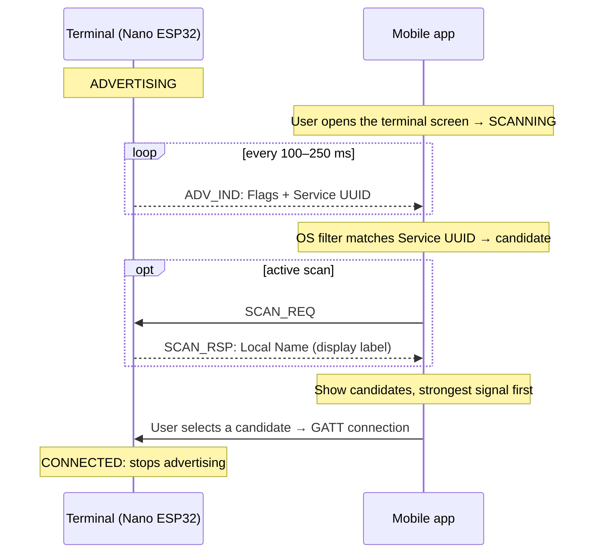

# BLE Advertising and Discovery

**Requirements:** FR-05.01, FR-05.05, NFR-01.03
**Devices:** Arduino Nano ESP32 terminal (BLE peripheral) and mobile app (BLE central)

This document is the project-wide contract for how a terminal advertises itself and how the
mobile app finds it. It builds on the earlier research into advertising and discovery
approaches and generalizes it for the whole project.

## 1. Scope

**In scope:** advertising data, terminal advertising behavior, app scanning and filtering on
Mobile, handling of candidates, versioning, security and privacy limits, known issues.

**Out of scope:** the GATT service and its characteristics, terminal
authentication, tickets and the secure handshake (see the [BLE Access and Security Concept](report/chapters/03-ideas-and-concepts.md#ble-access-and-security-concept)),
backend communication.

**Core rule:** discovery only finds *candidates*. A matching advertisement, name or Bluetooth
address never proves that a device is a genuine terminal and never grants access.

## 2. Overview

No backend call is needed for any of these steps.

## 3. Design decisions

| Decision | Reason |
|---|---|
| One shared 128-bit Service UUID for all terminals | Lets Mobile filter in the OS/controller instead of in app code. Some mobile platforms can only filter by service UUID. |
| Advertising contains only Flags and the Service UUID | Fits the 31-byte legacy limit with headroom, works with service UUID filtering on Mobile and does not broadcast stable identifiers. |
| Terminal ID and protocol version are read **after** connecting (GATT) | Keeps the advertisement small and stable; avoids publishing identifiers; the GATT contract already carries a version byte. |
| Optional Local Name in the Scan Response | Gives the user a readable label before connecting, without affecting the primary packet. Discovery must work without it. |
| Legacy advertising only, no Extended Advertising | Supported by every target phone and by the ESP32 BLE stacks. |
| Foreground scanning only | Matches the discovery user story. Background discovery is not needed for the check-in flow and is harder to make reliable. |

### Alternatives considered

| Option | Result |
|---|---|
| **A: Service UUID only** (+ optional name in Scan Response) | **Chosen.** Small, filterable on Mobile, leaks little. Two terminals cannot be told apart before connecting, which is solved by RSSI ordering and the GATT Terminal ID. |
| **B: Terminal ID / version / status in Manufacturer Data** | Rejected. Crowds the 31 bytes next to a 128-bit UUID, publishes a stable identifier that can be tracked, and the data would still not be trustworthy. |
| **C: Terminal ID / version in the Scan Response** | Rejected as a requirement. A Scan Response needs active scanning and is not always delivered (e.g. busy radio environment, background scanning on Mobile). |

## 4. Identifiers

| Name | Value | Where it is used |
|---|---|---|
| **BLE Booking Service UUID** | `fd698d10-c5c7-429b-9fb3-18a41dd73998` | Advertising (this document) and primary GATT service |

This UUID is already used by existing terminal and mobile prototype code, so that code stays compatible.

**Single source of truth:** this document. The code keeps one constant per component and must
match this value:

| Component | Location |
|---|---|
| Terminal firmware | one configuration header in `terminal/` (e.g. `ble_config.h`) |
| Mobile | one constant in the mobile BLE layer |

Changing the UUID is a breaking change (see [section 8](#8-versioning)) and must update every
constant and this document in the same release.

## 5. Advertising data

### 5.1 Advertising packet (`ADV_IND`, 21 of 31 bytes)

| Bytes (hex) | AD structure | Meaning |
|---|---|---|
| `02 01 06` | Flags | LE General Discoverable, BR/EDR not supported |
| `11 07` | Header: length 17, type `0x07` | Complete list of 128-bit Service UUIDs |
| `98 39 D7 1D A4 18 B3 9F 9B 42 C7 C5 10 8D 69 FD` | Service UUID | `fd698d10-c5c7-429b-9fb3-18a41dd73998` in little-endian byte order, as BLE requires |

Nothing else is placed in the primary packet. In particular: no Terminal ID, resource ID,
booking data, version number, status flags or user data.

### 5.2 Scan Response (`SCAN_RSP`, optional)

| Bytes (hex) | AD structure | Meaning |
|---|---|---|
| `LL 09` | Header: length `LL` = 1 + name length, type `0x09` | Complete Local Name |
| UTF-8 bytes | Local Name | Display label, e.g. `Locker 23` → `0A 09 4C 6F 63 6B 65 72 20 32 33` |

Rules for the Local Name:

- It is a **display label only**: not unique, not trusted, never used for decisions.
- Maximum 29 bytes (31 − 2 header bytes). Use **plain ASCII, at most 20 characters** to stay safe on all platforms.
- Prefer a neutral label (e.g. `Box 01`). Avoid names that reveal a person, a sensitive room or the stored equipment.
- The name is set during terminal setup (the USB setup path of the terminal design) and cannot be changed over BLE.

### 5.3 Byte order

The advertisement uses BLE's little-endian encoding for the UUID. Mobile platform APIs
(`ParcelUuid`, `CBUUID`) take the normal string form shown in section 4 and handle the byte
order themselves. Only firmware code that writes raw advertising bytes has to reverse them.

## 6. Terminal behavior

| State | Behavior |
|---|---|
| Startup | Starts **connectable, scannable, undirected legacy advertising** (`ADV_IND`) once the BLE stack is ready. Logs success or failure on the serial console. |
| `ADVERTISING` | Interval between **100 ms and 250 ms** (e.g. 152.5 ms, a value from Apple's accessory guidelines). TX power **−24 dBm**, the lowest level of the ESP32-S3, for advertising and connections. |
| `CONNECTED` | Accepts **one** central at a time and **stops advertising**, so no second phone can connect while a request runs (the security concept allows one request at a time). |
| After disconnect | **Restarts advertising** immediately. Some ESP32 BLE stacks do not do this automatically; the firmware must handle it. |
| Advertising fails to start | Retries with a delay and reports the error on the serial console and through the feedback LED/buzzer. |

**TX power:** the low power shortens the range, so that mainly phones close to the terminal see
it. It is not a sharp limit and does not change the advertising bytes. If the terminal cannot set
this power, it does not advertise.

**Idle connections:** a connected phone that sends no valid request must not block the
terminal forever. The terminal disconnects after a bounded idle time. The exact value belongs to
the GATT contract; 30 s is a reasonable starting point.

**Bluetooth address:** the ESP32 uses its fixed public address by default. That is acceptable
for the prototype, but the address is trackable and must never be used as an identifier (iOS does
not expose it anyway).

Diagnostic output must not contain keys, tickets or other secrets.

## 7. App behavior

These rules apply to Mobile as a whole. How each mobile platform implements them (scan APIs,
permissions, platform limits) is left to the mobile implementation.

1. **Scan only while needed:** start when the user opens the terminal/check-in screen, stop when the
   user leaves it, connects, or after a timeout (suggestion: 15 s, then offer "scan again").
   Never leave a scan running in the background.
2. **Filter by Service UUID in the scan request**, not only in app code.
3. **Check again in app code** that the Service UUID is present in the advertisement. Ignore the
   result otherwise.
4. **One entry per device:** deduplicate by the device handle the platform reports and update
   RSSI and name on each new advertisement. The handle is not a terminal ID and must not be
   stored or compared as one.
5. **Remove stale candidates** that have not been seen for about 5 s.
6. **Sort by RSSI**, strongest first. RSSI fluctuates, so smooth it (e.g. average of the last few
   values) before sorting. The strongest signal is only a hint for the closest terminal.
7. **Name handling:** show the Local Name if present and valid; otherwise show a neutral fallback
   such as "Unnamed terminal". Ignore empty, unreadable or overly long names.
8. Show only what discovery provides (label, signal strength). Resource or booking information
   is shown only after the terminal is verified over GATT.
9. Handle: Bluetooth off, permission denied, no results, scan failure. Each gets a clear message.

## 8. Versioning

- The advertisement has **no version field**. The Service UUID itself identifies the discovery
  contract.
- **Compatible changes** (e.g. a new Local Name, a different interval) keep the UUID.
- **Incompatible changes** to discovery or to the GATT service require a **new Service UUID**. Old apps then
  simply do not see new terminals instead of misreading them.
- The protocol version for messages is checked after connecting, in the first GATT exchange
  (see the GATT contract and the security concept). An app that does not support the terminal's version disconnects and shows
  "terminal not supported".

## 9. Security and privacy

What discovery protects: nothing. Everything below is accepted for discovery because the real
checks happen later, as described in the [BLE Access and Security Concept](report/chapters/03-ideas-and-concepts.md#ble-access-and-security-concept).

| Weakness | Effect | Handling |
|---|---|---|
| **Spoofing:** anyone can advertise the same UUID and name | A fake device appears as a candidate | The app verifies the terminal over GATT **before** sending any ticket, as the security concept requires. Discovery data is never trusted. |
| **Tracking / information leak:** the advertisement and fixed address are public | Terminals can be counted and located; the name may reveal what is stored | No IDs in the advertisement, neutral names, address never used as an identifier |
| **Blocking:** an attacker connects and holds the connection | Terminal stops advertising and is unusable | Idle-connection timeout on the terminal (section 6); later possibly a limit per peer |
| **Flooding the scan:** many fake advertisements | Long candidate list | RSSI sorting, stale-entry removal, verification after connecting |
| **Relay attack** | Exchange forwarded from another place | Not solved by BLE; documented as a known limit in the security concept |
| **Jamming** | No discovery at all | Not preventable; the app shows "no terminal found" |

## 10. Known limitations

- Two terminals in the same room cannot be told apart before connecting. The user picks by
  label and signal strength; the GATT Terminal ID confirms the choice.
- A terminal that is connected to another phone is invisible while the connection lasts.
- RSSI depends on phone model, orientation and obstacles. It is a hint, not a distance.
- The Scan Response (name) may be missing; discovery must still work.
- A terminal that an Admin has taken out of service, or a stolen one, still advertises normally.
  Discovery cannot exclude it; it is rejected only when the app verifies the terminal after connecting.
- Phones differ in how fast and how often they report advertisements. Discovery tests should cover
  at least one Android and one iOS device.
