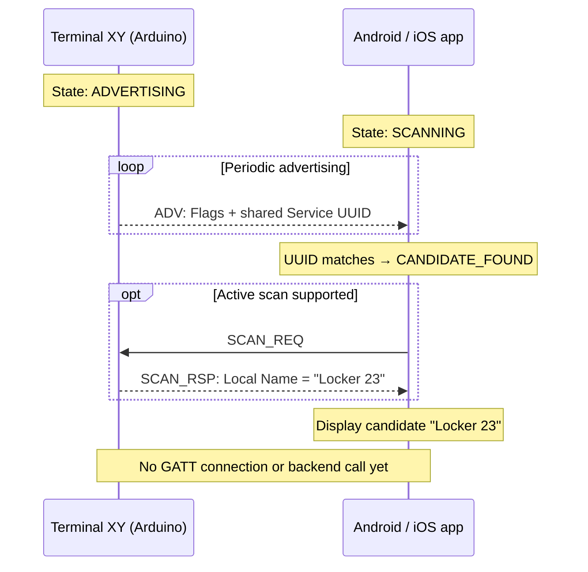
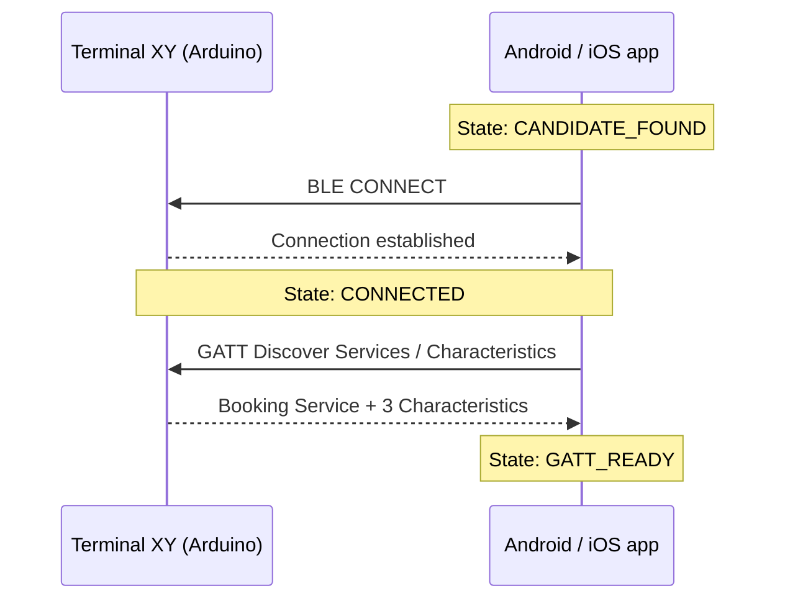
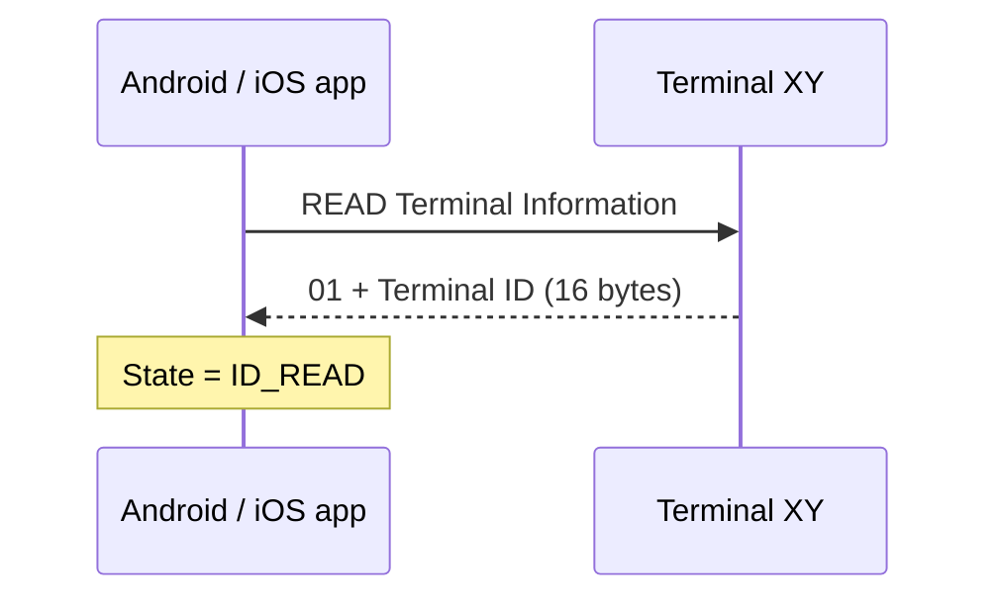
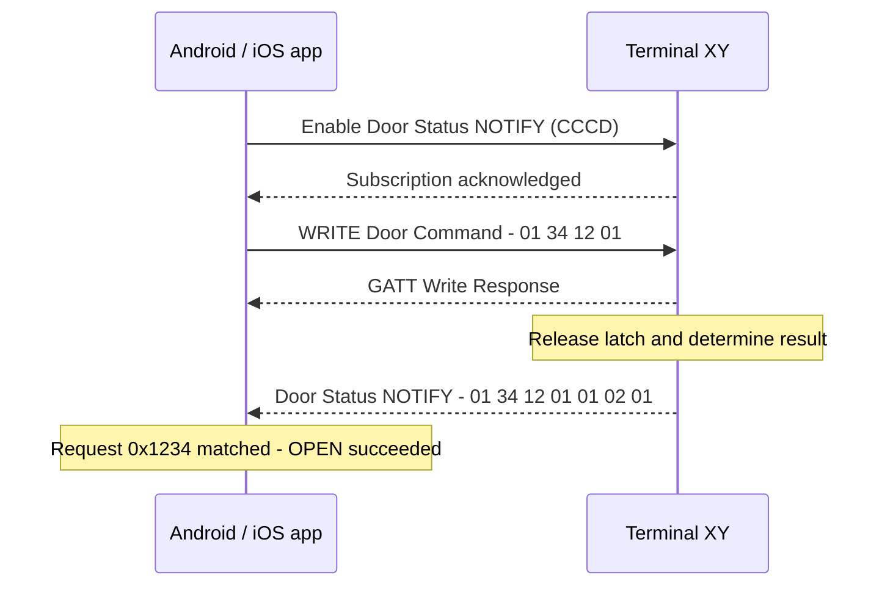
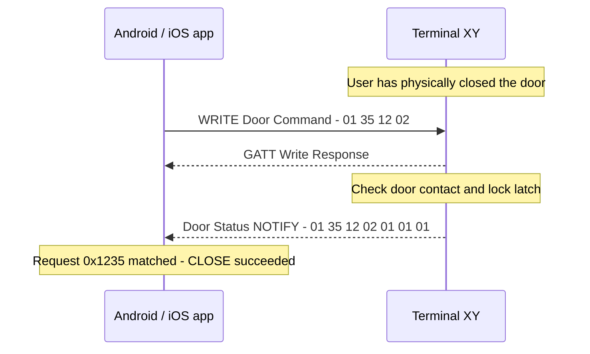
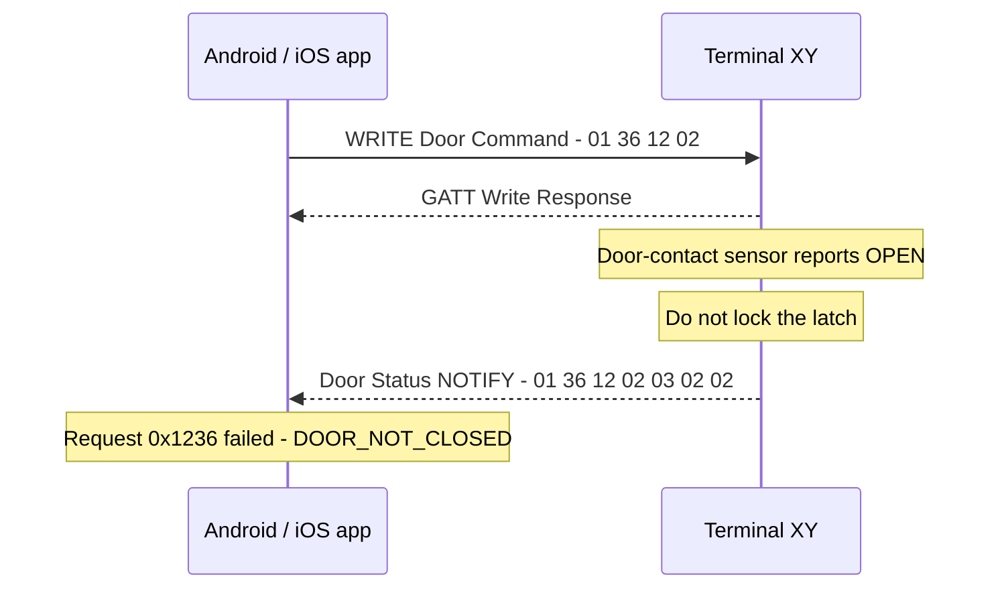

# BLE Demo Protocol: Advertising, Connection and Door Commands

**Project:** BLE Booking System  
**Enabler:** EN-03.05 — Define BLE advertising and discovery protocol  
**Status:** Demo / proof of concept only — **not the final production protocol**  
**Devices:** Arduino Nano ESP32 (BLE peripheral / GATT server) and Android/iOS app (BLE central / GATT client)

## 1. Introduction

This document describes a **minimal BLE demo** for EN-03.05: how the mobile app discovers a nearby terminal, connects to it, reads its ID, sends `OPEN` or `CLOSE`, and receives the terminal's result. The examples use **Terminal XY** with ID `550e8400-e29b-41d4-a716-446655440000`.

The terminal does **not** contact the backend during this flow. For the demo, door commands are shown without implementing the booking tickets, cryptographic authentication, protected session, or signed receipts from the existing *BLE Access and Security Concept* (T-003). **This is acceptable only for an isolated prototype, not for controlling a deployed door.** The final solution must enforce T-003 before accepting an access-changing command. The UUIDs and payloads below are the **demo contract**, not a claim that the final protocol is settled.

## 2. Advertising — finding the terminal

The terminal periodically broadcasts the shared BLE Booking System Service UUID. The mobile application scans for this UUID to find nearby project terminals.

For the demo, the terminal also provides a human-readable name (e.g. `Locker 23`) through an optional BLE Scan Response. This allows the app to display a recognizable candidate before connecting.

### Advertising flow

| Step | Terminal action / state | App action / state | Data exchanged |
|---|---|---|---|
| 1 | Starts connectable, scannable legacy advertising → `ADVERTISING` | Starts BLE scan → `SCANNING` | — |
| 2 | Periodically broadcasts the shared Service UUID | Filters advertisements by Service UUID | `ADV_IND` |
| 3 | Continues advertising | UUID matches → `CANDIDATE_FOUND` | Service UUID |
| 4 | Responds to active scan requests, when supported | Receives optional Scan Response | `SCAN_REQ` → `SCAN_RSP` |
| 5 | Remains available for connection | Displays `Locker 23` if the name is available | Local Name |

### Advertising packet (21 bytes)

| Bytes (hex) | Field | Meaning |
|---|---|---|
| `02 01 06` | Flags | General discoverable, BLE-only |
| `11 07` | AD field header | Complete 128-bit Service UUID list |
| `98 39 D7 1D A4 18 B3 9F 9B 42 C7 C5 10 8D 69 FD` | Service UUID | `fd698d10-c5c7-429b-9fb3-18a41dd73998`, BLE little-endian encoding |

### Scan Response packet (11 bytes)

| Bytes (hex) | Field | Meaning |
|---|---|---|
| `0A 09` | AD field header | Complete Local Name |
| `4C 6F 63 6B 65 72 20 32 33` | Local Name | UTF-8 text `Locker 23` |

The advertising packet and Scan Response are separate BLE packets, each respecting the 31-byte legacy payload limit.

### Important considerations

- All project terminals advertise the **same Service UUID**.
- The Local Name is a **display label**, not a unique or trusted identifier.
- Scan Responses are optional and may not always be available to the app. Discovery must therefore work using the Service UUID alone.
- The unique Terminal ID is retrieved through GATT after connection.
- Neither the Service UUID nor the Local Name proves the terminal's authenticity.
- The name `Locker 23` is suitable for the demo; exposing a real resource location in advertising should be reconsidered for production.

## 3. Connection — opening the GATT session

| Step | App request / state | Terminal response / state | Meaning |
|---|---|---|---|
| 1 | Connects to the selected candidate → `CONNECTING` | Accepts BLE connection → `CONNECTED` | A BLE link exists; the terminal is **not yet identified or authenticated** |
| 2 | Discovers GATT services → `DISCOVERING` | Exposes the Booking Service and its characteristics | App learns where to read the ID and write commands |
| 3 | Checks that the expected service and characteristics exist → `GATT_READY` | Remains connected | App can start GATT operations; a missing UUID causes disconnect |

**Demo GATT structure** (UUIDs are identical on all terminals):

| GATT item | UUID | Properties | Purpose |
|---|---|---|---|
| **Booking Service** | `fd698d10-c5c7-429b-9fb3-18a41dd73998` | Service | Groups the demo operations |
| **Terminal Information** | `81f905bd-4d25-4eeb-bf1d-89e909368fae` | `READ` | Returns the unique Terminal ID |
| **Door Command** | `08d0c22b-0be0-45c1-aea4-7d181b40f733` | `WRITE WITH RESPONSE` | Receives `OPEN` / `CLOSE` |
| **Door Status** | `3b33ab4f-826c-497b-a653-b16c46425d73` | `READ`, `NOTIFY` | Returns the result of a command |

## 4. GATT requests — ID, OPEN and CLOSE

This section describes the GATT requests exchanged between the mobile application and Terminal XY during the demo.

The terminal supports three operations:
1. Read the Terminal ID.
2. Send an `OPEN` command and receive its result.
3. Send a `CLOSE` command and receive its result.

A GATT Write Response only confirms that the command was received. The actual result is delivered separately through a Door Status notification.

### 4.1 Read the Terminal ID

After connecting and discovering the GATT service, the app reads the Terminal Information characteristic.

| Direction | Payload | Explanation |
|---|---|---|
| App → Terminal | GATT `READ` on Terminal Information | No application payload |
| Terminal → App | `01 55 0E 84 00 E2 9B 41 D4 A7 16 44 66 55 44 00 00` | Byte 0: format version `01`; bytes 1–16: Terminal XY's UUID in network byte order |

The app accepts **exactly 17 bytes** with format version `01`. Invalid length, unsupported version or an all-zero Terminal ID causes disconnection.

The Terminal ID identifies the device as a candidate but does not authenticate it.

### 4.2 Send OPEN and receive the answer

The app first subscribes to Door Status notifications by enabling the GATT Client Characteristic Configuration Descriptor (CCCD). Once the subscription is acknowledged, it sends the `OPEN` command.

| Message | Bytes | What they contain |
|---|---|---|
| **OPEN request** | `01 34 12 01` | Version `01`; request ID `0x1234` (`34 12`, little-endian); command `01` = **OPEN** |
| **GATT Write Response** | No application payload | The write was accepted by GATT, but the operation may still be pending |
| **Terminal answer (NOTIFY)** | `01 34 12 01 01 02 01` | Version `01`; same request ID; `OPEN`; result `01` = success; latch `02` = released; door `01` = physically closed |

**Result:** The terminal has successfully released the latch. The door may still be physically closed until the user opens it.

### 4.3 Send CLOSE and receive the answer

The app sends `CLOSE` after the user has physically closed the door. The terminal checks the door-contact sensor before locking the latch.

| Message | Bytes | What they contain |
|---|---|---|
| **CLOSE request** | `01 35 12 02` | Version `01`; new request ID `0x1235`; command `02` = **CLOSE** |
| **GATT Write Response** | No application payload | The write was accepted; operation result is still pending |
| **Terminal answer (NOTIFY)** | `01 35 12 02 01 01 01` | Version `01`; request ID `0x1235`; `CLOSE`; success; latch `01` = locked; door `01` = physically closed |

**Result:** The terminal confirms that the door is closed and the latch is locked.

#### Example: CLOSE fails because the door is open

If the door-contact sensor reports that the door is still open, the terminal does not lock the latch.

| Message | Bytes | What they contain |
|---|---|---|
| **CLOSE request** | `01 36 12 02` | Request ID `0x1236`; command `02` = CLOSE |
| **Terminal answer (NOTIFY)** | `01 36 12 02 03 02 02` | Result `03` = door not closed; latch `02` = released; door `02` = open |

The app displays an error such as **"Please close the door before locking."**

This demo assumes that the terminal has a working door-contact sensor.

### 4.4 Shared message formats and results

All values below are hexadecimal bytes unless stated otherwise.

| Characteristic | Size | Byte layout |
|---|---|---|
| Terminal Information | **17 bytes** | `[version:1][terminal UUID:16]` |
| Door Command | **4 bytes** | `[version:1][request ID:2 LE][command:1]` |
| Door Status | **7 bytes** | `[version:1][request ID:2 LE][command:1][result:1][latch:1][door:1]` |

#### Field values

| Field | Values |
|---|---|
| Command | `01` = OPEN; `02` = CLOSE |
| Result | `00` = no result; `01` = success; `02` = denied/reserved for authorization; `03` = door not closed; `04` = busy; `05` = actuator error; `06` = invalid command |
| Latch | `00` = unknown; `01` = locked; `02` = released |
| Door | `00` = unknown; `01` = closed; `02` = open |

#### Communication rules

- The app subscribes to Door Status notifications before sending commands.
- Each command contains a request ID that allows the app to match the corresponding notification.
- The app matches the result using both the request ID and command.
- The terminal processes one command at a time.
- Invalid payload length or version causes the write to be rejected without moving the actuator.
- The GATT Write Response does not indicate whether `OPEN` or `CLOSE` succeeded.
- The app considers an operation successful only after receiving a matching Door Status notification with result `01`.
- If the connection is lost before receiving the result, the outcome is unknown. The app must not blindly repeat the command.
- The request ID identifies a command within this BLE exchange. It is not the persistent booking operation ID defined in T-003.

#### Demo limitations

This is a simplified protocol for demonstrating BLE discovery, connection and basic door control.

The final system must include terminal authentication, secure communication, booking authorization and signed receipts as described in T-003. These security mechanisms are not implemented by the GATT messages defined here and are outside the scope of this demo.
