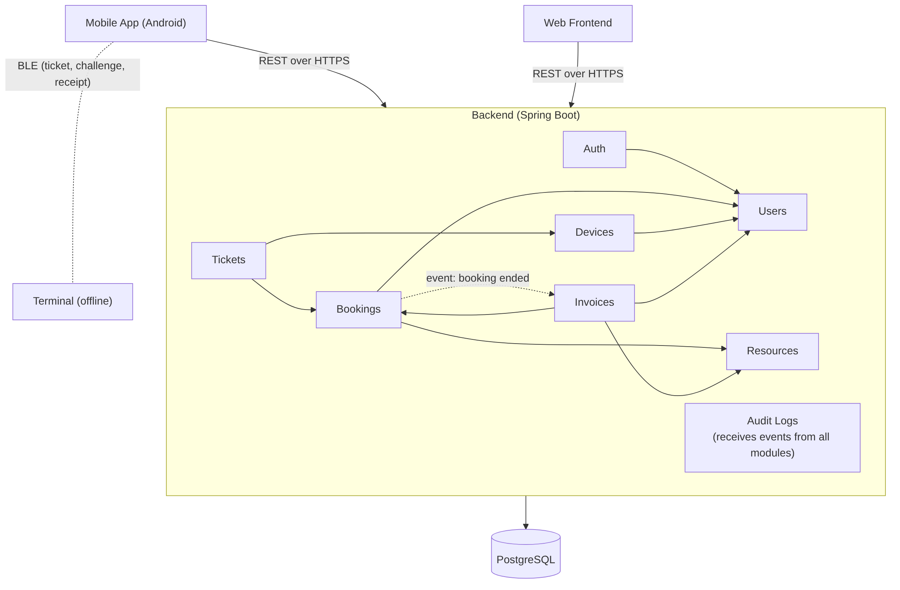
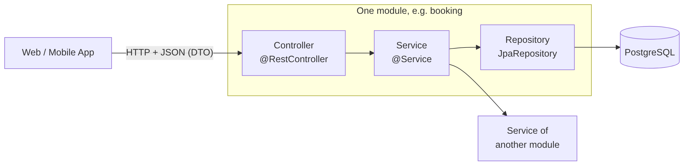
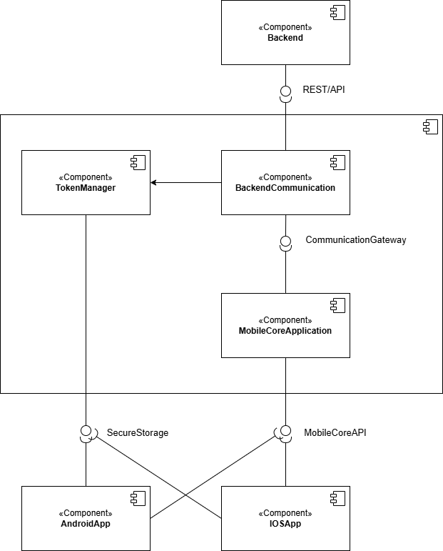
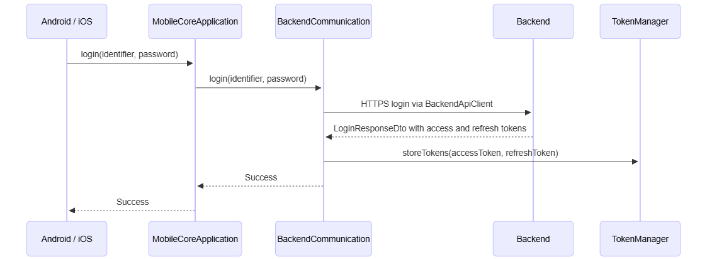
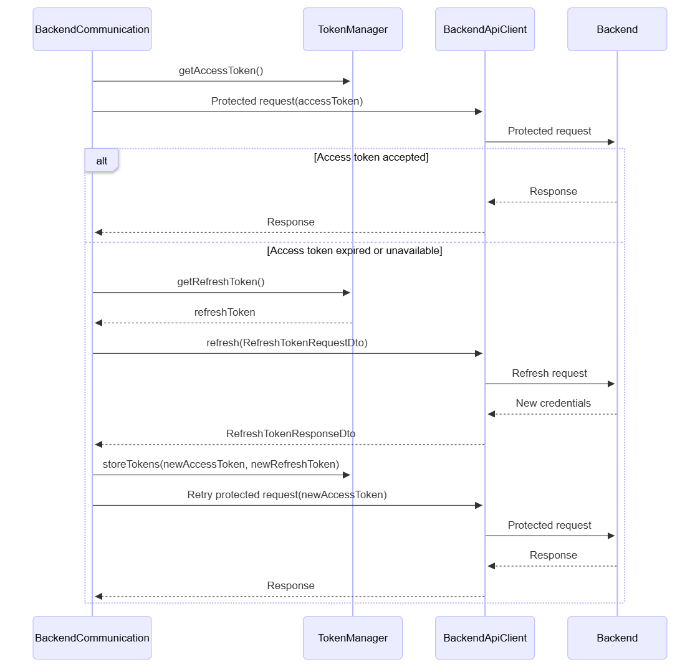
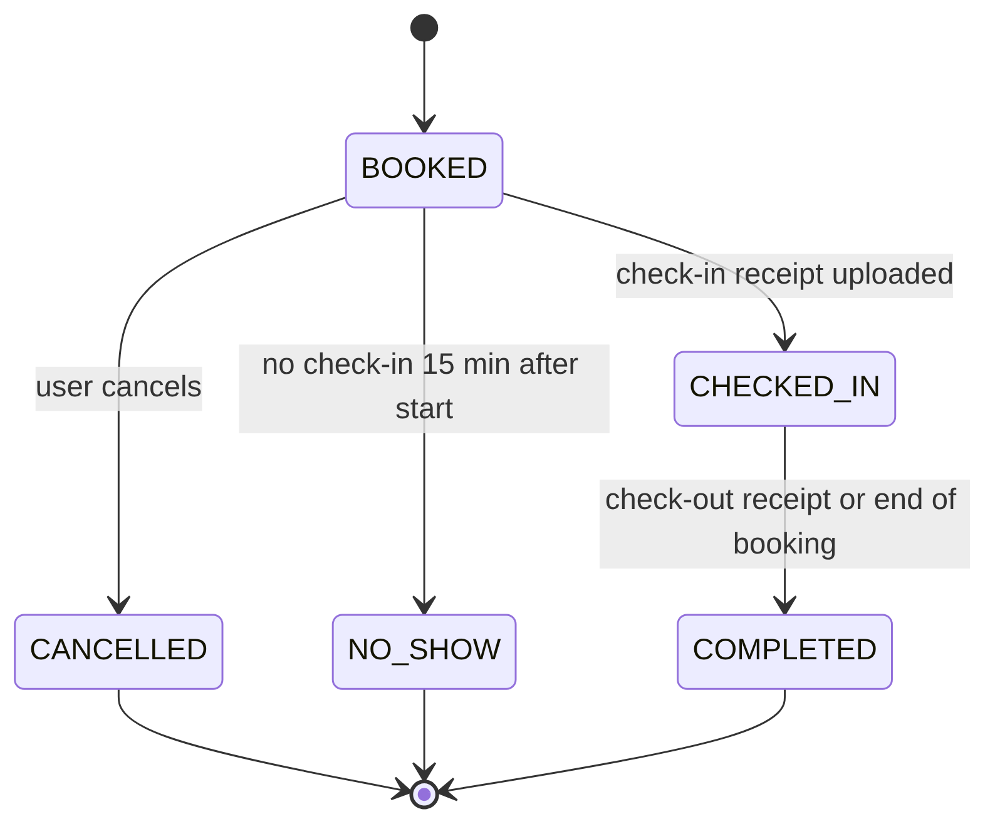
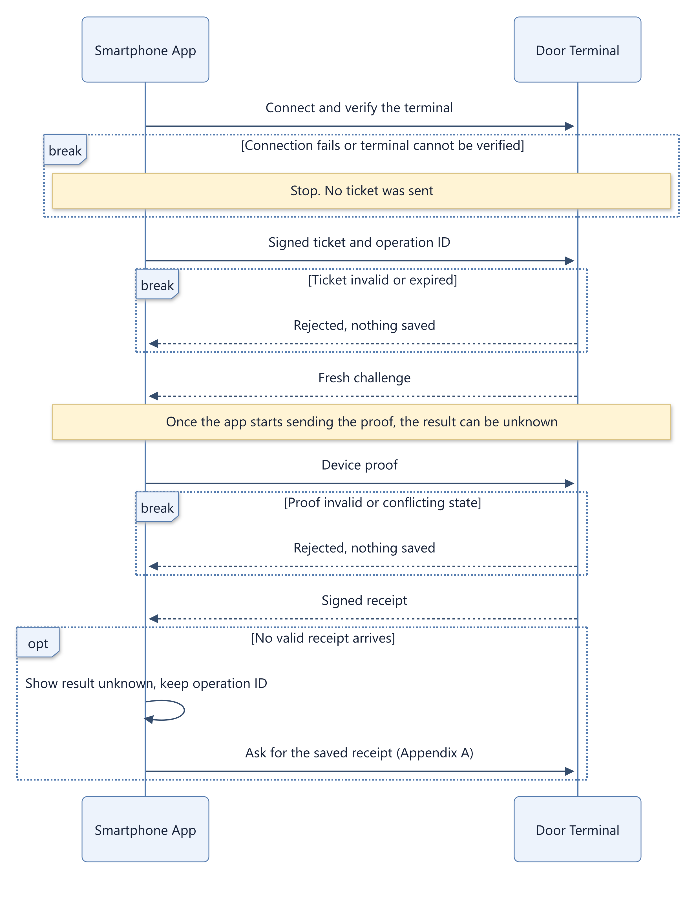

# Ideas and Concepts

## Use Cases

The web design covers authentication and invitation-based registration, resource discovery and booking, management of personal bookings and invoices, and administration of accounts, resources, terminals, bookings, payments and audit records. Students and Lecturers use the self-service functions; Admins manage the system. The [full UC-01–UC-11 scenarios](08-appendices.md#web-use-cases) include requirements and alternative outcomes.

<!-- Author: Add the agreed mobile use-case diagram. -->

## General System Flow

The intended flow links login and reservation to BLE check-in, use, check-out and billing. The backend authorizes the user and issues a device-bound ticket; the terminal verifies it locally and saves a signed receipt. The smartphone uploads that receipt so the backend can update the booking. The backend design then creates invoices through booking events. Walk-in access is required by FR-03.05, but its detailed flow is still to be defined.

## Proposed System Architecture

The web application provides booking and administration. The backend manages identities, resources, bookings, tickets, invoices and audit data in PostgreSQL. Native Android and iOS applications provide BLE and protected storage around a shared Mobile Core. The terminal authorizes local actions and controls the compartment latch. Web and mobile clients use the backend REST API over HTTPS; the terminal has no direct backend connection.

## Backend Design

The backend is a Spring Boot application with a PostgreSQL database. It is divided into eight modules. The web frontend and the mobile app communicate with it through a REST API over HTTPS. The door terminal has no connection to the backend; all data between terminal and backend is carried by the smartphone.

### Framework Selection

The backend has to provide a REST API for the web frontend and the mobile app, login with JWT and refresh tokens, roles and owner checks, password hashing with Argon2, signing and verifying P-256 signatures for tickets and receipts, PostgreSQL with migrations, scheduled jobs, internal events and PDF invoices with Swiss QR bill. The backend developer knows Java but has not built a REST API before, and the project runs for one semester.

| Framework | Language | Version (October 2026) | Description |
|---|---|------|--------|
| Spring Boot | Java | 4.1.1, support until July 2027 | Most widely used Java framework, large ecosystem |
| Quarkus | Java | 3.40 LTS, support until September 2027 | Cloud-native framework by Red Hat, fast startup |
| Micronaut | Java | 5.2.2 | Compile-time dependency injection, low memory use |
| Javalin | Java | 7.0 | Minimal web layer on Jetty, no built-in security or data access |
| ASP.NET Core | C# | .NET 10 LTS, support until November 2028 | Microsoft framework, strong built-in security |
| NestJS | TypeScript | – | Structured framework for Node.js |

: Framework Selection — framework, language {#tbl-03-01}

ASP.NET Core and NestJS are included because the project assignment mentions C# and Node.js as possible technologies. The alternatives were evaluated with the following criteria:

1. The team knows the language.
2. Built-in security (login, roles, password hashing, JWT, signatures).
3. Database support (PostgreSQL, migrations).
4. Learning resources and community.
5. Required libraries are available (PDF, Swiss QR bill).

| Criterion | Spring Boot | Quarkus | Micronaut | Javalin | ASP.NET Core | NestJS |
|---|---|---|---|---|---|---|
| Language known | yes | yes | yes | yes | no | no |
| Built-in security | good | good | good | none | good | partial |
| Database support | good | good | good | manual | good | good |
| Learning resources | many | some | few | some | many | many |
| Libraries | yes | yes | yes | yes | yes | yes |

: Framework Selection — criterion, spring boot {#tbl-03-02}

Spring Boot is the only option that fulfils all criteria well. Quarkus and Micronaut start faster and use less memory, but this is not important for a single backend instance.

**Decision:** Spring Boot 4.1 on Java 25 (LTS) is used for the backend, for the following reasons:

1. **Language known:** The team can focus on learning the framework, not a new language.
2. **Security included:** Most security requirements are covered by Spring Security instead of own code, which reduces the risk of security mistakes.
3. **Largest community:** Spring is used by a majority of Java developers, so most tutorials, answers and examples are available for it.
4. **All required libraries available:** QR bill, PDF and P-256 cryptography work with standard Java libraries.
5. **Long enough support:** Spring Boot 4.1 receives free updates until July 2027, which covers the whole project.
6. **Disadvantage accepted:** Spring Boot starts slower and uses more memory than Quarkus or Micronaut. This does not matter for one backend instance.

The project is created with Spring Initializr and Maven. It uses Spring Web, Spring Security, OAuth2 Resource Server (JWT), Spring Data JPA, the PostgreSQL driver, Flyway, Validation and Testcontainers.

### Module Structure

**Auth.** Handles the identity of a user: account activation, login, access and refresh tokens, and password reset. Users cannot register themselves. An admin creates the user, and the user receives an activation link by email to set a password. Activation and password reset use the same mechanism: a random one-time token with an expiry date, stored only as a hash. *Depends on:* Users.

**Users.** Manages users, their profile data, role (STUDENT, STAFF, ADMIN) and status (INVITED, ACTIVE, DISABLED). Only admins can create users and change roles. The first admin is created when the database is set up. *Depends on:* nothing.

**Resources.** Manages the university's resources (name, type, position, price per hour) and the terminals with their public keys. Each terminal belongs to one resource; a resource can have more than one terminal. *Depends on:* nothing.

**Bookings.** Creates, changes and cancels bookings, prevents overlapping bookings, calculates free time slots and handles check-in and check-out. A scheduled job detects missed check-ins and missing check-outs. When a booking ends, the module publishes an event so that an invoice can be created. *Depends on:* Users, Resources.

**Devices.** Manages the users' smartphones and stores the public key of each device, so that tickets can be bound to one specific device. A lost device can be blocked. *Depends on:* Users.

**Tickets.** Issues the signed tickets (JWT) that the smartphone presents at the terminal. Tickets are signed with a separate asymmetric key (ES256), so the terminal can verify them with the public key only. A ticket is issued shortly before the booking starts and is valid for a few minutes. *Depends on:* Bookings, Devices.

**Invoices.** Creates invoices automatically when a booking ends or when a user does not show up. Invoices are Swiss QR invoices and can be downloaded as PDF. The module also manages the payment status. *Depends on:* Bookings, Users, Resources.

**Audit Logs.** Stores security-relevant events of the whole application. The other modules publish events (Spring Events) to which this module listens. Only admins can read the logs, and nobody can change or delete them. *Depends on:* nothing.

The [module dependency table](08-appendices.md#backend-apis-and-modules) provides the detailed reference.

Bookings does not call Invoices directly. It publishes an event when a booking ends, and Invoices reacts to it. This avoids a circular dependency between the two modules.

{#fig-backend-architecture width=100%}

### Code Structure

This section only describes what is certain for the implementation. Class and method names are decided while programming.

**Project setup.** One Spring Boot project in `backend/` (Java 25, Maven) with Spring Web, Spring Security, Spring Data JPA, the PostgreSQL driver and Validation. The database schema is created by Flyway from the migrations in `backend/src/main/resources/db/migration`; JPA only checks that the entities match it (`ddl-auto=validate`). Secrets such as database passwords and signing keys are read from environment variables.

**Packages.** Each module is one Java package and owns the tables listed below.

Package ownership is listed in the [backend reference](08-appendices.md#backend-apis-and-modules).

Tickets are not stored. Whether ticket creation gets its own package or stays in `booking` is decided during implementation.

**Layers.** Every module has the same layers:

{#fig-backend-layers width=100%}

- Controllers receive requests and return DTOs. They contain no business logic.
- Services contain the business logic and transactions.
- Repositories are only used by their own module. Other modules call the service.
- Entities map the tables of the database schema and are never returned by the API.

**Shared parts.** Security (login with JWT, roles, password hashing), central error handling and audit logging are built once in `common` and used by all modules.

### API Structure

The [backend reference](08-appendices.md#backend-apis-and-modules) lists the proposed endpoints, permissions and error contracts.

### Authentication and Authorization

Authentication:

- An access token is required for all endpoints except `/auth/*`.
- Access token: JWT, valid for 15 minutes, contains the userId and the role.
- Refresh token: valid for 7 days, stored as a hash, replaced on every use.
- The refresh token becomes invalid after logout, after a password change and when the user is disabled.
- Login attempts are limited, and disabled users cannot log in.

Authorization is checked in two steps:

1. Role check with Spring Security (`@PreAuthorize`).
2. Owner check in the service of the module: users may only access objects that belong to them.

The complete role matrix is in the [backend reference](08-appendices.md#backend-permissions).

Check-in, check-out and tickets are restricted to the owner even for admins: only the owner of a booking can check in, with their own device.

### Error Handling

The design uses centrally handled Problem Details (RFC 9457) with a client-facing `code`. It hides implementation details and other users' objects, uses a generic login error, and records security-relevant errors. The [error contract](08-appendices.md#backend-errors) contains the example and status catalogue.

### Backend Design Decisions

1. **Technology:** Java with Spring Boot and PostgreSQL. Spring Security provides password hashing (Argon2), roles and JWT.
2. **Availability:** Free time slots are calculated in the Bookings module, where the bookings are stored. This avoids a circular dependency with Resources.
3. **Overlapping bookings:** A PostgreSQL exclusion constraint prevents two bookings for the same resource at the same time, even under concurrent requests.
4. **No-show:** If there is no check-in 15 minutes after the start, a scheduled job sets the booking to NO_SHOW, and an invoice with a no-show fee is created.
5. **Missing check-out:** Without a check-out, the booking is charged until its end time.
6. **Invoices:** Invoices are created automatically by the backend, triggered by an event from Bookings.
7. **Users:** Users cannot register themselves. An admin creates them, and they receive an activation link by email.
8. **User types:** One users table with a role (STUDENT, STAFF, ADMIN). The fields startSemester and bachelorCourse are only filled in for students.
9. **Audit logs:** Written through Spring Events. The database user of the application has only INSERT and SELECT rights on the audit table. Passwords and tokens are never logged.
10. **Terminals and resources:** The relation is stored once, as resourceId in the terminals table, so a resource can have more than one terminal.
11. **Tokens:** Short-lived access tokens (15 minutes) and refresh tokens (7 days) that are stored as a hash and replaced on every use.
12. **Two-step access check:** First the role (Spring Security), then the owner of the object (service).
13. **No hard delete of users:** Users are disabled, not deleted, because bookings, invoices and audit logs still refer to them.

## Mobile Application Design

### Purpose and Scope

This section defines the architecture of the mobile application and serves as the architectural baseline for implementation.

The design is based on Kotlin Multiplatform and focuses on the shared Mobile Core, its architectural components, and its boundaries with the native Android and iOS applications and the backend.

The component responsibilities and interaction flows describe the intended behavior of the system. The current implementation establishes its structural foundation; the implemented functionality and any deviations from this design are documented in Chapter 5.

The detailed internal architecture of the native applications and the BLE protocol remain to be defined. Backend implementation is outside the scope of this section.

### Component Architecture

The mobile architecture comprises a shared Mobile Core, native Android and iOS applications, and the backend.

#### Module Structure {.unnumbered}
The Mobile Core contains shared application logic, backend communication, and local authentication credential management. The native applications provide the user interface, BLE interaction, and platform-specific protected storage.

Native applications invoke shared operations through `MobileCoreApi`. They obtain a core instance through `MobileCoreFactory` and supply their platform-specific implementation of `SecureStorage`.

The following component diagram shows the architectural boundaries and the interfaces connecting these elements.

{#fig-mobile-component-diagram width=72%}

#### Mobile Core {.unnumbered}
The Mobile Core contains the shared Kotlin Multiplatform logic used by both Android and iOS. It consists of three architectural components.

| Component | Main Responsibilities | Interfaces |
|:-----------------------------|:---------------------------------------------|:-----------------------------|
| **MobileCoreApplication** | Coordinate authentication, booking, and resource-access operations; expose shared application functionality to the native applications. | **Provides:** `MobileCoreApi`; **Requires:** `CommunicationGateway`. |
| **BackendCommunication** | Communicate with the backend through HTTP; convert between application models and DTOs; coordinate login, token refresh, and logout using `TokenManager` to manage credentials. | **Provides:** `CommunicationGateway`; **Requires:** `REST/API`. |
| **TokenManager** | Maintain the access token in memory; store and retrieve the refresh token through secure storage; update and clear locally managed credentials. | **Provides:** none; **Requires:** `SecureStorage`. |

: Mobile Core — component, main responsibilities {#tbl-03-03}

#### External Components {.unnumbered}
**Backend** provides the REST API required by the mobile application. It authenticates requests, issues and renews credentials, revokes renewable sessions, supplies booking and access-related data, and processes access confirmations and check-out operations.

**AndroidApp** provides the Android user interface and native platform integration. It consumes `MobileCoreApi`, obtains the core through `MobileCoreFactory`, and provides an implementation of `SecureStorage`. BLE discovery, connection management, and terminal interaction remain native responsibilities.

**IOSApp** provides the iOS user interface and native platform integration. It consumes the same shared application contract and provides the iOS implementation of protected storage and BLE interaction.

#### Native Platform Design {.unnumbered}
The detailed native UI structure, navigation, BLE integration, protected-storage adapters, and key management will be documented in a later design step.

<!-- Author: Add the native class diagram when defined. -->

### Technical Reference

The [mobile reference](08-appendices.md#mobile-interfaces-classes-and-dtos) contains API signatures, class diagrams, models, DTOs and detailed responsibilities. These contracts support the design below and the implementation discussion in Chapter 5.

### Authentication and Token Lifecycle

Authentication is coordinated by `BackendCommunication` and `TokenManager`. The communication component owns backend interactions, while the token component owns local credential state.

The following flows describe the intended behavior. Authentication credentials remain internal to the core.

#### Login Flow {.unnumbered}
1. The native application calls `MobileCoreApi.login(identifier, password)`.
2. `ServiceFacade` delegates the operation to `AuthService`.
3. `AuthService` invokes `CommunicationGateway.login(...)`.
4. `BackendCommunication` creates a `LoginRequestDto` and delegates the HTTP request to `BackendApiClient`.
5. The backend validates the credentials and returns a short-lived access token and a long-lived refresh token.
6. `BackendCommunication` stores the credentials through `TokenManager.storeTokens(...)`.
7. The password is not persisted or reused for automatic authentication.

{#fig-mobile-login-flow width=100%}

#### Access Token Refresh {.unnumbered}
Refresh is transparent to callers and is not part of `MobileCoreApi` or `CommunicationGateway`.

1. `BackendCommunication` obtains the access token from `TokenManager`.
2. When available, the token is used for the protected backend request.
3. If the token is absent or rejected as expired, the communication component obtains the refresh token.
4. It creates a `RefreshTokenRequestDto` and calls `BackendApiClient.refresh(...)`.
5. On success, the replacement credentials are stored through `TokenManager`.
6. The protected operation is performed with the new token, or retried once if previously rejected.
7. If the refresh token is invalid, expired, or revoked, local credentials are cleared and authentication is required again.

{#fig-mobile-token-refresh-flow width=95%}

#### Logout Flow {.unnumbered}
1. The native application calls `MobileCoreApi.logout()`.
2. The operation reaches `BackendCommunication` through the facade, authentication service, and communication gateway.
3. The communication component obtains the refresh token from `TokenManager`.
4. The backend is asked to revoke the renewable session.
5. `TokenManager.clearTokens()` removes the local access token and persisted refresh token.

Backend revocation prevents the renewable credential from being used to obtain new access credentials.

#### Token and Session Lifecycle {.unnumbered}
**Password.** Used for the initial authentication operation and not persisted.

**Access token.** Used to authenticate protected backend requests. It is short-lived and retained in memory.

**Refresh token.** Used to obtain replacement access credentials. It is long-lived, revocable, and persisted through protected storage.

### Design Decisions and Assumptions

#### Design Decisions {.unnumbered}

| Decision | Rationale |
|:--------------------------|:------------------------------------------------------|
| Shared Mobile Core | Share application, communication, and credential-management logic across Android and iOS. |
| Three internal components | Separate application orchestration, backend communication, and local credential management. |
| Separate API package | Group the public application contract, core creation entry point, and native storage contract. |
| Single application contract | Let native applications invoke shared operations through `MobileCoreApi`. |
| Communication boundary | Keep application services independent from HTTP and transport formats through `CommunicationGateway`. |
| Separate data models | Allow backend transport representations to evolve independently from the application contract. |
| HTTP communication | Keep transport mechanisms and configuration within the backend communication boundary. |
| Internal token renewal | Keep login credentials and token-refresh mechanics out of native application flows. |
| Protected credentials | Preserve renewable sessions without storing the password. |
| Native adapters | Integrate platform-specific functionality through native applications and shared contracts. |

: Design Decisions — decision, rationale {#tbl-03-04}

#### Assumptions {.unnumbered}
- The backend provides REST endpoints for authentication, bookings, and resource-access operations.
- Login returns a short-lived access token and a long-lived refresh token.
- Refresh may rotate the refresh token; any replacement is stored immediately.
- Android and iOS provide concrete implementations of `SecureStorage`.
- Detailed native architecture and the BLE protocol will be designed separately.
- DTO attributes, endpoint contracts, and error mappings may be refined with the backend contract.
- Check-out uses `resourceId`; its transport representation may evolve independently.
- A protected operation is retried at most once after successful token renewal.

## Database Design

The data model links users, devices, renewable sessions and one-time tokens to resources, bookings, terminal receipts and invoices. Availability represents resource time windows and permitted roles; audit records identify actors and outcomes. A locked booking price and invoice records preserve the rate associated with usage. The [database reference](08-appendices.md#database-schema-and-constraints) contains fields, relationships and constraints, including the unresolved terminal cardinality.

### Database Trigger Evaluation

During the architectural design phase of the persistence layer, the application of database triggers was evaluated to determine whether system responsibilities (e.g., integrity checks, audit logging, or state transitions) should be delegated to the database level.

#### Evaluation & Trade-offs {.unnumbered}
- **Database Triggers (Pros & Cons):** While triggers guarantee data-level consistency regardless of the accessing client and reduce network overhead, they introduce significant architectural drawbacks. They hide core business logic within the database schema, complicate unit and integration testing, obscure debugging workflows, and introduce risks during database migrations.
- **Application Logic (Pros & Cons):** Handling system responsibilities within the Java/Spring Boot application layer keeps domain rules explicit, fully testable, and version-controlled within the primary codebase.

#### Architectural Decision {.unnumbered}
**Decision:** The team decided **against using database triggers** in the system architecture. All domain responsibilities, including booking availability validation, concurrent access controls, audit logging, and lifecycle timestamps, are assigned by this decision to the application service layer (Java / Spring Boot).

The stated intent is separation of concerns, maintainability and testability across the booking lifecycle; this rationale is not execution evidence.

---

## Booking and Usage Lifecycle

{#fig-booking-status width=60%}

The backend design defines no-show detection 15 minutes after the start, charging until the scheduled end when check-out is missing, and invoice creation from booking events. The design decisions below retain their exact policies; differences from the requirements are listed in [cross-component conflicts](#integration-conflicts).

## BLE Access and Security Concept

T-003 is a design proposal ready for team review.

### Purpose and Scope

This concept describes how the mobile app on the smartphone communicates with the door terminal over BLE to authorize access and record check-in/check-out. The terminal is assigned to the booked resource. The flow follows the backend's ticket approach.

#### The idea in short {.unnumbered}
Before check-in, the app fetches a signed ticket from the backend. The terminal can check this ticket completely offline. With a challenge-response step, the app proves that it holds the matching private key, so simply copying the ticket to another smartphone is not enough. If everything succeeds, the terminal saves the event and issues a signed receipt, which the app uploads to the backend. Check-out works the same way, with its own ticket.

**Not in scope:** BLE and firmware implementation, mobile classes, final data formats and cryptographic algorithms, detailed synchronization, and performance optimization.

### Actors and Prerequisites

Three parties are involved. Only the first two take part in the BLE exchange.

| Actor | Role |
|---|---|
| Mobile app on the smartphone | BLE central / GATT client. Verifies the terminal, sends the ticket, proves the device key, and uploads receipts. |
| Door terminal (assumed ESP32) | BLE peripheral / GATT server. Checks tickets offline, saves events, and returns signed receipts. |
| Backend | Registers devices, issues tickets, and processes receipts. It takes no part in the BLE exchange. |

: Actors and Prerequisites — actor, role {#tbl-03-05}

Before a check-in or check-out can start, four things must be in place:

1. The smartphone has a registered key pair. The private key stays in protected storage; the backend links the public key to the user.
2. The app holds a backend-signed ticket for this device key, booking, resource, action, and time window.
3. The terminal knows its terminal and resource IDs and the backend's verification key. It has its own signing key, a reliable clock, and storage that survives a restart.
4. The app has trusted information to verify the terminal.

The terminal never needs a name or email. It only checks the ticket and the device's proof. BLE advertising and addresses help the app find the terminal, but they do not prove identity.

Before issuing a ticket, the backend checks the user's role, booking ownership, and account/device status. In the proposed backend flow, only the booking owner can check in or out with their registered device.

The proposed design decisions are summarized below.

### Normal Flow: Check-in and Check-out

Check-in and check-out use the same exchange. Each needs its own ticket.

#### The five steps {.unnumbered}
1. **Connect and verify the terminal.** The app finds the terminal over BLE and connects. The terminal proves that it is the trusted terminal for this resource, and both sides set up a protected connection. *Message: handshake and terminal proof.*
2. **Send the ticket.** The app sends the signed ticket and an operation ID. The terminal checks the backend signature, resource, action, and time window. *Message: authorization request.*
3. **Prove the device key.** The terminal sends a fresh challenge, and the app signs it with the device key named in the ticket. *Messages: challenge and device proof.*
4. **Save and confirm.** The terminal checks its local state, saves the event, and returns a signed receipt. Only then may it signal access. *Message: signed receipt, or an error result.*
5. **Upload the receipt.** The app checks the terminal's signature and that the receipt matches its own request. It saves the receipt and uploads it when it is online. The backend then updates the booking status.

Under the backend's ticket proposal, a check-out ticket is issued only after the backend has accepted the check-in receipt. The upload in step 5 is therefore required to obtain that ticket.

{#fig-ble-normal-flow width=100%}

The message names describe purposes, not final names or formats. GATT characteristics, UUIDs, framing, and packet sizes are left for implementation.

#### What the terminal checks and saves {.unnumbered}

| Action | Required local state | Result |
|---|---|---|
| `CHECK_IN` | The booking may start. No conflicting use, and this booking was not started before. | One start event. The booking is in use. |
| `CHECK_OUT` | The same booking is currently in use. | One end event. The use is ended. |

: What the terminal checks and saves — action, required local state {#tbl-03-06}

The terminal follows three rules:

- **One request at a time.** It finishes one request before it handles the next.
- **Save first, then confirm.** Usage state, event, and receipt are saved together. Success and access are signalled only afterwards, so a restart cannot leave half an update.
- **Same request, same receipt.** If the app repeats a request that was already saved, the terminal returns the original receipt and creates no second event.

The terminal only knows its own local state. Whether a booking is valid centrally is checked by the backend when it issues the ticket.

### Failure and Initial Recovery

Every failed attempt ends in one of three results for the app. Which one depends on how far the exchange got:

- **Aborted:** a connection problem or an unverified terminal stopped the attempt before the app started sending the device proof. The terminal saved no usage event for this attempt.
- **Rejected:** the terminal answered with a rejection. This attempt saved nothing.
- **Unknown:** the app started sending the device proof but holds neither a valid receipt nor a final rejection. The terminal may have saved the event.

{#fig-ble-failure-flow width=100%}

#### Failure cases {.unnumbered}

| Where it fails | Result | What the app does |
|---|---|---|
| Connection problem before the app starts sending the device proof (Bluetooth off, terminal not found, connection drops) | Aborted | Explain the problem. Allow a limited number of retries. |
| Terminal cannot be verified (unsupported version, untrusted terminal, protection fails) | Aborted | Stop before sending the ticket. No automatic retry, no unprotected connection. |
| Terminal rejects the ticket or proof (invalid or expired ticket, wrong resource or action, unreliable clock, late or invalid proof) | Rejected | Show the reason. Request a new ticket if it expired. |
| Terminal rejects the action (conflicting use, check-out without active use, full event queue, or a storage failure that clearly saved nothing) | Rejected | Do not show success or signal access. |
| No valid receipt after the app has started sending the device proof (connection lost, response missing, receipt invalid, or a storage failure with an unclear result) | Unknown | Keep the operation ID and follow the unknown-result rules below. |

: Failure cases — where it fails, result {#tbl-03-07}

#### Unknown result {.unnumbered}
The terminal can save an action only after it has checked the device proof. Before the app starts sending the device proof, a failed attempt is simply unsuccessful. After the app has started sending it, the result stays unknown until the app holds a verified receipt or a final rejection.

This is why the operation ID matters. The app saves it before sending the request and reuses it for every retry of the same action. In the unknown case the app keeps that ID, reconnects, and asks the terminal for the saved receipt. This query only reads; it cannot perform a check-in or check-out. If no receipt comes back, that does not prove that nothing was saved. Whether a later rejection settles the earlier attempt depends on the terminal's history check; the BLE Recovery Proposal in the security appendix defines when a rejection is final. The app never creates a new operation ID to get around this.

The security appendix contains the detailed recovery and retry rules. A failed receipt upload or a backend conflict is handled by the BLE Synchronization Proposal in the same appendix.

### Security Rules

Each rule protects a step of the normal BLE flow.

| Rule | Protects against |
|---|---|
| The terminal proves its identity before the app sends a ticket. | Fake terminals collecting tickets |
| The connection is protected before sensitive data is sent. | Reading or changing tickets and proofs in transit |
| A ticket alone is not enough. The device answers a challenge. | Copied tickets |
| Every challenge is unpredictable, short-lived, and usable once. | Replayed answers |
| Each device proof covers the ticket, operation, action, terminal, resource, and protected session. | A valid proof being reused for another action, terminal, or session |
| The terminal remembers what it has already applied. | The same booking action running twice |
| Keys stay protected. Logs hold no secrets or unnecessary personal data. | Leaked keys and personal data |
| Message size, waiting time, and retries are limited. | Malformed messages creating events or blocking the terminal |

: Security Rules — rule, protects against {#tbl-03-08}

The terminal proof covers a fresh nonce from the app, the protocol version, the expected terminal and resource, and the handshake itself. A static ID or certificate is not enough.

**Known limit:** BLE authentication does not prove physical distance. An attacker could forward the exchange from another place (relay attack). The team has to accept this or assess extra protection.

**Lost or compromised equipment:** Under the backend proposal, a user or Admin can block a lost smartphone, and an Admin can remove a stolen or compromised terminal. The backend then issues no new tickets for the blocked device and rejects receipts from the removed terminal.

### BLE Design Decisions

The proposed flow assumes that one terminal manages local resource use and that the terminal hardware is an ESP32. Both assumptions need team confirmation.

#### Proposed design decisions {.unnumbered}

| Decision | Reason |
|---|---|
| Action-specific tickets | A check-in ticket must not allow check-out. |
| Save state, event, and receipt together before success | All three stay consistent after a restart. |
| Keep the operation ID on retries | A retry must not create a second event. |
| Recover with the original device key | The receipt can be fetched again without allowing a new action. |
| Protect the connection before sending a ticket | Tickets and proofs cannot be read or changed. |
| Same terminal for check-in and check-out | An offline terminal can check the order with its own saved state. |

: Proposed design decisions — decision, reason {#tbl-03-09}

## Offline Operation and Synchronization

### Authorization While Offline

The terminal works without Wi-Fi or backend access, so it cannot learn about changes immediately:

- A ticket is valid for a few minutes. The exact validity limit must be agreed.
- The terminal needs a reliable clock. Without one, it rejects new actions.
- If a device is blocked or a booking is cancelled after the ticket was issued, the terminal may still accept that ticket until it expires. A later backend rejection cannot undo access already granted.
- The smartphone still needs connectivity to get a new ticket. With a valid ticket already stored, the BLE exchange can run without smartphone connectivity.

Under the current backend proposal, the smartphone must upload its check-in receipt and wait for backend acceptance before obtaining a check-out ticket. Fully offline check-in and check-out therefore need another agreed authorization policy. A check-in ticket never substitutes for a check-out ticket. Physical exit behavior is outside this concept.

### Receipt Upload and Acknowledgment

The smartphone carries signed receipts from the terminal to the backend. A successful BLE exchange confirms the local event; it does not yet confirm that the backend has accepted it. If an upload fails, the app keeps the receipt and shows synchronization pending. The backend checks the terminal signature, event details, and event order, and processes each event once.

The proposed return path is a backend-signed acknowledgment carried by the app. The terminal verifies that acknowledgment before marking its event as synchronized. Conflicts stay available for Admin review; a rejected upload cannot undo access already granted. Pending events survive restarts and are never overwritten to make room. If the queue is full, the terminal rejects new actions that it cannot save.

The BLE synchronization proposal in Detailed Security Documentation gives the acknowledgment and retry details. Its return path after check-out, queue limits, and handling of late receipts still require team agreement.

## User Interface Design

### Web Application UI

#### Navigation Architecture & Role-Based Access {.unnumbered}
Navigation is structured using a responsive sidebar/header navigation layout:
* **Ordinary User Navigation:**
  * **Browse Resources** (`S-04`)
  * **My Bookings & Devices** (`S-06`)
  * **Invoices** (`S-07`)
  * **User Profile & Logout** (`S-01`)
* **Admin Navigation Panel:**
  * **Resource Management** (`S-09`)
  * **Bookings Administration** (`S-10`)
  * **User Management** (`S-08`)
  * **Billing & Invoices** (`S-11`)
  * **Audit Logs** (`S-12`)

---

#### Essential UI Screen States {.unnumbered}
To ensure a robust user interface design, all screens represent five fundamental interaction states:
1. **Success State:** Renders data items or displays positive action feedback (e.g., booking confirmed).
2. **Validation / Input Error State:** Highlights invalid form inputs and displays clear guidance (e.g., overlapping time slot selected).
3. **Empty State:** Displays clear contextual guidance when lists contain no data (e.g., "No active bookings").
4. **Access Denied State:** Renders appropriate restriction feedback when unauthorized users access restricted paths (`403 Forbidden`).
5. **System / Network Error State:** Displays error boundaries with retry actions when backend operations fail.

The [screen catalogue and wireframes](08-appendices.md#web-interface-reference) preserve the screen IDs, use-case mappings and supplied mockups.

### Mobile Application UI

<!-- Author: Include wireframes for the main mobile screens: login, current booking/access entitlement, BLE connection, and check-in/check-out. -->
<!-- Author: Show navigation and feedback for successful or denied access, disconnection, and offline operation. -->

## Door Terminal Design

T-016 · EN-03.02 · Design proposal · 17 October 2026.

### Purpose and scope

We divide the terminal software into modules with clear responsibilities. One controller coordinates access; separate services handle BLE, security, storage, time and hardware. This lets us test the access rules without a connected servo or smartphone.

The design follows the [BLE communication flow](03-ideas-and-concepts.md#ble-access-and-security-concept) (T-003) and the [hardware selection](03-ideas-and-concepts.md#terminal-hardware-selection) (T-015): a Nano ESP32, MG90S servo latch, door contact, DS3231 clock, RGB LED and active buzzer. One terminal manages one equipment compartment.

This spike defines responsibilities, dependencies and the main interfaces. The implementation language, firmware and detailed method implementations remain outside its scope. The names below describe the proposed structure; they are not existing terminal code.

### Modules and responsibilities

The smartphone talks to the BLE module. Access control coordinates the checks and calls the other services. Startup and setup connect these components and check that the terminal is ready.

{#fig-terminal-modules width=100%}

*Solid arrows show communication with the smartphone or dependencies between modules. The dotted arrows show startup coordination.*

The controller owns access decisions; BLE and protocol handle the smartphone connection. Storage, security, time, door control and feedback are separate services. Startup and setup connect them and check readiness. Their [classes and dependencies](08-appendices.md#terminal-modules-and-interfaces) are catalogued in the technical reference.

The USB setup path is a proposal for the prototype. It is separate from normal BLE access and needs its own authorization before it can change configuration or keys.

### Dependencies and communication

`BleProtocol` passes requests to `TerminalController` and sends its answers back to the app. The controller uses the service interfaces listed above, so its access rules do not depend on GPIO pins or a particular BLE or storage library.

Messages may exceed the size of one [BLE write or notification](https://www.bluetooth.com/wp-content/uploads/Files/Specification/HTML/Core-54/out/en/host/attribute-protocol--att-.html). `BleTransport` sends suitable chunks, and `BleProtocol` checks their order, total size and completeness before passing the reassembled message to the controller. Final framing and limits belong to T-003.

Only the controller decides whether an access request is allowed. Door control carries out its commands and reports the door contact; a contact change alone cannot start or end a loan. Hardware and library calls stay inside the service implementations.

We propose one event queue for BLE messages, connection changes and door-contact readings. Callbacks add events to the queue; the main loop processes them. Only one action may reach the state-changing part of the flow at a time. A second action receives a busy result instead of running alongside it. Feedback must not block that loop while a beep is playing.

The supervisor creates the services and connects them at startup. Configuration holds the terminal/resource identifiers and agreed limits such as message size, challenge lifetime and storage capacity. Their final values follow the BLE contract.

Security supplies secure random values. The controller uses them to create session-bound challenges and discards each challenge after use, disconnect or expiry. Diagnostic logs must exclude keys, tickets and proofs.

### Check-in, check-out and recovery

#### Normal actions {.unnumbered}
Both actions use the same BLE authorization flow:

1. `BleProtocol` establishes the protected connection with help from `SecurityService`. The app verifies the terminal before sending its ticket.
2. `TerminalController` checks the ticket signature, resource, action and validity using Security and Time. It issues a fresh challenge and verifies the device proof.
3. After a valid proof, the controller checks the operation ID and saved loan state. For a new operation, it checks the action-specific conditions below, signs the receipt and asks Storage to save the new state, event and receipt together.
4. Only after a successful save does it command the latch, signal the result and return the signed receipt through BLE.

| Action | Condition for a new operation | After saving |
|---|---|---|
| `CHECK_IN` | Valid authorization; no conflicting loan; this booking has not already started. | Mark the booking as in use and release the latch. It stays released throughout the loan. |
| `CHECK_OUT` | Valid authorization for the same active booking; door contact reports closed. | End the local loan and command the latch to lock. |

: Normal actions — action, condition for a new operation {#tbl-03-10}

If the operation ID already exists with the same booking, resource, action, terminal and device key, the controller returns the original receipt. It creates no event and issues no new servo command. Reusing that ID with different details is rejected. A retry with an agreed replacement ticket keeps the original operation ID.

The compartment holds one assigned item. The door is moved by hand. Closing it during a loan does not lock it or check the user out. As in T-015, the user confirms the return: the prototype has no sensor that verifies the equipment is inside. Equipment left in the compartment after check-in, or returned without check-out, remains accessible.

Saving the loan event and moving the mechanism are separate steps. The receipt confirms the saved event; the door contact cannot confirm that the latch moved. If a hardware fault is detected after saving, the terminal keeps the record and reports the fault rather than silently undoing the event.

The [terminal operation guide](08-appendices.md#terminal-operation) gives the detailed startup, failure and receipt-recovery rules. An unreliable saved state, clock or missing key blocks new actions; startup restores the latch from the loan state without generating a new usage event.

### Architectural decisions

| Decision | Reason |
|---|---|
| One controller coordinates actions; hardware sits behind interfaces. | The access rules can be tested with simulated storage, clock and door readings. |
| One state-changing action at a time. | Two phones must not both start a loan against the same local state. |
| Save loan state, event and signed receipt together before success or latch commands. | Recovery must find one consistent result after a restart. The flash implementation must provide this guarantee; choosing flash alone does not provide it. |
| Use a stable operation ID and check its associated details. | Retries and replacement tickets must not cause a second event or servo action. |
| Use the saved loan state to control the latch; keep door position separate. | This matches T-015. Closing the door alone does not end the loan. |
| Keep setup separate from the BLE access protocol. | A normal access request must not replace trusted keys, identifiers or time settings. |
| Let the smartphone carry receipts and proposed acknowledgments. | This follows the backend and BLE concepts and keeps terminal Wi-Fi outside the initial prototype. |

: Architectural decisions — decision, reason {#tbl-03-11}

### Integration and remaining decisions

The terminal uses the backend's ticket and receipt contracts. The following points need coordination with the other components.

| Area | Integration point or remaining decision |
|---|---|
| Backend | The backend checks account, role and booking eligibility when issuing tickets. The terminal checks the signed permission locally. The proposed requirement to upload an accepted check-in receipt before obtaining a check-out ticket remains a team dependency. |
| Mobile | BLE belongs to the native Android/iOS applications. Agree how `requestAccess`, `confirmAccess` and `checkOut(resourceId)` coordinate tickets and receipts; the current access-service methods are still placeholders. |
| Database | `Device` and `Receipt` already exist in the central design. Agree how the operation ID and terminal retry records map to uploaded receipts; the terminal does not maintain a copy of the backend database. |
| Resource assignment | This prototype uses one terminal per compartment. The backend allows several terminals per resource, while the database currently makes `terminal.resource_id` unique. Multi-terminal coordination needs a separate agreement. |
| T-003 alignment | Align T-003 and mobile with the closed-door condition and the door-open rejection identifier for new check-outs. |
| BLE security and synchronization | Session protection, trust provisioning, recovery limits, acknowledgment delivery and retention follow the open T-003 decisions. This document assigns them to modules without finalizing their formats or algorithms. |

: Integration and remaining decisions — area, integration point or remaining decision {#tbl-03-12}

#### Platform security {.unnumbered}
We assume controlled physical access during development, subject to team confirmation. Protection of stored keys and firmware still needs a platform configuration covering [NVS encryption](https://docs.espressif.com/projects/esp-idf/en/stable/esp32s3/api-reference/storage/nvs_encryption.html), [Secure Boot](https://docs.espressif.com/projects/esp-idf/en/stable/esp32s3/security/secure-boot-v2.html) and download/debug restrictions; this protection has not yet been demonstrated.

## Terminal Hardware Selection

**T-015 · 14 October 2026 · Enabler EN-03.02**

*Document updated: 22 October 2026.*

We chose an Arduino Nano ESP32 (ABX00083) for our equipment lending station. A smartphone sends access requests over BLE, an MG90S servo moves the latch, and a magnetic contact detects whether the door is closed. The prototype uses a plywood body with printed holders and fittings.

The purchases total **CHF 131.80** against a CHF 200 budget. The 3D printer, filament, assembly screws and nuts are privately available. The [purchase record](08-appendices.md#terminal-purchases) gives the items and prices.

This spike covers the hardware choice and planned setup. Firmware implementation, language selection, detailed CAD and production hardware are outside its scope.

### Selection criteria

The criteria follow the [project requirements](08-appendices.md#full-requirements-register), particularly FR-05.01 to FR-05.04 on BLE access and offline event recording.

| Criterion | Requirement for the prototype |
|---|---|
| BLE | Exchange tickets, device proofs and receipts with the smartphone. |
| Local storage | Retain settings, keys, usage state and pending events after a restart. |
| Network connectivity | The smartphone uploads receipts in the proposed BLE flow. Terminal Wi-Fi is available for later extensions. |
| Connections | Support a servo, door contact, I2C clock and buzzer. |
| Development | Documented interfaces, development tools and examples. |
| Size and cost | Fit inside a compact enclosure and keep the complete prototype within CHF 200. |

: Selection criteria — criterion, requirement for the prototype {#tbl-03-13}

### Hardware alternatives

All four boards support BLE and Wi-Fi. We compared their size, connections, price and delivery time. The prices and delivery times below refer to the offers we considered when ordering.

| Platform | Main specifications | Fit for the prototype |
|---|---|---|
| **[Arduino Nano ESP32 with headers](https://store.arduino.cc/products/nano-esp32-with-headers)** | ESP32-S3; 16 MB flash; 8 MB PSRAM; USB-C; 45 x 18 mm. | Compact board with fitted headers and enough connections for the planned components. CHF 19.50 at Galaxus, with pickup in Wohlen. |
| **[ESP32-S3-DevKitC-1-N8R8](https://docs.espressif.com/projects/esp-dev-kits/en/latest/esp32s3/esp32-s3-devkitc-1/user_guide_v1.1.html)** | ESP32-S3; 8 MB flash; 8 MB PSRAM; more exposed GPIO pins. | Also covers the planned functions, but needs more mounting space. The offer we compared cost about twice as much as the Nano and would have arrived around a week and a half later. |
| **[M5Stack Atom Lite](https://docs.m5stack.com/en/core/Atom-Lite)** | ESP32-PICO-D4; 4 MB flash; USB-C; 24 x 24 mm enclosure. | Compact board with an enclosure and RGB LED. It exposes fewer GPIO pins than the Nano, leaving less room for additional components. |
| **[Raspberry Pi Zero 2 W](https://www.raspberrypi.com/products/raspberry-pi-zero-2-w/)** | Quad-core 1 GHz processor; 512 MB RAM; microSD storage; 65 x 30 mm. | Provides a Linux environment for Python development. We would also need to set up and maintain the operating system on a microSD card. |

: Hardware alternatives — platform, main specifications {#tbl-03-14}

### Selected board: Arduino Nano ESP32

We chose the Nano ESP32 because it covers our requirements in a compact board. Compared with the DevKit offer, its lower price and earlier availability mattered more to us than additional GPIO pins.

We selected the version with fitted headers to avoid soldering them ourselves. For setup and programming, we can use Arduino's [Nano ESP32 guides](https://docs.arduino.cc/hardware/nano-esp32/) and Espressif's [Arduino-ESP32 documentation](https://docs.espressif.com/projects/arduino-esp32/en/latest/getting_started.html).

## Cross-Component Conflicts and Open Decisions {#integration-conflicts}

The following differences remain in the project sources and require agreement; the report preserves the original identifiers.

| Topic | Source statements to reconcile |
|---|---|
| Roles | FR-01.01 and web use cases use Student, Lecturer and Admin; the backend design uses `STUDENT`, `STAFF`, `ADMIN`. A Lecturer-to-`STAFF` mapping is not explicitly agreed. |
| Booking status and modification | UC-04 creates `CONFIRMED`; the backend API permits changes only in `BOOKED`. FR-04.03 and UC-05 permit modification during use. The backend design and the requirements therefore differ on modification after check-in. |
| Terminal cardinality | Backend responsibilities and decision 10 allow several terminals per resource; the database design and V1 migration make `terminal.resource_id` unique. T-015/T-016 use one terminal per compartment. |
| Checkout condition | T-015/T-016 require the door to be closed for a new check-out. T-003's local-state table only requires active use; its door-open rejection identifier remains to be agreed. |
| Checkout integration | Mobile `checkOut(resourceId)` and the backend `/bookings/{id}/check-out` receipt endpoint use different boundaries. T-016 leaves their coordination open. |
| Offline completion | FR-05.03 requires offline event recording. The proposed ticket flow needs an accepted uploaded check-in receipt before issuing a check-out ticket. Fully offline start and end require a further authorization policy. |
| Database enforcement | The trigger decision describes concurrency and audit responsibilities as application-layer work; the schema and backend design also use a database exclusion constraint. The distinction between service validation and database integrity needs confirmation. |
| Scope labels | ER-01, ER-10 and ER-13 retain NFC/BLE wording from the assignment; FR-05.01 and the repository scope explicitly exclude NFC implementation. |
| Session revocation | UC-07 describes immediate loss of online session access; the backend design specifies 15-minute access JWTs and refresh-token invalidation. How existing access tokens are rejected after deactivation is not specified. |

: Cross-Component Conflicts and Open Decisions — topic, source statements to reconcile {#tbl-03-15}

Implementation-source discrepancies concerning database versions, schema names and CI are recorded in [implementation limits](05-implementation.md#implementation-discrepancies). None of these differences is resolved by changing an identifier during migration.
