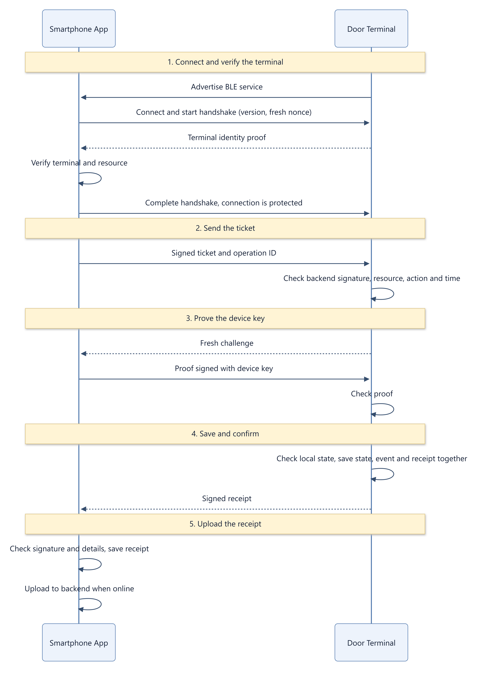

# Ideas and Concepts

- *Present the proposed solution, component designs, and main design choices.*

## Use Cases

### Web Application

- *Include a Use Case Diagram for resource search, booking management, invoice viewing, and administration through the web application.*
- *Show which actions are available to Student, Lecturer, and Admin.*

### Mobile Application

- *Include a Use Case Diagram for login, viewing the current booking or access entitlement, BLE identification, and check-in/check-out.*
- *Show the relevant user roles and distinguish required mobile functions from optional functions.*

## General System Flow

- *Show the overall process from login and booking to BLE check-in, resource use, check-out, and billing.*
- *Include permitted access without a prior booking and indicate where offline operation affects the process.*

## Proposed System Architecture

- *Include a conceptual component diagram with Web, Backend, Database, Shared Mobile Core, Android, iOS, and Door Terminal controlling the door.*
- *Briefly explain each component's responsibility, the proposed module boundaries, and the connections through REST/HTTPS, shared mobile interfaces, and BLE.*

## Backend Design

The backend is a Spring Boot application with a PostgreSQL database. It is divided into eight modules. The web frontend and the mobile app communicate with it through a REST API over HTTPS. The door terminal has no connection to the backend; all data between terminal and backend is carried by the smartphone.

### Module Structure

**Auth.** Handles the identity of a user: account activation, login, access and refresh tokens, and password reset. Users cannot register themselves. An admin creates the user, and the user receives an activation link by email to set a password. Activation and password reset use the same mechanism: a random one-time token with an expiry date, stored only as a hash. *Depends on:* Users.

**Users.** Manages users, their profile data, role (STUDENT, STAFF, ADMIN) and status (INVITED, ACTIVE, DISABLED). Only admins can create users and change roles. The first admin is created when the database is set up. *Depends on:* nothing.

**Resources.** Manages the university's resources (name, type, position, price per hour) and the terminals with their public keys. Each terminal belongs to one resource; a resource can have more than one terminal. *Depends on:* nothing.

**Bookings.** Creates, changes and cancels bookings, prevents overlapping bookings, calculates free time slots and handles check-in and check-out. A scheduled job detects missed check-ins and missing check-outs. When a booking ends, the module publishes an event so that an invoice can be created. *Depends on:* Users, Resources.

**Devices.** Manages the users' smartphones and stores the public key of each device, so that tickets can be bound to one specific device. A lost device can be blocked. *Depends on:* Users.

**Tickets.** Issues the signed tickets (JWT) that the smartphone presents at the terminal. Tickets are signed with a separate asymmetric key (ES256), so the terminal can verify them with the public key only. A ticket is issued shortly before the booking starts and is valid for a few minutes. *Depends on:* Bookings, Devices.

**Invoices.** Creates invoices automatically when a booking ends or when a user does not show up. Invoices are Swiss QR invoices and can be downloaded as PDF. The module also manages the payment status. *Depends on:* Bookings, Users, Resources.

**Audit Logs.** Stores security-relevant events of the whole application. The other modules publish events (Spring Events) to which this module listens. Only admins can read the logs, and nobody can change or delete them. *Depends on:* nothing.

| Module | Depends on |
|---|---|
| Auth | Users |
| Users | – |
| Resources | – |
| Bookings | Users, Resources |
| Devices | Users |
| Tickets | Bookings, Devices |
| Invoices | Bookings, Users, Resources |
| Audit Logs | – (receives events from all modules) |

: Backend module dependencies

Bookings does not call Invoices directly. It publishes an event when a booking ends, and Invoices reacts to it. This avoids a circular dependency between the two modules.

{width=100%}

{width=60%}

### API Structure

**Auth**

| Method | Path | Body / Note |
|---|---------|--------|
| POST | `/auth/activate` | activation token (from the email link), new password |
| POST | `/auth/login` | email, password; returns access token (JWT) and refresh token |
| POST | `/auth/refresh` | refresh token; returns a new access token and a new refresh token |
| POST | `/auth/logout` | refresh token; the refresh token is no longer valid |
| POST | `/auth/password-reset/request` | email; the response is always the same, whether the email exists or not |
| POST | `/auth/password-reset/confirm` | reset code, new password |

**Users**

| Method | Path | Body / Note |
|---|---------|--------|
| POST | `/users` | email, firstName, lastName, role, startSemester and bachelorCourse (students only); sends the activation email |
| GET | `/users` | list of users; query: role, status; with pagination |
| POST | `/users/{id}/invitation` | sends the activation email again |
| GET | `/users/{id}` | |
| PATCH | `/users/{id}` | only the fields that change; the role cannot be changed here |
| PATCH | `/users/{id}/role` | changes the role (written to the audit log) |
| DELETE | `/users/{id}` | sets the status to DISABLED; the user is not deleted |

**Resources and Terminals**

| Method | Path | Body / Note |
|---|---------|--------|
| POST | `/resources` | name, type (MOBILE or FIXED), position, pricePerHour |
| GET | `/resources` | list of resources; query: type |
| GET | `/resources/{id}` | |
| PATCH | `/resources/{id}` | only the fields that change |
| DELETE | `/resources/{id}` | |
| GET | `/resources/{id}/availability` | free time slots; query: from, to; the logic is in the Bookings module |
| POST | `/terminals` | name, resourceId, publicKey (P-256, DER, Base64); the response contains the terminalId and the backend public key |
| GET | `/terminals` | list of terminals |
| GET | `/terminals/{id}` | |
| DELETE | `/terminals/{id}` | removes a terminal, e.g. if it is stolen |

**Bookings and Tickets**

| Method | Path | Body / Note |
|---|---------|--------|
| POST | `/bookings` | resourceId, start, end; the user is taken from the access token |
| GET | `/bookings` | list of bookings; query: from, to, resourceId, userId; users only receive their own |
| GET | `/bookings/{id}` | |
| PATCH | `/bookings/{id}` | only while the status is BOOKED |
| DELETE | `/bookings/{id}` | cancels the booking (status CANCELLED) |
| POST | `/bookings/{id}/check-in` | check-in receipt signed by the terminal |
| POST | `/bookings/{id}/check-out` | check-out receipt signed by the terminal |
| GET | `/bookings/{id}/ticket` | query: deviceId; ticket for an active booking, available shortly before the start |

**Devices**

| Method | Path | Body / Note |
|---|---------|--------|
| POST | `/users/me/devices` | publicKey (P-256, DER, Base64), device name; requires a recent login |
| GET | `/users/me/devices` | the user's own devices |
| DELETE | `/users/me/devices/{id}` | blocks a device, e.g. if it is lost |
| GET | `/users/{id}/devices` | devices of any user |
| DELETE | `/users/{id}/devices/{deviceId}` | blocks a device of any user |

**Invoices and Audit Logs**

| Method | Path | Body / Note |
|---|---------|--------|
| GET | `/invoices` | list of invoices; query: userId, paymentStatus; users only receive their own |
| GET | `/invoices/{id}/pdf` | invoice as PDF (Swiss QR invoice) |
| PATCH | `/invoices/{id}` | changes the payment status |
| POST | `/invoices` | creates an invoice manually for special cases |
| GET | `/admin/audit-logs` | audit log entries; query: from, to, userId; with pagination |

### Authentication and Authorization

Authentication:

- An access token is required for all endpoints except `/auth/*`.
- Access token: JWT, valid for 15 minutes, contains the userId and the role.
- Refresh token: valid for 7 days, stored as a hash, replaced on every use.
- The refresh token becomes invalid after logout, after a password change and when the user is disabled.
- Login attempts are limited, and disabled users cannot log in.

Authorization is checked in two steps:

1. Role check with Spring Security (`@PreAuthorize`).
2. Owner check in the service of the module: users may only access objects that belong to them.

Table: Access rights by role. *Yes* = allowed, *Own* = only objects that belong to the user, *No* = not allowed.

| Endpoint | Not logged in | STUDENT | STAFF | ADMIN |
|---|---|---|---|---|
| All `/auth/*` endpoints | Yes | Yes | Yes | Yes |
| `POST /users`, `GET /users` | No | No | No | Yes |
| `POST /users/{id}/invitation` | No | No | No | Yes |
| `GET /users/{id}`, `PATCH /users/{id}` | No | Own | Own | Yes |
| `PATCH /users/{id}/role`, `DELETE /users/{id}` | No | No | No | Yes |
| `GET /resources`, `GET /resources/{id}` | No | Yes | Yes | Yes |
| `GET /resources/{id}/availability` | No | Yes | Yes | Yes |
| `POST`, `PATCH`, `DELETE /resources` | No | No | No | Yes |
| All `/terminals` endpoints | No | No | No | Yes |
| `POST /bookings` | No | Yes | Yes | Yes |
| `GET`, `PATCH`, `DELETE /bookings/{id}` | No | Own | Own | Yes |
| `POST /bookings/{id}/check-in`, `/check-out` | No | Own | Own | Own |
| `GET /bookings/{id}/ticket` | No | Own | Own | Own |
| `/users/me/devices` (all methods) | No | Own | Own | Own |
| `GET`, `DELETE /users/{id}/devices` | No | No | No | Yes |
| `GET /invoices`, `GET /invoices/{id}/pdf` | No | Own | Own | Yes |
| `PATCH /invoices/{id}`, `POST /invoices` | No | No | No | Yes |
| `GET /admin/audit-logs` | No | No | No | Yes |

Check-in, check-out and tickets are restricted to the owner even for admins: only the owner of a booking can check in, with their own device.

### Database Access

Each module owns its tables:

| Module | Tables |
|---|---|
| Auth | refresh_tokens, one_time_tokens |
| Users | users |
| Resources | resources, terminals |
| Bookings | bookings, receipts |
| Devices | devices |
| Tickets | – (tickets are not stored) |
| Invoices | invoices |
| Audit Logs | audit_log |

: Table ownership

### Error Handling

All errors are returned as Problem Details (RFC 9457) and handled centrally with `@RestControllerAdvice`. An additional field `code` allows the clients to show the right message.

```json
{
  "type": "about:blank",
  "title": "Booking overlap",
  "status": 409,
  "detail": "The resource is already booked at this time.",
  "instance": "/bookings",
  "code": "BOOKING_OVERLAP"
}
```

| Status | Code (examples) | When |
|---|---|---|
| 400 | VALIDATION_ERROR, INVALID_RECEIPT | Invalid input, invalid signature |
| 401 | UNAUTHORIZED | Token missing, invalid or expired |
| 403 | FORBIDDEN | Role not allowed |
| 404 | NOT_FOUND | Object does not exist or does not belong to the user |
| 409 | BOOKING_OVERLAP, INVALID_STATUS | Conflict with existing data or booking status |
| 429 | TOO_MANY_REQUESTS | Too many login attempts |
| 500 | INTERNAL_ERROR | Unexpected error |

: HTTP status codes

- Responses contain no stack traces, SQL errors or other internal details; these are written only to the server log.
- Objects of other users return 404, not 403, so the API does not reveal whether they exist.
- A failed login always returns the same message.
- Security-relevant errors are written to the audit log.

The check-in and check-out process with tickets, receipts and the offline terminal is described in [BLE Access and Security Concept](#ble-access-and-security-concept).

### Backend Design Decisions

1. **Technology:** Java with Spring Boot and PostgreSQL. Spring Security provides password hashing (Argon2), roles and JWT.
2. **Availability:** Free time slots are calculated in the Bookings module, where the bookings are stored. This avoids a circular dependency with Resources.
3. **Overlapping bookings:** A PostgreSQL exclusion constraint prevents two bookings for the same resource at the same time, even under concurrent requests.
4. **No-show:** If there is no check-in 15 minutes after the start, a scheduled job sets the booking to NO_SHOW, and an invoice with a no-show fee is created.
5. **Missing check-out:** Without a check-out, the booking is charged until its end time.
6. **Invoices:** Invoices are created automatically by the backend, triggered by an event from Bookings.
7. **Users:** Users cannot register themselves. An admin creates them, and they receive an activation link by email.
8. **User types:** One users table with a role (STUDENT, STAFF, ADMIN). The fields startSemester and bachelorCourse are only filled in for students.
9. **Audit logs:** Written through Spring Events. The database user of the application has only INSERT and SELECT rights on the audit table. Passwords and tokens are never logged.
10. **Terminals and resources:** The relation is stored once, as resourceId in the terminals table, so a resource can have more than one terminal.
11. **Tokens:** Short-lived access tokens (15 minutes) and refresh tokens (7 days) that are stored as a hash and replaced on every use.
12. **Two-step access check:** First the role (Spring Security), then the owner of the object (service).
13. **No hard delete of users:** Users are disabled, not deleted, because bookings, invoices and audit logs still refer to them.

## Mobile Application Design

### Purpose and Scope

This document defines the current architecture of the mobile application and serves as the architectural baseline for the implementation phase.

The design is based on Kotlin Multiplatform (KMP) and focuses on the shared Mobile Core, its internal modules, and the boundaries to the native Android and iOS applications and the backend.

The internal architecture of the native applications and the BLE protocol are not yet defined and remain TODO items. The backend implementation is outside the scope of this mobile architecture section.

### Component Architecture

The mobile application is structured around a shared Kotlin Multiplatform core, native Android/iOS applications, and the backend.

#### Module Structure

The following diagram summarizes the module boundaries between the shared Kotlin Multiplatform core, the native applications, and the backend. It reflects the component responsibilities described below without introducing platform-specific implementation details.

The shared `Mobile Core` contains application logic, backend communication, and token lifecycle management. Android and iOS consume the shared core through `MobileCoreApi` and remain responsible for native platform functionality. `SecureStorage` is defined as a shared interface and implemented by the native platforms.

The following diagrams summarize the component-level architecture and the module boundaries described above.

{width=72%}


#### Mobile Core

The `Mobile Core` contains the shared Kotlin Multiplatform logic used by both Android and iOS. Its three components are summarized below.

| Component | Main Responsibilities | Interfaces |
|:--|:--|:--|
| `MobileCoreApplication` | Provide the shared application entry point; coordinate authentication, booking, and resource-access logic; keep platform-specific code separated from shared business logic. | **Provides:** `MobileCoreApi`; **Requires:** `CommunicationGateway` |
| `BackendCommunication` | Perform REST communication; isolate HTTP and transport-specific details; convert between application models and DTOs; attach authentication credentials; coordinate login, token refresh, and logout; use `TokenManager` for locally managed credentials. | **Provides:** `CommunicationGateway`; **Requires:** `REST/API` |
| `TokenManager` | Maintain the short-lived access token; store and retrieve the long-lived refresh token; update and clear locally managed credentials; keep storage independent from platform-specific APIs. | **Provides:** none; **Requires:** `SecureStorage` |

#### External Components

The following components interact with the Mobile Core but are not part of it. Their internal architecture is not modeled in detail at this stage.

| Component | Main Responsibilities | Interfaces |
|:--|:--|:--|
| `Backend` | Provide backend functionality required by the mobile application; authenticate requests; issue, renew, and revoke authentication credentials; provide booking and access-related data; process access and check-out operations. | **Provides:** `REST/API`; **Requires:** none |
| `AndroidApp` | **TODO:** define the native Android architecture, platform-specific responsibilities, protected-storage implementation, and BLE integration. | **TODO** |
| `IOSApp` | **TODO:** define the native iOS architecture, platform-specific responsibilities, protected-storage implementation, and BLE integration. | **TODO** |

#### Native Platform Design — TODO

The internal architecture of the native Android and iOS applications has not yet been defined. The native UI structure, BLE integration, platform-specific protected storage, key management, and concrete implementations of shared interfaces will be documented in a later design step.

No native class diagram is included at this stage.


### Detailed Module Design

This section describes the internal structure of the Mobile Core components.

The class diagrams represent the current architectural design and define the main classes, dependencies, and interfaces between the modules.

The diagrams intentionally focus on architectural responsibilities rather than implementation details. Data fields, error models, and platform-specific implementations may be refined during implementation.

#### MobileCoreApplication

The `MobileCoreApplication` module contains the shared application-level logic. It is the entry point used by the native Android and iOS applications and coordinates the specialized services responsible for authentication, bookings, and resource access.

{width=95%}

##### MobileCoreApi


###### Purpose {.unnumbered}

`MobileCoreApi` defines the public contract through which the native Android and iOS applications access the shared Mobile Core.

###### Responsibilities {.unnumbered}

- expose the functionality required by the native applications,
- hide the internal organization of the `MobileCoreApplication` module,
- provide a stable boundary between platform-specific code and shared application logic.

###### Dependencies {.unnumbered}

The interface does not depend directly on internal services. Its implementation is provided by `ServiceFacade`.

###### Interface Operations {.unnumbered}


| Operation | Description |
|---|---|
| `login(identifier: String, password: String)` | Starts the authentication flow using the supplied user identifier and password. Authentication credentials returned by the backend remain internal to the Mobile Core. |
| `logout()` | Ends the current session and triggers backend revocation and local credential cleanup. |
| `getActiveBookings() List<Booking>` | Retrieves the active bookings available to the current user. |
| `requestAccess(request: ResourceAccessRequest) ResourceAccessResponse` | Requests authorization to access a resource using an application-level access request. |
| `confirmAccess(confirmation: AccessConfirmation)` | Confirms the result of a previously initiated resource-access operation. |
| `checkOut(resourceId: String)` | Initiates the check-out flow for the specified resource. |

The interface uses application models rather than transport DTOs. This keeps HTTP-specific representations outside the public Mobile Core API.

##### ServiceFacade


###### Purpose {.unnumbered}

`ServiceFacade` is the concrete implementation of `MobileCoreApi` and acts as the single entry point to the services contained in the `MobileCoreApplication` module.

###### Responsibilities {.unnumbered}

- implement the `MobileCoreApi` contract,
- delegate authentication operations to `AuthService`,
- delegate booking operations to `BookingService`,
- delegate resource-access operations to `AccessService`,
- prevent native applications from depending directly on individual application services.

###### Dependencies {.unnumbered}

- `AuthService`
- `BookingService`
- `AccessService`

##### AuthService


###### Purpose {.unnumbered}

`AuthService` contains the application-level logic related to authentication and session lifecycle.

###### Responsibilities {.unnumbered}

- coordinate user login,
- coordinate logout,
- delegate authentication-related backend operations through `CommunicationGateway`,
- remain independent from token storage and refresh implementation details.

###### Dependencies {.unnumbered}

- `CommunicationGateway`

##### BookingService


###### Purpose {.unnumbered}

`BookingService` contains the application logic required to retrieve booking information.

###### Responsibilities {.unnumbered}

- request active booking information,
- expose booking data as application models,
- keep booking-related backend communication outside the native applications.

###### Dependencies {.unnumbered}

- `CommunicationGateway`

##### AccessService


###### Purpose {.unnumbered}

`AccessService` coordinates the application-level resource access lifecycle.

###### Responsibilities {.unnumbered}

- request access to a resource,
- process access confirmation,
- initiate resource check-out,
- delegate backend-related operations through `CommunicationGateway`.

###### Dependencies {.unnumbered}

- `CommunicationGateway`


#### BackendCommunication

The `BackendCommunication` module provides the boundary between the application layer and the backend REST API.

It separates application-level models and operations from HTTP communication, authentication transport, and DTO-specific representations.


{width=100%}

##### CommunicationGateway


###### Purpose {.unnumbered}

`CommunicationGateway` defines the application-facing contract for backend communication.

It allows the `MobileCoreApplication` module to perform backend operations without depending on HTTP clients, REST endpoints, DTO representations, or token-management details.

###### Responsibilities {.unnumbered}

- expose backend-related capabilities using application-level types,
- isolate the `MobileCoreApplication` module from transport-specific details,
- hide authentication credential handling from application services,
- define the boundary between application logic and backend communication.

###### Dependencies {.unnumbered}

The interface itself has no concrete infrastructure dependency. It is implemented by `BackendCommunication`.

###### Interface Operations {.unnumbered}


| Operation | Description |
|---|---|
| `login(identifier: String, password: String)` | Authenticates the user through the backend. Returned credentials are handled internally by `BackendCommunication` and `TokenManager`. |
| `logout()` | Terminates the current session, requests backend-side revocation, and clears locally managed credentials. |
| `getActiveBookings() List<Booking>` | Retrieves active bookings and exposes them as application `Booking` models. |
| `requestAccess(request: ResourceAccessRequest) ResourceAccessResponse` | Sends a resource-access request and returns the corresponding application-level response. |
| `confirmAccess(confirmation: AccessConfirmation)` | Sends an access confirmation to the backend. |
| `checkOut(resourceId: String)` | Requests completion of resource usage for the specified resource. |

No DTO or token types are exposed through this interface. DTO creation, authentication headers, token refresh, and credential persistence remain internal to the communication and token-management modules.

##### BackendCommunication


###### Purpose {.unnumbered}

`BackendCommunication` implements `CommunicationGateway` and acts as the adapter between application-level operations and the REST client.

It also coordinates authentication-related communication without exposing token mechanics to the application layer.

###### Responsibilities {.unnumbered}

- implement the `CommunicationGateway` contract,
- coordinate calls to `BackendApiClient`,
- convert application models to DTOs before sending requests,
- convert received DTOs back into application models,
- store credentials returned by a successful login through `TokenManager`,
- obtain access and refresh tokens through `TokenManager`,
- refresh the access token when required,
- retry an authenticated operation after a successful refresh,
- clear local credentials when logout completes or renewal is no longer possible.

###### Dependencies {.unnumbered}

- `BackendApiClient`
- `TokenManager`

###### Authentication Behaviour {.unnumbered}


###### Login {.unnumbered}

`BackendCommunication.login()` creates a `LoginRequestDto` from the supplied identifier and password and delegates the HTTP request to `BackendApiClient`.

After successful authentication, the returned `LoginResponseDto` contains the access and refresh credentials. `BackendCommunication` passes these credentials to `TokenManager.storeTokens(...)`. The password is not persisted by the Mobile Core.

###### Token Refresh {.unnumbered}

Token refresh is an internal communication concern and is not exposed through `CommunicationGateway`.

When an authenticated request cannot use the current access token because it is unavailable or rejected as expired, `BackendCommunication` retrieves the refresh token from `TokenManager`, creates a `RefreshTokenRequestDto`, and calls `BackendApiClient.refresh(...)`.

If the refresh succeeds, the returned credentials are stored through `TokenManager` and the original operation may be retried once using the new access token.

If the refresh token is rejected, expired, or revoked, the local credentials are cleared and the authentication failure is propagated to the application layer.

###### Logout {.unnumbered}

During logout, `BackendCommunication` obtains the refresh token and requests backend-side session revocation through `BackendApiClient.logout(...)`. Local credentials are then cleared through `TokenManager`.

##### BackendApiClient


###### Purpose {.unnumbered}

`BackendApiClient` is the low-level REST communication client.

###### Responsibilities {.unnumbered}

- execute HTTP requests,
- send and receive transport DTOs,
- send the access token with protected requests,
- perform login, refresh, and logout transport operations,
- isolate HTTP-specific communication from the rest of the Mobile Core.

###### Dependencies {.unnumbered}

- `HttpClient`

The concrete HTTP client configuration is an implementation concern and is not further defined by this class diagram.

##### LoginRequestDto


###### Purpose {.unnumbered}

`LoginRequestDto` represents the transport data sent to the backend during login.

###### Responsibilities {.unnumbered}

- represent the login request in the REST communication layer,
- carry the supplied identifier and password to the authentication endpoint,
- provide a serializable transport representation for authentication data.

###### Dependencies {.unnumbered}

None are defined in the current architecture.

##### LoginResponseDto


###### Purpose {.unnumbered}

`LoginResponseDto` represents the transport response returned by the backend after successful authentication.

###### Responsibilities {.unnumbered}

- represent the authentication response,
- carry the short-lived access token and long-lived refresh token returned by the backend,
- provide the credentials that are passed to `TokenManager`.

###### Dependencies {.unnumbered}

None are defined in the current architecture.

##### RefreshTokenRequestDto


###### Purpose {.unnumbered}

`RefreshTokenRequestDto` represents the transport request used to renew authentication credentials.

###### Responsibilities {.unnumbered}

- carry the current refresh token to the backend refresh endpoint,
- keep refresh-specific transport data inside the communication layer.

###### Dependencies {.unnumbered}

None are defined in the current architecture.

##### RefreshTokenResponseDto


###### Purpose {.unnumbered}

`RefreshTokenResponseDto` represents the transport response returned after a successful token refresh.

###### Responsibilities {.unnumbered}

- carry the new access token,
- carry a replacement refresh token when refresh-token rotation is applied,
- provide the credentials used to update `TokenManager`.

###### Dependencies {.unnumbered}

None are defined in the current architecture.

##### BookingDto


###### Purpose {.unnumbered}

`BookingDto` represents booking information exchanged with the backend.

###### Responsibilities {.unnumbered}

- represent booking data in the transport layer,
- provide the source representation used when converting backend data into the application `Booking` model.

###### Dependencies {.unnumbered}

None are defined in the current architecture.

##### ResourceAccessRequestDto


###### Purpose {.unnumbered}

`ResourceAccessRequestDto` represents a resource-access request sent through the REST API.

###### Responsibilities {.unnumbered}

- represent resource-access information in transport form,
- keep the backend request representation separate from the application model.

###### Dependencies {.unnumbered}

None are defined in the current architecture.

##### ResourceAccessResponseDto


###### Purpose {.unnumbered}

`ResourceAccessResponseDto` represents the backend response to a resource-access request.

###### Responsibilities {.unnumbered}

- represent the REST response for an access request,
- provide the transport representation used to create a `ResourceAccessResponse`.

###### Dependencies {.unnumbered}

None are defined in the current architecture.

##### AccessConfirmationRequestDto


###### Purpose {.unnumbered}

`AccessConfirmationRequestDto` represents the transport request used to confirm a resource-access operation.

###### Responsibilities {.unnumbered}

- represent access-confirmation data sent to the backend,
- isolate the REST representation from the application-level `AccessConfirmation` model.

###### Dependencies {.unnumbered}

None are defined in the current architecture.

##### CheckOutRequestDto


###### Purpose {.unnumbered}

`CheckOutRequestDto` represents a check-out request in the REST communication layer.

###### Responsibilities {.unnumbered}

- represent check-out information in transport form,
- provide the DTO required by `BackendApiClient` when sending a check-out request.

###### Dependencies {.unnumbered}

None are defined in the current architecture.

##### Booking


###### Purpose {.unnumbered}

`Booking` is the application-level representation of a booking.

###### Responsibilities {.unnumbered}

- represent booking information independently from the REST API,
- provide a shared model that can be used by the `MobileCoreApplication` module.

###### Dependencies {.unnumbered}

None are defined in the current architecture.

##### ResourceAccessRequest


###### Purpose {.unnumbered}

`ResourceAccessRequest` represents an application-level request to access a resource.

###### Responsibilities {.unnumbered}

- contain the information required by the application access flow,
- keep the `MobileCoreApplication` module independent from `ResourceAccessRequestDto`.

###### Dependencies {.unnumbered}

None are defined in the current architecture.

##### ResourceAccessResponse


###### Purpose {.unnumbered}

`ResourceAccessResponse` represents the application-level result of a resource-access request.

###### Responsibilities {.unnumbered}

- expose the access result to the `MobileCoreApplication` module,
- hide the backend-specific `ResourceAccessResponseDto` representation.

###### Dependencies {.unnumbered}

None are defined in the current architecture.

##### AccessConfirmation


###### Purpose {.unnumbered}

`AccessConfirmation` represents an application-level confirmation of a resource-access operation.

###### Responsibilities {.unnumbered}

- represent confirmation data inside the Mobile Core,
- keep access-confirmation logic independent from the REST DTO representation.

###### Dependencies {.unnumbered}

None are defined in the current architecture.


#### TokenManager

The `TokenManager` module encapsulates local authentication credential handling and separates credential storage from backend communication.

The module does not perform REST requests. Token renewal is coordinated by `BackendCommunication`, while `TokenManager` is responsible for storing, retrieving, updating, and clearing credentials.

{width=80%}


##### TokenManager


###### Purpose {.unnumbered}

`TokenManager` manages the authentication credentials used by the Mobile Core without performing backend communication.

###### Responsibilities {.unnumbered}

- maintain the short-lived access token in memory,
- retrieve the current access token when required,
- persist the long-lived refresh token through `SecureStorage`,
- retrieve the refresh token when renewal or logout requires it,
- replace locally managed credentials after login or successful refresh,
- clear both access and refresh credentials when the session ends.

###### Dependencies {.unnumbered}

- `SecureStorage`

###### Operations {.unnumbered}


| Operation | Description |
|---|---|
| `getAccessToken() String?` | Returns the currently available in-memory access token, or no value if none is available. |
| `getRefreshToken() String?` | Retrieves the persisted refresh token from `SecureStorage`, or no value if no renewable session exists. |
| `storeTokens(accessToken: String, refreshToken: String)` | Replaces the currently managed credentials. The access token is kept in memory and the refresh token is persisted through `SecureStorage`. |
| `clearTokens()` | Removes the in-memory access token and deletes the persisted refresh token. |

##### SecureStorage


###### Purpose {.unnumbered}

`SecureStorage` defines the platform-independent contract used to persist sensitive values securely.

The interface allows the shared Mobile Core to use protected storage without depending directly on Android or iOS storage APIs.

###### Responsibilities {.unnumbered}

- define secure key-value storage operations,
- abstract platform-specific protected storage,
- allow the native Android and iOS applications to provide their respective implementations.

###### Dependencies {.unnumbered}

The interface has no platform dependency inside the Mobile Core. Its concrete implementation is provided externally by the native application.

###### Interface Operations {.unnumbered}


| Operation | Description |
|---|---|
| `save(key: String, value: String)` | Stores the supplied value under the specified key using the platform-protected storage implementation. |
| `get(key: String) String?` | Retrieves the value associated with the specified key. Returns no value if the key is not present. |
| `remove(key: String)` | Removes the value associated with the specified key from secure storage. |

The interface intentionally exposes generic key-value operations. Token-specific decisions, such as which values are stored and which keys are used, remain the responsibility of `TokenManager`.


The following diagram summarizes the classes and dependencies described in this section.


### Authentication and Token Lifecycle

Authentication state is managed jointly by `BackendCommunication` and `TokenManager`.

`BackendCommunication` owns the communication workflow, while `TokenManager` owns the local credential state. Authentication details are not exposed to the native applications or to the application services.

#### Login Flow

1. The native application calls `MobileCoreApi.login(identifier, password)`.
2. `ServiceFacade` delegates the operation to `AuthService`.
3. `AuthService` calls `CommunicationGateway.login(...)`.
4. `BackendCommunication` creates a `LoginRequestDto` and delegates the HTTP operation to `BackendApiClient`.
5. The backend validates the credentials and returns a short-lived access token and a long-lived refresh token.
6. `BackendCommunication` stores the returned credentials through `TokenManager.storeTokens(...)`.
7. The password is discarded after the login operation and is not used for automatic re-authentication.

The complete login sequence is summarized in the following diagram.

{width=100%}

#### Access Token Refresh

Token refresh is transparent to the caller and is not part of `MobileCoreApi` or `CommunicationGateway`.

1. `BackendCommunication` obtains the current access token from `TokenManager`.
2. The access token is used for a protected backend request.
3. If no access token is available, or if the backend rejects it because it has expired, `BackendCommunication` requests the refresh token from `TokenManager`.
4. `BackendCommunication` creates a `RefreshTokenRequestDto` and calls `BackendApiClient.refresh(...)`.
5. When the refresh succeeds, the returned credentials replace the previous credentials through `TokenManager.storeTokens(...)`.
6. The original protected operation may then be retried once with the new access token.
7. If renewal fails because the refresh token is expired, revoked, or invalid, the local credentials are cleared and the caller is informed that authentication is required again.

The complete renewal sequence is summarized in the following diagram.

{width=95%}

#### Logout Flow

1. The native application calls `MobileCoreApi.logout()`.
2. The operation reaches `BackendCommunication` through `AuthService` and `CommunicationGateway`.
3. `BackendCommunication` retrieves the refresh token from `TokenManager`.
4. The backend is asked to invalidate the renewable session.
5. `TokenManager.clearTokens()` removes the local access token and the persisted refresh token.

Local credentials are cleared when the user logs out. Backend-side invalidation ensures that the renewal credential can no longer be used to obtain new access credentials.

#### Token and Session Lifecycle


| Credential | Purpose | Lifetime | Local Storage |
|---|---|---|---|
| Password | Initial user authentication | Used only during login | Not persisted |
| Access token | Authenticate protected backend requests | Short-lived | Memory |
| Refresh token | Obtain new access credentials without storing the password | Long-lived and revocable | `SecureStorage` |

### Design Decisions and Assumptions

This section records the main architectural decisions and assumptions that define the current Mobile Core design.

#### Design Decisions

| Decision | Rationale |
|---|---|
| Shared application logic is implemented in Kotlin Multiplatform. | Authentication, booking, backend communication, and token-related logic can be shared between Android and iOS while platform-specific functionality remains native. |
| Native applications access the shared core only through `MobileCoreApi`. | A single public boundary reduces coupling between native code and the internal service structure of the Mobile Core. |
| Backend communication is isolated behind `CommunicationGateway`. | Application services remain independent from REST, HTTP, serialization, DTO, and token-management concerns. |
| DTOs are kept inside the communication layer. | Transport representations can evolve without directly affecting the application-facing API and models. |
| Authentication communication is coordinated by `BackendCommunication`. | Login, refresh, and logout require interaction with the backend and therefore belong to the communication boundary rather than to application services or local token storage. |
| `TokenManager` does not perform backend communication. | The module has a single responsibility: manage local authentication credentials and their storage lifecycle. |
| The access token is kept in memory while the refresh token is persisted securely. | The access credential is short-lived, while the long-lived renewal credential requires platform-protected storage. |
| Secure storage is represented by a platform-independent interface. | Android and iOS use different protected-storage mechanisms while the shared core remains platform-independent. |
| BLE communication remains outside the Mobile Core. | BLE interaction depends on native platform APIs and is handled by the Android and iOS applications. |

#### Assumptions

- The backend provides REST endpoints for login, token refresh, session revocation, and the operations required by `CommunicationGateway`.
- Successful login returns a short-lived access token and a long-lived refresh token.
- Successful refresh returns a new access token and may rotate the refresh token; when rotation is used, the replacement token is stored immediately.
- Android and iOS provide concrete implementations of `SecureStorage`.
- The internal architecture of the Android and iOS applications will be designed separately.
- The BLE protocol and terminal interaction contract are not defined by this document.
- DTO fields, error representations, and detailed endpoint contracts may be refined when the backend contract is finalized.
- The current check-out flow uses `resourceId` at the application boundary. `CheckOutRequestDto` allows the transport request to be extended later without changing the current application interface.
- An authenticated backend operation is retried at most once after a successful access-token refresh to avoid uncontrolled retry loops.

## Door Terminal Design

### Module Structure

- *Show the proposed firmware modules for BLE communication, credential verification, door control, local storage, and event handling.*
- *Explain their responsibilities, dependencies, and interfaces with the mobile app and the selected synchronization route.*

### Class and Data Structure Design

- *Include a proposed diagram of the important firmware classes or data structures, according to the chosen C/C++ design.*
- *Show how protocol messages, authorization data, terminal state, and queued usage events relate to the firmware modules.*

## Database Design


### 1. Core Entities

#### User
`id`, `email`, `password_hash`, `role` (VARCHAR), `status` (VARCHAR), `created_at` (TIMESTAMPTZ), `first_name`, `last_name`, `start_semester`, `field_of_study`, `failed_attempts`, `locked_until` (TIMESTAMPTZ)

#### Device
`id`, `user_id` (FK), `name`, `public_key`, `created_at` (TIMESTAMPTZ), `revoked_at` (TIMESTAMPTZ)

#### RefreshToken
`id`, `user_id` (FK), `token_hash`, `expires_at` (TIMESTAMPTZ), `revoked_at` (TIMESTAMPTZ)

#### OneTimeToken
`id`, `user_id` (FK), `token_hash`, `purpose` (VARCHAR), `expires_at` (TIMESTAMPTZ), `used_at` (TIMESTAMPTZ), `created_by_user_id` (FK)

#### Resource
`id`, `name`, `description`, `price_per_hour` (DECIMAL), `status` (VARCHAR), `type` (VARCHAR), `position` (VARCHAR)

#### Terminal
`id`, `public_key`, `status` (VARCHAR), `resource_id` (FK, UNIQUE)

#### Booking
`id`, `user_id` (FK), `resource_id` (FK), `start_time` (TIMESTAMPTZ), `end_time` (TIMESTAMPTZ), `status` (VARCHAR), `locked_price` (DECIMAL)

#### Receipt
`id` (UUID), `booking_id` (FK), `terminal_id` (FK), `ticket_id`, `type` (VARCHAR), `receipt_time` (TIMESTAMPTZ), `signature`, `received_at` (TIMESTAMPTZ)

#### Invoice
`id`, `invoice_number`, `booking_id` (FK, UNIQUE), `user_id` (FK), `final_price` (DECIMAL), `pdf_file_path`, `status` (VARCHAR), `created_at` (TIMESTAMPTZ), `type` (VARCHAR), `qr_reference`, `due_date`, `paid_at` (TIMESTAMPTZ), `currency` (VARCHAR)

#### Availability
`id`, `resource_id` (FK), `day_of_week` (SMALLINT), `start_time`, `end_time`, `permitted_role` (VARCHAR)

#### AuditLog
`id`, `actor_user_id` (FK), `action` (VARCHAR), `target_entity` (VARCHAR), `timestamp` (TIMESTAMPTZ), `details` (JSONB), `target_id`, `outcome` (VARCHAR), `ip_address` (VARCHAR)

### 2. Relationships & Cardinalities

- **User -> Booking ($1 : n$):** A user can place multiple bookings over time.
- **User -> Device ($1 : n$):** A user can register multiple authentication devices.
- **User -> RefreshToken ($1 : n$):** A user can maintain multiple active authentication sessions.
- **User -> OneTimeToken ($1 : n$):** A user can have multiple tokens issued for or by them (`created_by_user_id`).
- **User -> Invoice ($1 : n$):** A user is assigned to all invoices generated for their bookings.
- **User -> AuditLog ($1 : n$):** A user triggers multiple logged system actions (`actor_user_id`).
- **Resource -> Booking ($1 : n$):** A bookable resource can have multiple scheduled bookings.
- **Resource -> Availability ($1 : n$):** A resource defines multiple time-window access rules across days of the week.
- **Terminal -> Resource ($1 : 1$):** Each hardware terminal is assigned to exactly one physical resource (`resource_id` in `terminal`).
- **Terminal -> Receipt ($1 : n$):** A physical terminal generates and signs multiple access receipts.
- **Booking -> Receipt ($1 : n$):** A single booking session tracks check-in and check-out receipts.
- **Booking -> Invoice ($1 : 1$):** Every completed/billable booking correlates to exactly one invoice (`UNIQUE` constraint on `booking_id`).
## Booking and Usage Lifecycle

- *Show the proposed states and transitions for bookings and resource usage.*
- *Summarize the main policies for booking conflicts, walk-in access, no-shows, overtime, and missing check-out.*

## BLE Access and Security Concept

Status: design proposal for T-003, ready for team review.

### Purpose and Scope

This concept describes how the mobile app on the smartphone communicates with the door terminal over BLE to authorize access and record check-in/check-out. The terminal is assigned to the booked resource. The flow follows the backend's ticket approach.

#### The idea in short

Before check-in, the app fetches a signed ticket from the backend. The terminal can check this ticket completely offline. With a challenge-response step, the app proves that it holds the matching private key, so simply copying the ticket to another smartphone is not enough. If everything succeeds, the terminal saves the event and issues a signed receipt, which the app uploads to the backend. Check-out works the same way, with its own ticket.

**Not in scope:** BLE and firmware implementation, mobile classes, final data formats and cryptographic algorithms, detailed synchronization, and performance optimization.

### Actors and Prerequisites

Three parties are involved. Only the first two take part in the BLE exchange.

| Actor | Role |
|---|---|
| Mobile app on the smartphone | BLE central / GATT client. Verifies the terminal, sends the ticket, proves the device key, and uploads receipts. |
| Door terminal (assumed ESP32) | BLE peripheral / GATT server. Checks tickets offline, saves events, and returns signed receipts. |
| Backend | Registers devices, issues tickets, and processes receipts. It takes no part in the BLE exchange. |

Before a check-in or check-out can start, four things must be in place:

1. The smartphone has a registered key pair. The private key stays in protected storage; the backend links the public key to the user.
2. The app holds a backend-signed ticket for this device key, booking, resource, action, and time window.
3. The terminal knows its terminal and resource IDs and the backend's verification key. It has its own signing key, a reliable clock, and storage that survives a restart.
4. The app has trusted information to verify the terminal.

The terminal never needs a name or email. It only checks the ticket and the device's proof. BLE advertising and addresses help the app find the terminal, but they do not prove identity.

Before issuing a ticket, the backend checks the user's role, booking ownership, and account/device status. In the proposed backend flow, only the booking owner can check in or out with their registered device.

The proposed design decisions are summarized below.

### Normal Flow: Check-in and Check-out

Check-in and check-out use the same exchange. Each needs its own ticket.

#### The five steps

1. **Connect and verify the terminal.** The app finds the terminal over BLE and connects. The terminal proves that it is the trusted terminal for this resource, and both sides set up a protected connection. *Message: handshake and terminal proof.*
2. **Send the ticket.** The app sends the signed ticket and an operation ID. The terminal checks the backend signature, resource, action, and time window. *Message: authorization request.*
3. **Prove the device key.** The terminal sends a fresh challenge, and the app signs it with the device key named in the ticket. *Messages: challenge and device proof.*
4. **Save and confirm.** The terminal checks its local state, saves the event, and returns a signed receipt. Only then may it signal access. *Message: signed receipt, or an error result.*
5. **Upload the receipt.** The app checks the terminal's signature and that the receipt matches its own request. It saves the receipt and uploads it when it is online. The backend then updates the booking status.

Under the backend's ticket proposal, a check-out ticket is issued only after the backend has accepted the check-in receipt. The upload in step 5 is therefore required to obtain that ticket.

{width=100%}

The message names describe purposes, not final names or formats. GATT characteristics, UUIDs, framing, and packet sizes are left for implementation.

#### What the terminal checks and saves

| Action | Required local state | Result |
|---|---|---|
| `CHECK_IN` | The booking may start. No conflicting use, and this booking was not started before. | One start event. The booking is in use. |
| `CHECK_OUT` | The same booking is currently in use. | One end event. The use is ended. |

The terminal follows three rules:

- **One request at a time.** It finishes one request before it handles the next.
- **Save first, then confirm.** Usage state, event, and receipt are saved together. Success and access are signalled only afterwards, so a restart cannot leave half an update.
- **Same request, same receipt.** If the app repeats a request that was already saved, the terminal returns the original receipt and creates no second event.

The terminal only knows its own local state. Whether a booking is valid centrally is checked by the backend when it issues the ticket.

### Failure and Initial Recovery

Every failed attempt ends in one of three results for the app. Which one depends on how far the exchange got:

- **Aborted:** a connection problem or an unverified terminal stopped the attempt before the app started sending the device proof. The terminal saved no usage event for this attempt.
- **Rejected:** the terminal answered with a rejection. This attempt saved nothing.
- **Unknown:** the app started sending the device proof but holds neither a valid receipt nor a final rejection. The terminal may have saved the event.

{width=100%}

#### Failure cases

| Where it fails | Result | What the app does |
|---|---|---|
| Connection problem before the app starts sending the device proof (Bluetooth off, terminal not found, connection drops) | Aborted | Explain the problem. Allow a limited number of retries. |
| Terminal cannot be verified (unsupported version, untrusted terminal, protection fails) | Aborted | Stop before sending the ticket. No automatic retry, no unprotected connection. |
| Terminal rejects the ticket or proof (invalid or expired ticket, wrong resource or action, unreliable clock, late or invalid proof) | Rejected | Show the reason. Request a new ticket if it expired. |
| Terminal rejects the action (conflicting use, check-out without active use, full event queue, or a storage failure that clearly saved nothing) | Rejected | Do not show success or signal access. |
| No valid receipt after the app has started sending the device proof (connection lost, response missing, receipt invalid, or a storage failure with an unclear result) | Unknown | Keep the operation ID and follow the unknown-result rules below. |

#### Unknown result

The terminal can save an action only after it has checked the device proof. Before the app starts sending the device proof, a failed attempt is simply unsuccessful. After the app has started sending it, the result stays unknown until the app holds a verified receipt or a final rejection.

This is why the operation ID matters. The app saves it before sending the request and reuses it for every retry of the same action. In the unknown case the app keeps that ID, reconnects, and asks the terminal for the saved receipt. This query only reads; it cannot perform a check-in or check-out. If no receipt comes back, that does not prove that nothing was saved. Whether a later rejection settles the earlier attempt depends on the terminal's history check; the BLE Recovery Proposal in the security appendix defines when a rejection is final. The app never creates a new operation ID to get around this.

The security appendix contains the detailed recovery and retry rules. A failed receipt upload or a backend conflict is handled by the BLE Synchronization Proposal in the same appendix.

### Security Rules

Each rule protects a step of the normal BLE flow.

| Rule | Protects against |
|---|---|
| The terminal proves its identity before the app sends a ticket. | Fake terminals collecting tickets |
| The connection is protected before sensitive data is sent. | Reading or changing tickets and proofs in transit |
| A ticket alone is not enough. The device answers a challenge. | Copied tickets |
| Every challenge is unpredictable, short-lived, and usable once. | Replayed answers |
| Each device proof covers the ticket, operation, action, terminal, resource, and protected session. | A valid proof being reused for another action, terminal, or session |
| The terminal remembers what it has already applied. | The same booking action running twice |
| Keys stay protected. Logs hold no secrets or unnecessary personal data. | Leaked keys and personal data |
| Message size, waiting time, and retries are limited. | Malformed messages creating events or blocking the terminal |

The terminal proof covers a fresh nonce from the app, the protocol version, the expected terminal and resource, and the handshake itself. A static ID or certificate is not enough.

**Known limit:** BLE authentication does not prove physical distance. An attacker could forward the exchange from another place (relay attack). The team has to accept this or assess extra protection.

**Lost or compromised equipment:** Under the backend proposal, a user or Admin can block a lost smartphone, and an Admin can remove a stolen or compromised terminal. The backend then issues no new tickets for the blocked device and rejects receipts from the removed terminal.


### BLE Design Decisions

The proposed flow assumes that one terminal manages local resource use and that the terminal hardware is an ESP32. Both assumptions need team confirmation.

#### Proposed design decisions

| Decision | Reason |
|---|---|
| Action-specific tickets | A check-in ticket must not allow check-out. |
| Save state, event, and receipt together before success | All three stay consistent after a restart. |
| Keep the operation ID on retries | A retry must not create a second event. |
| Recover with the original device key | The receipt can be fetched again without allowing a new action. |
| Protect the connection before sending a ticket | Tickets and proofs cannot be read or changed. |
| Same terminal for check-in and check-out | An offline terminal can check the order with its own saved state. |

## Offline Operation and Synchronization

### Authorization While Offline

The terminal works without Wi-Fi or backend access, so it cannot learn about changes immediately:

- A ticket is valid for a few minutes. The exact validity limit must be agreed.
- The terminal needs a reliable clock. Without one, it rejects new actions.
- If a device is blocked or a booking is cancelled after the ticket was issued, the terminal may still accept that ticket until it expires. A later backend rejection cannot undo access already granted.
- The smartphone still needs connectivity to get a new ticket. With a valid ticket already stored, the BLE exchange can run without smartphone connectivity.

Under the current backend proposal, the smartphone must upload its check-in receipt and wait for backend acceptance before obtaining a check-out ticket. Fully offline check-in and check-out therefore need another agreed authorization policy. A check-in ticket never substitutes for a check-out ticket. Physical exit behavior is outside this concept.

### Receipt Upload and Acknowledgment

The smartphone carries signed receipts from the terminal to the backend. A successful BLE exchange confirms the local event; it does not yet confirm that the backend has accepted it. If an upload fails, the app keeps the receipt and shows synchronization pending. The backend checks the terminal signature, event details, and event order, and processes each event once.

The proposed return path is a backend-signed acknowledgment carried by the app. The terminal verifies that acknowledgment before marking its event as synchronized. Conflicts stay available for Admin review; a rejected upload cannot undo access already granted. Pending events survive restarts and are never overwritten to make room. If the queue is full, the terminal rejects new actions that it cannot save.

The BLE synchronization proposal in Detailed Security Documentation gives the acknowledgment and retry details. Its return path after check-out, queue limits, and handling of late receipts still require team agreement.

## User Interface Design

### Web Application UI

- *Include wireframes for the main web screens: login, resource search, bookings, invoices, and administration.*
- *Show navigation and the actions available to each role, including important confirmation and error states.*

### Mobile Application UI

- *Include wireframes for the main mobile screens: login, current booking/access entitlement, BLE connection, and check-in/check-out.*
- *Show navigation and feedback for successful or denied access, disconnection, and offline operation.*

## Design Choices

- *Summarize the important choices in architecture, technologies, mobile integration, and BLE communication, with their reasons.*
- *Record unresolved design questions; describe the final implemented structures and any changes in Chapter 5.*
