\appendix

# Appendices {#appendices}

## Requirements and Expected Results

### Full Requirements Register {#full-requirements-register}

#### Functional requirements {.unnumbered}

##### FR-01 — Accounts, roles, and sessions {.unnumbered}

<a id="tbl-08-01"></a>

| ID | Requirement | Priority | Version |
|:--|:--|:--|:--|
| FR-01.01 | The system shall support exactly three application roles: Student, Lecturer, and Admin. Admins can manage accounts, resources, payment status, and audit records; Students and Lecturers can use only functions and resources permitted by their role. | Must | 1.0 |
| FR-01.02 | An Admin shall create a personal, single-use, expiring invitation link for a new account. Registration through it shall set the invited identity and role; invalid, expired, or reused links shall be rejected. Public self-registration is out of scope. | Must | 1.0 |
| FR-01.03 | An Admin shall view, update, deactivate, and change the role of an account. A deactivated account shall lose online access and new sessions, subject to the documented offline authorization window. | Must | 1.0 |
| FR-01.04 | Users shall sign in to the web app with username or email and password, and sign out. | Must | 1.0 |
| FR-01.05 | Users shall reset a password through a single-use, expiring recovery link. | Optional | 1.0 |
| FR-01.06 | Following an initial mobile sign-in, the app shall maintain access using a revocable long-lived renewal credential and short-lived access credentials, without storing the password for automatic login. Sign-out, deactivation, or explicit revocation shall prevent renewal. | Must | 1.0 |
| FR-01.07 | The backend shall enforce role rules for every protected operation. An Admin shall configure which resources or time windows Students and Lecturers may book; the UI shall show only permitted actions. | Must | 1.0 |

: FR-01 — Accounts, roles, and sessions — id, requirement {#tbl-08-01}


---

##### FR-02 — Web and mobile applications {.unnumbered}

<a id="tbl-08-02"></a>

| ID | Requirement | Priority | Version |
|:--|:--|:--|:--|
| FR-02.01 | The web app shall let authorized users search resources, inspect availability, and create and manage their own bookings; Admins shall have the administration functions defined here. | Must | 1.0 |
| FR-02.02 | A mobile application shall support account sign-in, display of the user's current booking or access entitlement, and BLE communication with the associated resource terminal for check-in and check-out. | Must | 1.0 |
| FR-02.03 | The system shall handle concurrency between mobile and web access to the same terminal. | Must | 1.0 |

: FR-02 — Web and mobile applications — id, requirement {#tbl-08-02}


---

##### FR-03 — Resources and availability {.unnumbered}

<a id="tbl-08-03"></a>

| ID | Requirement | Priority | Version |
|:--|:--|:--|:--|
| FR-03.01 | An Admin shall add and edit resources through the web app, including their description, bookable time windows, role eligibility, associated terminal, and pricing rule. | Must | 1.0 |
| FR-03.02 | An Admin shall remove a resource from future bookings without deleting its booking, usage, or invoice history. | Must | 1.0 |
| FR-03.03 | Authorized users shall see available resources and bookable time windows in the web app, reflecting existing bookings and role restrictions. | Must | 1.0 |
| FR-03.04 | The mobile app shall display resource and booking information. | Optional | 1.0 |
| FR-03.05 | The system shall allow a user to access and use a resource without a prior booking when the resource is currently available and not reserved by another user. | Must | 1.0 |

: FR-03 — Resources and availability — id, requirement {#tbl-08-03}


---

##### FR-04 — Bookings and lifecycle {.unnumbered}

<a id="tbl-08-04"></a>

| ID | Requirement | Priority | Version |
|:--|:--|:--|:--|
| FR-04.01 | An eligible user shall create a booking for an available resource and time window and receive an email confirmation. | Must | 1.0 |
| FR-04.02 | The system shall prevent overlapping active bookings of the same resource and enforce role eligibility and availability on creation or change, including concurrent requests. | Must | 1.0 |
| FR-04.03 | A booking owner or authorized Admin shall be able to modify a booking before or during its use; any modification shall recheck availability. A booking may be cancelled only before use begins. A checked-in booking may be modified but not cancelled, while a completed booking shall not be modified or cancelled. | Must | 1.0 |
| FR-04.04 | The system shall record confirmed, cancelled, in-use, and completed states and valid transitions; expiry or no-show shall have an explicit outcome under the agreed policy. | Must | 1.0 |
| FR-04.05 | Users shall see their own current/past bookings; Admins shall inspect bookings for administration, without exposing other users' details to ordinary users. | Must | 1.0 |

: FR-04 — Bookings and lifecycle — id, requirement {#tbl-08-04}


---

##### FR-05 — BLE access, terminal, and offline operation {.unnumbered}

<a id="tbl-08-05"></a>

| ID | Requirement | Priority | Version |
|:--|:--|:--|:--|
| FR-05.01 | Identification at a resource terminal shall use BLE communication with the mobile app and bind access to a specific user, resource, and eligible booking. NFC is outside implementation scope. | Must | 1.0 |
| FR-05.02 | A valid start of use shall create a check-in event, and a valid end of use shall create a check-out event. The status shall be updated after synchronization. | Must | 1.0 |
| FR-05.03 | The terminal shall verify eligible access and record check-in/check-out without Wi-Fi or backend connectivity, using locally available authorization data for a bounded offline validity window. Unknown or expired authorizations shall be rejected. | Must | 1.0 |
| FR-05.04 | The terminal shall queue offline events durably and synchronize them on reconnection without duplicate check-ins, check-outs, or charges. Conflicts shall be flagged for Admin review, not silently overwritten. | Must | 1.0 |
| FR-05.05 | The terminal/mobile contract shall document enrollment, message types, versioning, identifiers, outcomes, error handling, and security handshake; the terminal/backend synchronization contract shall also be documented. | Must | 1.0 |
| FR-05.06 | An Admin shall associate a terminal with a resource and take a lost or compromised terminal out of service. | Must | 1.0 |

: FR-05 — BLE access, terminal, and offline operation — id, requirement {#tbl-08-05}


---

##### FR-06 — Billing and payment status {.unnumbered}

<a id="tbl-08-06"></a>

| ID | Requirement | Priority | Version |
|:--|:--|:--|:--|
| FR-06.01 | The system shall automatically calculate the final cost based on the agreed pricing rule and the finalized usage at check-out. If no check-out is recorded, the cost shall be calculated using the agreed end-of-booking rule. | Must | 1.0 |
| FR-06.02 | The system shall define and apply rules for no-shows, overtime, and missing check-out before billing is enabled. | Must | 1.0 |
| FR-06.03 | The system shall generate one uniquely identified PDF invoice per billable finalized usage, linked to user, booking, resource, calculation, and amount. Repeated processing shall not duplicate it. | Must | 1.0 |
| FR-06.04 | Each invoice shall have a Due, Pending, or Paid status. An authorized Admin shall update it and record when/by whom; users shall see their own invoice status. | Must | 1.0 |
| FR-06.05 | Issued invoice data shall remain traceable to the rate and usage on which it was based; later price/resource changes shall not silently alter its PDF or amount. | Must | 1.0 |

: FR-06 — Billing and payment status — id, requirement {#tbl-08-06}


---

##### FR-07 — Email and audit trail {.unnumbered}

<a id="tbl-08-07"></a>

| ID | Requirement | Priority | Version |
|:--|:--|:--|:--|
| FR-07.01 | The system shall email affected users when bookings are confirmed, changed, or cancelled, when a resource change affects their booking, and when an invoice or payment status changes. Invitations and password resets shall also be emailed. | Must | 1.0 |
| FR-07.02 | Email failure shall be recorded and retried or surfaced to an Admin without undoing a successful operation. Messages shall not contain passwords, tokens, or unnecessary personal data. | Must | 1.0 |
| FR-07.03 | The system shall log relevant account/role, authentication, resource/booking, BLE access, check-in/out, invoice, payment, and offline reconciliation events with actor, time, action, target, and outcome. | Must | 1.0 |
| FR-07.04 | Admins shall view and filter the audit log; ordinary users shall not access it. Entries shall not be editable through the app. | Must | 1.0 |

: FR-07 — Email and audit trail — id, requirement {#tbl-08-07}


---

#### Non-functional requirements {.unnumbered}

##### NFR-01 — Security and privacy {.unnumbered}

<a id="tbl-08-08"></a>

| ID | Requirement | Priority | Version |
|:--|:--|:--|:--|
| NFR-01.01 | Online client/server and terminal/server communication shall use authenticated, encrypted transport. Passwords shall be stored only as salted adaptive hashes (for example, Argon2id or bcrypt), never plaintext or reversible. | Must | 1.0 |
| NFR-01.02 | Sessions, invitation/reset links, and mobile renewal credentials shall have defined expiry and revocation. Renewal credentials shall be stored in platform-protected storage, never in logs, and rotated or invalidated according to the chosen session design. | Must | 1.0 |
| NFR-01.03 | BLE identification shall authenticate devices or credentials, protect sensitive exchanges, and resist replay/copied-message attacks; a BLE address or proximity alone shall not grant access. | Must | 1.0 |
| NFR-01.04 | The backend and offline terminal shall enforce their valid authorization policies. Maximum offline credential validity and delay before central revocation takes effect offline shall be defined and documented. | Must | 1.0 |
| NFR-01.05 | Personal, booking, and billing data shall be accessible only to authorized roles. Secrets shall not appear in the repository, email, audit entries, or diagnostics. | Must | 1.0 |

: NFR-01 — Security and privacy — id, requirement {#tbl-08-08}


### Expected Results and Verification Matrix {#expected-results}

The original assignment wording is retained, including NFC/BLE. The implementation scope is BLE-only under FR-05.01. Evidence entries describe intended verification; all recorded statuses remain Planned.

<!-- Author: Update evidence and statuses only from verified results. -->


<a id="tbl-08-09"></a>

| ID | Expected result | Source | Evidence or verification | Status |
|:--|:--|:--|:--|:--|
| ER-01 | A functional prototype of a secure NFC/BLE-based booking system is implemented. | Project assignment | Demonstration of the complete system workflow from authentication to resource usage and billing. | Planned |
| ER-02 | The system supports secure user management with three roles: Student, Lecturer, and Admin. | FR-01 | Test cases proving role creation, authentication, authorization, and restricted access to functions. | Planned |
| ER-03 | Users can authenticate securely using username/email and password, with secure session management. | FR-01.04, FR-01.06, NFR-01.02 | Login/logout tests, session expiration tests, credential revocation tests. | Planned |
| ER-04 | Administrators can manage user accounts, invitations, roles, and account status. | FR-01.02, FR-01.03 | Admin interface demonstration and tests for account activation, deactivation, and role changes. | Planned |
| ER-05 | The system provides resource management including creation, configuration, availability windows, and pricing rules. | FR-03 | Admin creates and modifies resources; verification through database records and UI tests. | Planned |
| ER-06 | Authorized users can search available resources and create bookings according to permissions and availability. | FR-03.03, FR-04.01 | Booking scenarios showing successful reservations and rejection of invalid bookings. | Planned |
| ER-07 | The system prevents conflicting bookings and enforces resource availability and role restrictions. | FR-04.02 | Concurrent booking tests and validation of rejected overlapping reservations. | Planned |
| ER-08 | The booking lifecycle is implemented with states such as confirmed, cancelled, in-use, and completed. | FR-04.04 | State transition tests covering valid and invalid booking changes. | Planned |
| ER-09 | Users can view their own current and previous bookings while administrators can manage bookings. | FR-04.05 | User interface tests verifying correct visibility of booking information. | Planned |
| ER-10 | Mobile identification through BLE/NFC enables secure access to assigned resources. | FR-05.01 | Demonstration of mobile-terminal communication and successful identification flow. | Planned |
| ER-11 | Check-in and check-out operations are recorded and linked to users, resources, and bookings. | FR-05.02 | Test scenario showing resource usage start/end and stored usage events. | Planned |
| ER-12 | Offline terminal operation is supported with local authorization data and later synchronization. | FR-05.03, FR-05.04 | Offline usage simulation, event queue verification, and synchronization tests. | Planned |
| ER-13 | BLE/NFC communication implements security mechanisms against unauthorized access and replay attacks. | NFR-01.03 | Security tests and documentation of authentication handshake and protection mechanisms. | Planned |
| ER-14 | The system automatically calculates usage costs based on defined pricing rules. | FR-06.01 | Test cases comparing usage duration and generated costs. | Planned |
| ER-15 | The system generates unique PDF invoices connected to usage, booking, resource, and user information. | FR-06.03 | Verification of generated PDF invoices and database references. | Planned |
| ER-16 | Payment status management is implemented with Due, Pending, and Paid states. | FR-06.04 | Admin updates payment status and users verify their own invoice status. | Planned |
| ER-17 | All important system events are recorded through an audit trail. | FR-07.03, FR-07.04 | Audit log inspection showing actor, timestamp, action, target, and outcome. | Planned |
| ER-18 | Email notifications are generated for important events such as booking changes, invitations, and invoice updates. | FR-07.01 | Email delivery tests and verification of logged failures. | Planned |
| ER-19 | The application uses a documented software architecture and database model. | Project assignment | Architecture diagrams, database schema documentation, and technical report. | Planned |
| ER-20 | Security requirements are documented and validated, including TLS communication, password hashing, authorization, and audit logging. | NFR-01 | Security documentation and test results. | Planned |
| ER-21 | Functional and security testing is performed using defined test cases. | Project assignment | Test report containing executed scenarios and results. | Planned |
| ER-22 | The final documentation contains system architecture, data model, use cases, security concept, and evaluation results. | Project assignment | Complete project documentation/PDF report. | Planned |

: Expected Results and Verification Matrix — id, expected result {#tbl-08-09}


### Web Use Cases {#web-use-cases}


#### Overview & Role Scope {.unnumbered}
The web use cases group the three roles into ordinary users and Admin:
1. **Ordinary Users (Student / Lecturer):** Focus on self-service resource browsing, booking management, availability inspection, and viewing invoices.
2. **Admin:** Full administrative permissions to manage user accounts, resources, terminals, billing statuses, and system audit logs.

---

#### Ordinary User Use Cases {.unnumbered}

##### UC-01: User Authentication (Sign In / Sign Out / Password Reset) {.unnumbered}
* **Actor:** Student, Lecturer, Admin
* **Objective:** Securely authenticate and access the web application or terminate an active session.
* **Requirements:** FR-01.04, FR-01.05
* **Main Success Scenario:**
  1. The user navigates to the login page and enters their username/email and password.
  2. The backend validates the credentials and creates an authenticated session.
  3. The user is redirected to the dashboard.
  4. The user can log out at any time via the sign-out action, invalidating the session.
* **Alternative / Failure Outcomes:**
  * *Invalid Credentials:* The system denies access and displays a generic error message.
  * *Forgot Password (Optional):* The user requests a password recovery link via email (FR-07.01) containing a temporary single-use token to reset their password.

##### UC-02: Account Registration via Invitation {.unnumbered}
* **Actor:** Unregistered User (Invited Student or Lecturer)
* **Objective:** Register a new user account using a personal invitation link.
* **Requirements:** FR-01.02
* **Main Success Scenario:**
  1. The user opens the personal invitation link provided by an Admin.
  2. The system validates the link (checking validity, expiration, and single-use status).
  3. The user sets a password and completes account registration.
  4. The account is activated, and the user is redirected to the sign-in page.
* **Alternative / Failure Outcomes:**
  * *Expired / Reused / Invalid Link:* Registration is rejected, and the user is instructed to contact an Admin.

##### UC-03: Search Resources & Inspect Availability {.unnumbered}
* **Actor:** Student, Lecturer
* **Objective:** Browse available resources (e.g., rooms, terminals) and inspect bookable time slots.
* **Requirements:** FR-01.07, FR-02.01, FR-03.03
* **Main Success Scenario:**
  1. The user opens the resource catalog on the web dashboard.
  2. The user applies filters or searches by resource type, availability, or time window.
  3. The system displays only resources and time slots that match the user's role permissions (Student vs. Lecturer) and are not already booked.
* **Alternative / Failure Outcomes:**
  * *No Availability:* The system renders an appropriate empty state ("No resources available for the selected criteria").

##### UC-04: Create Booking {.unnumbered}
* **Actor:** Student, Lecturer
* **Objective:** Create a binding booking for an available resource within a selected time window.
* **Requirements:** FR-02.01, FR-04.01, FR-04.02, FR-07.01
* **Main Success Scenario:**
  1. The user selects an available resource and a valid time window.
  2. The user confirms the booking.
  3. The system verifies availability on the server side (enforcing concurrency control / `EXCLUDE` constraint) and saves the booking with status `CONFIRMED`.
  4. The system sends a confirmation email to the user.
* **Alternative / Failure Outcomes:**
  * *Overlapping Booking (Concurrent Request):* If another user completes a booking for the same slot simultaneously, the system rejects the request and prompts the user to select another time.
  * *Email Dispatch Failure:* The booking remains valid, but the email delivery failure is logged internally for administrative awareness (FR-07.02).

##### UC-05: Manage Own Bookings (View / Modify / Cancel) {.unnumbered}
* **Actor:** Student, Lecturer
* **Objective:** Inspect active/past bookings, modify upcoming time slots, or cancel bookings prior to use.
* **Requirements:** FR-04.03, FR-04.05, FR-07.01
* **Main Success Scenario:**
  1. The user navigates to the "My Bookings" section.
  2. **Modify:** The user selects an upcoming or active booking and modifies the scheduled time. The system re-checks slot availability.
  3. **Cancel:** The user cancels an upcoming booking *before* use begins. The status transitions to `CANCELLED`.
  4. An email notification is sent to confirm the booking modification or cancellation.
* **Alternative / Failure Outcomes:**
  * *Cancellation After Check-In:* If the user attempts to cancel a booking that is already `IN_USE`, the request is rejected.
  * *Modification After Completion:* Completed bookings (`COMPLETED`) cannot be altered or cancelled.

##### UC-06: View Own Invoices & Payment Status {.unnumbered}
* **Actor:** Student, Lecturer
* **Objective:** View issued invoices, track payment status (`DUE`, `PENDING`, `PAID`), and download PDF copies.
* **Requirements:** FR-06.03, FR-06.04, FR-06.05
* **Main Success Scenario:**
  1. The user navigates to the "Invoices" section.
  2. The system lists all invoices linked to the account, displaying the total amount, usage details, and current payment status.
  3. The user downloads the immutable PDF document for a selected invoice.
* **Alternative / Failure Outcomes:**
  * *No Invoices:* The system displays an empty state indicator.

---

#### Admin Use Cases {.unnumbered}

##### UC-07: Account Management (Invitation, Edit, Deactivate, Role Change) {.unnumbered}
* **Actor:** Admin
* **Objective:** Manage all user accounts, generate single-use invitation links, and assign roles.
* **Requirements:** FR-01.02, FR-01.03, FR-01.07
* **Main Success Scenario:**
  1. The Admin accesses the User Management panel.
  2. **Invite:** The Admin generates an expiring, single-use invitation link assigned to a specific role (Student or Lecturer).
  3. **Manage:** The Admin updates user details, adjusts roles, or deactivates accounts.
  4. Deactivated accounts immediately lose online session access.
* **Alternative / Failure Outcomes:**
  * *Self-Deactivation Prevention:* The system prevents an Admin from revoking their own administrative privileges or deactivating their active account.

##### UC-08: Resource & Terminal Administration {.unnumbered}
* **Actor:** Admin
* **Objective:** Create, edit, link, or decommission resources and hardware terminals.
* **Requirements:** FR-03.01, FR-03.02, FR-05.06
* **Main Success Scenario:**
  1. The Admin creates or updates a resource (description, pricing rules, bookable windows, role eligibility).
  2. The Admin associates a physical terminal with a resource.
  3. The Admin flags lost or compromised terminals as "Out of Service".
  4. The Admin removes a resource from future bookings (soft-delete / archive) without corrupting existing booking or invoice records.

##### UC-09: Global Booking Inspection & Management {.unnumbered}
* **Actor:** Admin
* **Objective:** Inspect, adjust, or override all system-wide bookings across all users.
* **Requirements:** FR-04.03, FR-04.05
* **Main Success Scenario:**
  1. The Admin searches and filters through all bookings system-wide.
  2. The Admin modifies or cancels bookings when administrative intervention is required.
  3. Affected users are automatically notified via email.

##### UC-10: Invoice & Payment Status Management {.unnumbered}
* **Actor:** Admin
* **Objective:** Manage system invoices, manually update payment states, and ensure billing traceability.
* **Requirements:** FR-06.04, FR-06.05
* **Main Success Scenario:**
  1. The Admin accesses the global invoice ledger and filters by status (e.g., `DUE` or `PENDING`).
  2. The Admin updates a record status to `PAID`, logging the timestamp and Admin ID.
  3. The system updates the status and notifies the respective user via email.
* **Alternative / Failure Outcomes:**
  * *Retrospective Price Protection:* Subsequent resource price changes do not modify previously issued invoices or generated PDFs.

##### UC-11: Audit Log Inspection & Offline Conflict Review {.unnumbered}
* **Actor:** Admin
* **Objective:** Inspect system audit trails and resolve offline terminal synchronization conflicts.
* **Requirements:** FR-05.04, FR-07.03, FR-07.04
* **Main Success Scenario:**
  1. The Admin opens the read-only audit log and filters entries by timestamp, actor, event type (e.g., BLE Check-In, Sync, Sign-In), or outcome.
  2. The Admin reviews flagged offline synchronization conflicts reported by terminals and resolves discrepancies manually.
* **Alternative / Failure Outcomes:**
  * *Read-Only Enforcement:* The system strictly prevents editing or deleting audit log records.

### Terminal Requirement Coverage


This table assigns the terminal's part of each requirement. The full requirements also involve the backend and mobile application.


<a id="tbl-08-10"></a>

| Requirement | Design responsibility |
|---|---|
| FR-05.01, FR-05.03 | BLE and protocol, Access control, Security and Time verify device-bound permission offline within its validity window. |
| FR-05.02 | Access control and Storage record check-in/check-out. The backend updates its status after synchronization. |
| FR-05.04 | Storage retains pending events; Access control handles duplicates and proposed acknowledgments. Conflicts remain for review. |
| FR-05.05 | BLE and protocol use T-003's enrollment, message and security contract. |
| FR-05.06 | Startup and setup configure the terminal/resource association. Central removal of a compromised terminal belongs to the backend. |
| NFR-01.03, NFR-01.04 | Security, BLE and protocol, and Time enforce proofs, session protection and ticket validity; final policies follow T-003. |
| NFR-01.05 | Security and authorized setup protect keys and configuration; diagnostics exclude secrets. |
| FR-07.03 | Stored events and signed receipts provide the terminal contribution to the backend audit trail. |

: Terminal Requirement Coverage — requirement, design responsibility {#tbl-08-10}


## Product Backlog and Project Management Records

### ID Rules

The following ID formats and numbering rules are used across the project.

- Requirement IDs:
  - Functional requirements: `FR-XX.XX`
  - Non-functional requirements: `NFR-XX.XX`

- Expected result IDs:
  - `ER-XX`

- Epic IDs:
  - `EP-XX`
  - Epic IDs are assigned sequentially.

- User Story IDs:
  - `US-XX.YY`
  - `XX` identifies the parent Epic.
  - `YY` is assigned sequentially within that Epic.

- Enabler IDs:
  - `EN-XX.YY`
  - `XX` identifies the parent Epic.
  - `YY` is assigned sequentially within that Epic.
  - Enablers represent technical outcomes that support current or future product functionality.

- Task and Spike IDs:
  - `T-XXX`
  - Tasks and Spikes share one globally unique sequential number range.
  - A Spike uses the same `T-XXX` identifier and is additionally marked with `[Spike]` in the GitHub Issue title.
  - Example Task: `T-015 Create initial database migration`
  - Example Spike: `T-016 [Spike] Evaluate database triggers`
  - The project task ID is independent from the GitHub Issue number.

- ID assignment rules:
  - IDs are assigned sequentially within their respective numbering scheme.
  - An assigned ID is never reused.
  - Closing, cancelling, superseding, or deleting an item does not make its ID available again.
  - Moving a Task or Spike to another parent does not change its `T-XXX` ID.
  - User Story and Enabler IDs retain their original ID once assigned.

---

### Epics


<a id="tbl-08-11"></a>

| Epic ID | Title | Description and intended outcome | Requirement IDs | Status |
|:--|:--|:--|:--|:--|
| EP-01 | Accounts and Access Management | Provide secure account creation, authentication, session management, role management, and role-based authorization for Students, Lecturers, and Admins. | FR-01.01–FR-01.07, NFR-01.01, NFR-01.02, NFR-01.05 | Planned |
| EP-02 | Resource Discovery and Booking | Allow authorized users to discover resources, inspect availability, create and manage bookings, and ensure booking conflicts and role restrictions are correctly enforced. | FR-02.01, FR-03.01–FR-03.05, FR-04.01–FR-04.05 | Planned |
| EP-03 | Mobile and BLE Resource Access | Enable users to use the mobile application and BLE terminal communication for secure resource access, check-in, check-out, offline operation, and synchronization. | FR-02.02, FR-02.03, FR-05.01–FR-05.06, NFR-01.03, NFR-01.04 | Planned |
| EP-04 | Billing and Invoicing | Calculate usage costs, generate traceable PDF invoices, and manage invoice and payment status. | FR-06.01–FR-06.05 | Planned |
| EP-05 | Notifications and Audit Trail | Notify users about relevant system events and provide a secure, traceable audit trail for administrative and security-relevant actions. | FR-07.01–FR-07.04 | Planned |
| EP-06 | Security and System Foundations | Establish cross-cutting security controls and technical foundations required by the web app, mobile app, backend, terminal, and stored data. | NFR-01.01–NFR-01.05 | Planned |

: Epics — epic id, title {#tbl-08-11}


---

### User Stories

User Stories describe functionality or behavior that delivers value to a user or stakeholder.

A User Story should be sufficiently refined and scoped so that it can reasonably be completed within a single Sprint before it is selected for Sprint Planning.

<!-- Author: Add the available story index with Story ID, Epic ID, title, description, requirement IDs and status. No story rows were supplied. -->

---

### Enablers, Tasks and Spikes

Technical Enablers, Tasks, and Spikes are created and managed only as GitHub Issues and are not duplicated in this file.

#### Enablers {.unnumbered}
An Enabler represents a concrete technical outcome required to support current or future product functionality.

Each Enabler shall:

- use an `EN-XX.YY` ID,
- reference its parent Epic,
- define a clear and verifiable technical outcome,
- be scoped so that it can reasonably be completed within a Sprint.

#### Tasks {.unnumbered}
A Task represents concrete implementation or engineering work that is sufficiently understood to be carried out directly.

Each Task shall:

- use a globally unique `T-XXX` ID,
- reference its parent User Story or Enabler when applicable,
- otherwise reference the relevant Epic,
- contribute directly to the completion of its related backlog item,
- define clear completion criteria.

#### Spikes {.unnumbered}
A Spike represents time-boxed research, investigation, or technical exploration used to reduce uncertainty before implementation.

Each Spike shall:

- use a globally unique `T-XXX` ID from the same numbering sequence as normal Tasks,
- include `[Spike]` in the GitHub Issue title,
- reference its parent User Story or Enabler when applicable,
- otherwise reference the relevant Epic,
- define the specific question or uncertainty to be investigated,
- produce a documented conclusion, decision, model, or recommendation.

Tasks and Spikes share the same global `T-XXX` numbering sequence. Assigned IDs are never reused.

Do not maintain a duplicate list of Enablers, Tasks, or Spikes in this file.

### Terminal Purchases {#terminal-purchases}

**T-015 · 14 October 2026, updated 22 October 2026 · Budget: CHF 200**

Purchases for our [Nano ESP32 equipment lending station](03-ideas-and-concepts.md#terminal-hardware-selection), grouped by supplier. All prices are in CHF and include Swiss VAT. They are based on the offers and reservations used for our orders in October 2026. The total is **CHF 131.80**, leaving **CHF 68.20** of the CHF 200 budget.

#### Bastelgarage order {.unnumbered}

<a id="tbl-08-12"></a>

| Qty | Part and article number | Unit CHF | Line CHF | Purpose / assembly |
|---:|---|---:|---:|---|
| 1 | [MG90S servo with metal gears, 420309](https://www.bastelgarage.ch/towerpro-micro-servo-mg90s-mit-metallgetriebe) | 7.90 | 7.90 | Moves the latch; horn and screws included. |
| 1 | [DS3231 RTC with AT24C32 EEPROM, 420105](https://www.bastelgarage.ch/rtc-ds3231-zeitmodul-mit-at24c32-eeprom-speicher-32k) | 8.90 | 8.90 | 3.3 V I2C; fitted header; 38.5 x 22 x 13 mm. |
| 1 | [LIR2032 cell, 3.6 V / 40 mAh, 420113](https://www.bastelgarage.ch/knopfzellen-akku-batterie-lir2032-lithium-3-6v) | 4.50 | 4.50 | Rechargeable clock backup. |
| 1 | [LIR2032 USB-C charger, 423446](https://www.bastelgarage.ch/lir2032-usb-c-ladegerat-fur-knopfzellen) | 7.90 | 7.90 | External charging when needed. |
| 1 | [Door contact with magnet, 420310](https://www.bastelgarage.ch/magnetischer-tur-fenster-kontakt) | 4.90 | 4.90 | Detects whether the door is closed. |
| 1 | [Waveshare 5 V / 4 A adapter, 17679 (423817)](https://www.bastelgarage.ch/bauteile/netzteile-strom/stecknetzteil/5v-dc-4000ma-stecknetzteil-5-5mm-2-1mm-stecker) | 15.90 | 15.90 | Regulated supply; 5.5 / 2.1 mm output; EU plug. |
| 1 | [5.5 / 2.1 mm DC jack with screw terminals, 420128](https://www.bastelgarage.ch/dc-buchse-female-barrel-jack-5-5mm-2-1mm-mit-schraubklemmen) | 1.90 | 1.90 | Rear inlet; 36.5 x 14 x 13 mm. |
| 1 | [DFRobot USB-C cable with screw terminals, FIT0993 (424303)](https://www.bastelgarage.ch/5-pin-typ-c-stecker-auf-schraubklemme-30cm-5v-2a) | 9.90 | 9.90 | Nano power; 30 cm; 5 V / 2 A. |
| 1 | [1000 µF / 25 V electrolytic capacitor, 420416](https://www.bastelgarage.ch/elektrolyt-kondensator-1000-f-25-v) | 0.95 | 0.95 | Capacitor across the servo supply. |
| 1 | [SYB-170 mini breadboard, 170 contacts, 420365](https://www.bastelgarage.ch/syb-170-mini-breadboard-170-pins-weiss) | 2.90 | 2.90 | 47 x 35 x 9 mm; Nano mounting and signal connections. |
| 1 | [20 male–male jumpers, 20 cm, 420619](https://www.bastelgarage.ch/dupont-kabel-m-m-20cm-20-stuck) | 2.90 | 2.90 | Breadboard and servo connections. |
| 1 | [20 male–female jumpers, 20 cm, 420620](https://www.bastelgarage.ch/zubehor/dupont-kabel-m-f-20cm-20-stuck) | 2.90 | 2.90 | Clock and buzzer connections. |
| 6 | [PCT-213 three-way lever connector, 420797](https://www.bastelgarage.ch/pct-213-3pin-federklemme-betatigungshebel) | 0.90 | 5.40 | Two linked for 5 V, two linked for GND, two for the door contact. |
| 1 | [Active piezo buzzer, 420248](https://www.bastelgarage.ch/piezo-buzzer-summer-aktiv) | 1.50 | 1.50 | 3.3-5 V, 15-20 mA; diameter 12 mm; separate printed holder. |
| 1 | [Stranded wire 5 x 0.75 mm², 1 m, 425234](https://www.bastelgarage.ch/litze-5-x-0-75mm-18awg-weiss-blau-rot-grun-schwarz) | 3.50 | 3.50 | Red and black cores for power wiring and bridges. |
| 1 | [100 black cable ties, 3 x 100 mm, 420646](https://www.bastelgarage.ch/mechanische-bauteile/kabelbinder/schwarze-3x100mm-nylon-kabelbinder-100-stuck) | 3.90 | 3.90 | Secure wiring away from the latch. |
| 4 | [Self-adhesive cable-tie mounts, 20 x 20 mm, 421476](https://www.bastelgarage.ch/mechanische-bauteile/kabelbinder/20x20mm-kabelbindersockel-weiss-selbstklebend) | 0.20 | 0.80 | Attach wiring to the mounting plate. |
| | **Bastelgarage total** | | **86.55** | |

: Bastelgarage order — qty, part and article number {#tbl-08-12}


#### Galaxus order {.unnumbered}

<a id="tbl-08-13"></a>

| Qty | Part | Unit CHF | Line CHF | Purpose / assembly |
|---:|---|---:|---:|---|
| 1 | [Arduino Nano ESP32 with headers, ABX00083](https://www.galaxus.ch/de/s1/product/arduino-nano-esp32-with-headers-entwicklungsboard-kit-37112615) | 19.50 | 19.50 | 45 x 18 mm; headers already fitted. |
| | **Galaxus total** | | **19.50** | |

: Galaxus order — qty, part {#tbl-08-13}


#### HORNBACH Luzern order {.unnumbered}
Eight panels form the box; the second door panel is a spare. All panels are cut to the finished sizes below, with no separate cutting charge on the reservation.


<a id="tbl-08-14"></a>

| Qty | Part and article number | Unit CHF | Line CHF | Purpose / assembly |
|---:|---|---:|---:|---|
| 1 | [Poplar plywood 8 mm, 5814807, 300 x 250 mm](https://www.hornbach.ch/de/conf/sperrholzplatte-pappel-a-b-2520x1850x8-mm/5814807/) | 1.90 | 1.90 | Back panel. |
| 2 | [Poplar plywood 8 mm, 5814807, 166 x 230 mm](https://www.hornbach.ch/de/conf/sperrholzplatte-pappel-a-b-2520x1850x8-mm/5814807/) | 0.95 | 1.90 | Inset door and one spare panel. |
| 1 | [Poplar plywood 8 mm, 5814807, 102 x 230 mm](https://www.hornbach.ch/de/conf/sperrholzplatte-pappel-a-b-2520x1850x8-mm/5814807/) | 0.60 | 0.60 | Hinged electronics cover. |
| 2 | [Poplar plywood 8 mm, 5814807, 142 x 250 mm](https://www.hornbach.ch/de/conf/sperrholzplatte-pappel-a-b-2520x1850x8-mm/5814807/) | 0.90 | 1.80 | Side panels. |
| 2 | [Poplar plywood 8 mm, 5814807, 284 x 142 mm](https://www.hornbach.ch/de/conf/sperrholzplatte-pappel-a-b-2520x1850x8-mm/5814807/) | 1.00 | 2.00 | Top and bottom. |
| 1 | [Poplar plywood 8 mm, 5814807, 142 x 234 mm](https://www.hornbach.ch/de/conf/sperrholzplatte-pappel-a-b-2520x1850x8-mm/5814807/) | 0.85 | 0.85 | Internal divider. |
| 1 | [Ponal Classic wood glue, 120 g, 2540321](https://www.hornbach.ch/de/p/ponal-classic-holzleim-weissleim-120-g/2540321/) | 3.95 | 3.95 | Joining the wooden body panels and divider. |
| 4 | [ALBERTS steel hinge, 31.5 x 25 mm, 8062997](https://www.hornbach.ch/de/p/alberts-scharnier-schmal-mit-vernietetem-messingstift-31-5-x-25-mm-sendzimirverzinkt/8062997/) | 1.50 | 6.00 | Two for the door, two for the electronics cover. |
| | **HORNBACH total** | | **19.00** | |

: HORNBACH Luzern order — qty, part and article number {#tbl-08-14}


The [hardware document, section 5](08-appendices.md#plywood-cutting-list), shows the panel layout and assembly dimensions.

#### JUMBO Villmergen order {.unnumbered}

<a id="tbl-08-15"></a>

| Qty | Part and article number | Unit CHF | Line CHF | Purpose / assembly |
|---:|---|---:|---:|---|
| 1 | [Hettich magnetic catches, 2 cm, pack of two, 6936427](https://www.jumbo.ch/de/maschinen-werkstatt/beschlaege-zubehoer/beschlaege/scharniere-schnaepper/hettich-aufschieb-magnetschnaepper--2-cm/p/6936427) | 6.75 | 6.75 | Slide-on mounting plates and counterplates; one catch per panel. |
| | **JUMBO total** | | **6.75** | |

: JUMBO Villmergen order — qty, part and article number {#tbl-08-15}


#### Budget {.unnumbered}

<a id="tbl-08-16"></a>

| Order | CHF |
|---|---:|
| Bastelgarage | 86.55 |
| Galaxus | 19.50 |
| HORNBACH Luzern | 19.00 |
| JUMBO Villmergen | 6.75 |
| **Total** | **131.80** |
| **Remaining from CHF 200** | **68.20** |

: Budget — order, chf {#tbl-08-16}


The 3D printer, filament, assembly screws and nuts are privately available and excluded from the purchase total.

Bastelgarage offers free delivery from CHF 80. We collect the Galaxus order in Wohlen, the HORNBACH order in Luzern and the JUMBO order in Villmergen.

## Interfaces and Data Structures

### Backend APIs and Modules {#backend-apis-and-modules}

The following catalogue records the backend design contracts; endpoint presence here does not establish implementation.

#### Module dependencies {.unnumbered}

<a id="tbl-08-17"></a>

| Module | Depends on |
|---|---|
| Auth | Users |
| Users | – |
| Resources | – |
| Bookings | Users, Resources |
| Devices | Users |
| Tickets | Bookings, Devices |
| Invoices | Bookings, Users, Resources |
| Audit Logs | – (receives events from all modules) |

: Module dependencies — module, depends on {#tbl-08-17}


#### Package and table ownership {.unnumbered}

<a id="tbl-08-18"></a>

| Package | Tables |
|---|---|
| `user` | user |
| `auth` | refresh_token, one_time_token |
| `resource` | resource, availability, terminal |
| `booking` | booking, receipt |
| `device` | device |
| `invoice` | invoice |
| `audit` | audit_log |
| `common` | – (security configuration, error handling) |

: Package and table ownership — package, tables {#tbl-08-18}


The parallel database-access table in the source uses plural table names. It is retained below as a naming discrepancy; the migration uses singular names, and `availability` is assigned to `resource` in the package table above.

#### Database Access {.unnumbered}
Each module owns its tables:


<a id="tbl-08-19"></a>

| Module | Tables |
|---|---|
| Auth | refresh_tokens, one_time_tokens |
| Users | users |
| Resources | resources, terminals |
| Bookings | bookings, receipts |
| Devices | devices |
| Tickets | – (tickets are not stored) |
| Invoices | invoices |
| Audit Logs | audit_log |

: Database Access: T-015 · 14 October 2026, updated 22 October 2026 · Budget: CHF 200 — module, tables {#tbl-08-19}


#### API Structure {.unnumbered}
**Auth**


<a id="tbl-08-20"></a>

| Method | Path | Body / Note |
|---|---------|--------|
| POST | `/auth/activate` | activation token (from the email link), new password |
| POST | `/auth/login` | email, password; returns access token (JWT) and refresh token |
| POST | `/auth/refresh` | refresh token; returns a new access token and a new refresh token |
| POST | `/auth/logout` | refresh token; the refresh token is no longer valid |
| POST | `/auth/password-reset/request` | email; the response is always the same, whether the email exists or not |
| POST | `/auth/password-reset/confirm` | reset code, new password |

: API Structure: Auth — method, path {#tbl-08-20}


**Users**


<a id="tbl-08-21"></a>

| Method | Path | Body / Note |
|---|---------|--------|
| POST | `/users` | email, firstName, lastName, role, startSemester and bachelorCourse (students only); sends the activation email |
| GET | `/users` | list of users; query: role, status; with pagination |
| POST | `/users/{id}/invitation` | sends the activation email again |
| GET | `/users/{id}` | |
| PATCH | `/users/{id}` | only the fields that change; the role cannot be changed here |
| PATCH | `/users/{id}/role` | changes the role (written to the audit log) |
| DELETE | `/users/{id}` | sets the status to DISABLED; the user is not deleted |

: API Structure: Users — method, path {#tbl-08-21}


**Resources and Terminals**


<a id="tbl-08-22"></a>

| Method | Path | Body / Note |
|---|---------|--------|
| POST | `/resources` | name, type (MOBILE or FIXED), position, pricePerHour |
| GET | `/resources` | list of resources; query: type |
| GET | `/resources/{id}` | |
| PATCH | `/resources/{id}` | only the fields that change |
| DELETE | `/resources/{id}` | |
| GET | `/resources/{id}/availability` | free time slots; query: from, to; the logic is in the Bookings module |
| POST | `/terminals` | name, resourceId, publicKey (P-256, DER, Base64); the response contains the terminalId and the backend public key |
| GET | `/terminals` | list of terminals |
| GET | `/terminals/{id}` | |
| DELETE | `/terminals/{id}` | removes a terminal, e.g. if it is stolen |

: API Structure: Resources and Terminals — method, path {#tbl-08-22}


**Bookings and Tickets**


<a id="tbl-08-23"></a>

| Method | Path | Body / Note |
|---|---------|--------|
| POST | `/bookings` | resourceId, start, end; the user is taken from the access token |
| GET | `/bookings` | list of bookings; query: from, to, resourceId, userId; users only receive their own |
| GET | `/bookings/{id}` | |
| PATCH | `/bookings/{id}` | only while the status is BOOKED |
| DELETE | `/bookings/{id}` | cancels the booking (status CANCELLED) |
| POST | `/bookings/{id}/check-in` | check-in receipt signed by the terminal |
| POST | `/bookings/{id}/check-out` | check-out receipt signed by the terminal |
| GET | `/bookings/{id}/ticket` | query: deviceId; ticket for an active booking, available shortly before the start |

: API Structure: Bookings and Tickets — method, path {#tbl-08-23}


**Devices**


<a id="tbl-08-24"></a>

| Method | Path | Body / Note |
|---|---------|--------|
| POST | `/users/me/devices` | publicKey (P-256, DER, Base64), device name; requires a recent login |
| GET | `/users/me/devices` | the user's own devices |
| DELETE | `/users/me/devices/{id}` | blocks a device, e.g. if it is lost |
| GET | `/users/{id}/devices` | devices of any user |
| DELETE | `/users/{id}/devices/{deviceId}` | blocks a device of any user |

: API Structure: Devices — method, path {#tbl-08-24}


**Invoices and Audit Logs**


<a id="tbl-08-25"></a>

| Method | Path | Body / Note |
|---|---------|--------|
| GET | `/invoices` | list of invoices; query: userId, paymentStatus; users only receive their own |
| GET | `/invoices/{id}/pdf` | invoice as PDF (Swiss QR invoice) |
| PATCH | `/invoices/{id}` | changes the payment status |
| POST | `/invoices` | creates an invoice manually for special cases |
| GET | `/admin/audit-logs` | audit log entries; query: from, to, userId; with pagination |

: API Structure: Invoices and Audit Logs — method, path {#tbl-08-25}


#### Role permissions {#backend-permissions}

Access rights by role (*Yes* = allowed, *Own* = only objects that belong to the user, *No* = not allowed):


<a id="tbl-08-26"></a>

| Endpoint | Not logged in | STUDENT | STAFF | ADMIN |
|---|---|---|---|---|
| All `/auth/*` endpoints | Yes | Yes | Yes | Yes |
| `POST /users`, `GET /users` | No | No | No | Yes |
| `POST /users/{id}/invitation` | No | No | No | Yes |
| `GET /users/{id}`, `PATCH /users/{id}` | No | Own | Own | Yes |
| `PATCH /users/{id}/role`, `DELETE /users/{id}` | No | No | No | Yes |
| `GET /resources`, `GET /resources/{id}` | No | Yes | Yes | Yes |
| `GET /resources/{id}/availability` | No | Yes | Yes | Yes |
| `POST`, `PATCH`, `DELETE /resources` | No | No | No | Yes |
| All `/terminals` endpoints | No | No | No | Yes |
| `POST /bookings` | No | Yes | Yes | Yes |
| `GET`, `PATCH`, `DELETE /bookings/{id}` | No | Own | Own | Yes |
| `POST /bookings/{id}/check-in`, `/check-out` | No | Own | Own | Own |
| `GET /bookings/{id}/ticket` | No | Own | Own | Own |
| `/users/me/devices` (all methods) | No | Own | Own | Own |
| `GET`, `DELETE /users/{id}/devices` | No | No | No | Yes |
| `GET /invoices`, `GET /invoices/{id}/pdf` | No | Own | Own | Yes |
| `PATCH /invoices/{id}`, `POST /invoices` | No | No | No | Yes |
| `GET /admin/audit-logs` | No | No | No | Yes |

: Role permissions — endpoint, not logged in {#tbl-08-26}


#### Error contract {#backend-errors}


All errors are returned as Problem Details (RFC 9457) and handled centrally with `@RestControllerAdvice`. An additional field `code` allows the clients to show the right message.

```json
{
  "type": "about:blank",
  "title": "Booking overlap",
  "status": 409,
  "detail": "The resource is already booked at this time.",
  "instance": "/bookings",
  "code": "BOOKING_OVERLAP"
}
```


<a id="tbl-08-27"></a>

| Status | Code (examples) | When |
|---|---|---|
| 400 | VALIDATION_ERROR, INVALID_RECEIPT | Invalid input, invalid signature |
| 401 | UNAUTHORIZED | Token missing, invalid or expired |
| 403 | FORBIDDEN | Role not allowed |
| 404 | NOT_FOUND | Object does not exist or does not belong to the user |
| 409 | BOOKING_OVERLAP, INVALID_STATUS | Conflict with existing data or booking status |
| 429 | TOO_MANY_REQUESTS | Too many login attempts |
| 500 | INTERNAL_ERROR | Unexpected error |

: Error contract — status, code (examples) {#tbl-08-27}


- Responses contain no stack traces, SQL errors or other internal details; these are written only to the server log.
- Objects of other users return 404, not 403, so the API does not reveal whether they exist.
- A failed login always returns the same message.
- Security-relevant errors are written to the audit log.

The check-in and check-out process with tickets, receipts and the offline terminal is described in [BLE Access and Security Concept](03-ideas-and-concepts.md#ble-access-and-security-concept).

### Mobile Interfaces, Classes and DTOs {#mobile-interfaces-classes-and-dtos}


This section describes the public integration package and the three architectural modules of the Mobile Core.

The API package is documented through individual descriptions. Within the remaining modules, interfaces retain their detailed contracts and classes are summarized through their purpose, responsibilities, and dependencies.

Application models and error representations are described with the application module. DTOs and HTTP communication are described with the communication module.

The existing diagrams retain their original groupings. In the source code, `MobileCoreApi` and `SecureStorage` belong to the separate `api` package.

#### API Package (`api`) {.unnumbered}
The `api` package defines the public integration boundary between the Mobile Core and the native Android and iOS applications. It contains `MobileCoreApi`, `MobileCoreFactory`, and `SecureStorage`.

These elements are grouped separately because they define how a native application invokes shared operations, obtains a core instance, and supplies protected storage. This separates the integration contract from the internal application services, backend communication, and token management.

`SecureStorage` belongs to this package because native applications must be able to implement the storage contract independently from the internal token manager. Application models and shared error types are used by the public contract but are documented separately from the API entry points below.

##### MobileCoreApi {.unnumbered}

<a id="tbl-08-28"></a>

| Aspect | Description |
|:----------------|:--------------------------------------------------------------------------|
| **Purpose** | Define the public contract through which native Android and iOS applications invoke shared Mobile Core operations. |
| **Responsibilities** | Expose authentication, booking, and resource-access operations; hide the internal application services; provide a stable boundary between native code and shared application logic. |
| **Dependencies** | Application models and `MobileCoreException`. The interface is implemented by `ServiceFacade`. |

: MobileCoreApi — aspect, description {#tbl-08-28}


###### Interface Operations {.unnumbered}

- `login(identifier: String, password: String)` starts authentication with the supplied credentials. Returned authentication tokens remain internal to the core.

- `logout()` ends the session and coordinates backend revocation and local credential cleanup.

- `getActiveBookings()` returns the current user's active bookings as a list of `Booking` models.

- `requestAccess(request: ResourceAccessRequest)` requests resource-access authorization and returns a `ResourceAccessResponse`.

- `confirmAccess(confirmation: AccessConfirmation)` confirms the outcome of a previously initiated resource-access operation.

- `checkOut(resourceId: String)` initiates check-out for the specified resource.

These operations are asynchronous. Expected application and communication failures are represented by `MobileCoreException`.

The interface uses application models rather than transport DTOs. Backend transport details and authentication credentials remain internal to the core. BLE communication is handled by the native applications.

##### MobileCoreFactory {.unnumbered}

<a id="tbl-08-29"></a>

| Aspect | Description |
|:----------------|:--------------------------------------------------------------------------|
| **Purpose** | Provide the public creation entry point for a Mobile Core instance, receiving a native `SecureStorage` implementation and returning `MobileCoreApi`. |
| **Responsibilities** | Construct and connect the token, communication, and application-service components; create the facade implementing `MobileCoreApi`; encapsulate component construction within the shared core. |
| **Dependencies** | `SecureStorage`, `TokenManager`, `BackendCommunication`, `AuthService`, `BookingService`, `AccessService`, and `ServiceFacade`. |

: MobileCoreFactory — aspect, description {#tbl-08-29}


###### Creation Operation {.unnumbered}

`create(secureStorage: SecureStorage)` returns a `MobileCoreApi` instance backed by `ServiceFacade`.

The native application is responsible for creating its concrete protected-storage adapter. The complete initialization of HTTP communication will be defined during implementation.

##### SecureStorage {.unnumbered}

<a id="tbl-08-30"></a>

| Aspect | Description |
|:----------------|:--------------------------------------------------------------------------|
| **Purpose** | Define a platform-independent contract for protected persistence of sensitive values. |
| **Responsibilities** | Define secure key-value storage operations; abstract platform-specific protected storage; allow Android and iOS applications to supply their respective implementations. |
| **Dependencies** | No concrete platform dependency. The implementation is supplied by the native application. |

: SecureStorage — aspect, description {#tbl-08-30}


###### Interface Operations {.unnumbered}

- `save(key: String, value: String)` stores a value under the specified key using protected storage.

- `get(key: String)` returns the value associated with the key, or no value when the key is absent.

- `remove(key: String)` removes the value associated with the key.

The interface exposes generic key-value operations. Token-specific decisions, including the stored values and their keys, remain the responsibility of `TokenManager`.


#### MobileCoreApplication {.unnumbered}
The application module coordinates shared authentication, booking, and resource-access operations. `ServiceFacade` implements the contract defined by `MobileCoreApi` and delegates operations to the specialized services.

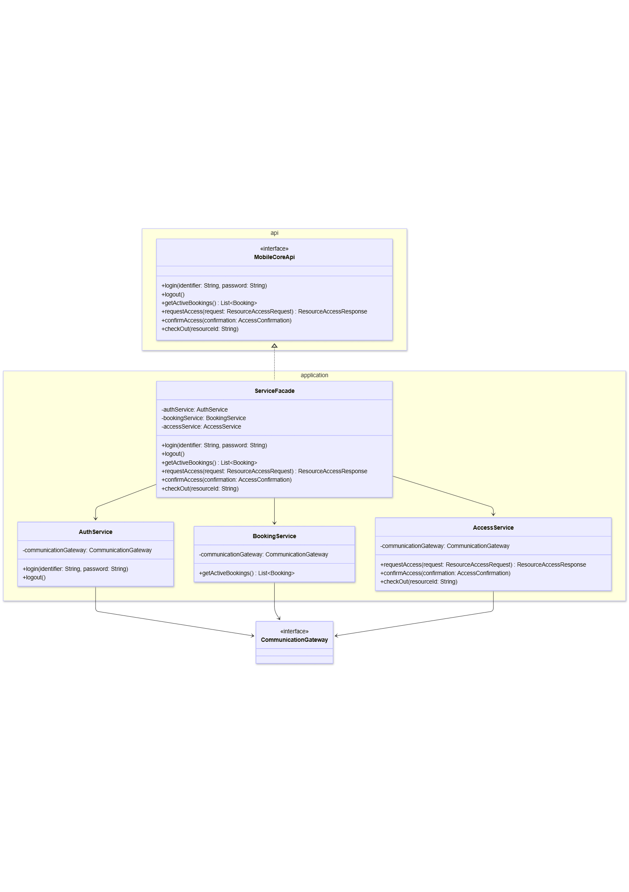{#fig-mobile-core-classes width=95%}


<a id="tbl-08-31"></a>

| Element | Description |
|:----------------------------------------|:------------------------------------------------------------|
| **ServiceFacade** |  **Purpose:** Implement `MobileCoreApi` and provide the entry point to application services. `\par\smallskip`{=latex} **Responsibilities:** Delegate authentication to `AuthService`, booking retrieval to `BookingService`, and access operations to `AccessService`; keep individual services behind the public contract. `\par\smallskip`{=latex} **Dependencies:** `MobileCoreApi`, `AuthService`, `BookingService`, `AccessService`. |
| **AuthService** |  **Purpose:** Coordinate application-level authentication and session operations. `\par\smallskip`{=latex} **Responsibilities:** Handle login and logout through the communication gateway; remain independent from token storage and refresh details. `\par\smallskip`{=latex} **Dependencies:** `CommunicationGateway`. |
| **BookingService** |  **Purpose:** Retrieve booking information for the current user. `\par\smallskip`{=latex} **Responsibilities:** Request active bookings through the gateway and expose the result as application models. `\par\smallskip`{=latex} **Dependencies:** `CommunicationGateway`, `Booking`. |
| **AccessService** |  **Purpose:** Coordinate the application-level resource-access lifecycle. `\par\smallskip`{=latex} **Responsibilities:** Request access, confirm its outcome, and initiate check-out through the gateway. `\par\smallskip`{=latex} **Dependencies:** `CommunicationGateway`, `ResourceAccessRequest`, `ResourceAccessResponse`, `AccessConfirmation`. |

: MobileCoreApplication — element, description {#tbl-08-31}


##### Application Models {.unnumbered}

\leavevmode\par

These models form the application-facing data contract shared by the public API, application services, and communication gateway. Their detailed attributes will be refined with the access and backend contracts.


<a id="tbl-08-32"></a>

| Element | Description |
|:----------------------------------------|:------------------------------------------------------------|
| **Booking** |  **Purpose:** Represent a booking at application level. `\par\smallskip`{=latex} **Responsibilities:** Provide booking information independently from its REST transport representation. `\par\smallskip`{=latex} **Dependencies:** None are defined in the current design. |
| **ResourceAccessRequest** |  **Purpose:** Represent an application-level request to access a resource. `\par\smallskip`{=latex} **Responsibilities:** Carry the information required by the access flow while keeping application services independent from the transport DTO. `\par\smallskip`{=latex} **Dependencies:** None are defined in the current design. |
| **ResourceAccessResponse** |  **Purpose:** Represent the application-level result of an access request. `\par\smallskip`{=latex} **Responsibilities:** Expose the access outcome while hiding the backend-specific transport representation. `\par\smallskip`{=latex} **Dependencies:** None are defined in the current design. |
| **AccessConfirmation** |  **Purpose:** Represent confirmation of a resource-access operation. `\par\smallskip`{=latex} **Responsibilities:** Carry confirmation information independently from the REST DTO. `\par\smallskip`{=latex} **Dependencies:** None are defined in the current design. |

: Application Models — element, description {#tbl-08-32}


##### Error Representation {.unnumbered}

\leavevmode\par

The shared error representation gives native applications a consistent description of application and communication failures.


<a id="tbl-08-33"></a>

| Element | Description |
|:----------------------------------------|:------------------------------------------------------------|
| **MobileCoreException** |  **Purpose:** Represent an expected application or communication failure. `\par\smallskip`{=latex} **Responsibilities:** Carry an error code, an optional diagnostic message, and an optional underlying cause. `\par\smallskip`{=latex} **Dependencies:** `MobileCoreErrorCode`, `Exception`, and an optional `Throwable` cause. |
| **MobileCoreErrorCode** | **Type:** Enumeration `\par\smallskip`{=latex} **Purpose:** Define the error categories exposed by the core. `\par\smallskip`{=latex} **Responsibilities:** Distinguish backend failures, connection errors, timeouts, and unrecognized failures. `\par\smallskip`{=latex} **Dependencies:** None. |

: Error Representation — element, description {#tbl-08-33}


#### BackendCommunication {.unnumbered}
The communication module provides the boundary between application operations and the backend REST API. It contains the communication contract, its implementation, the REST client, transport DTOs, and HTTP communication infrastructure.

Application models are converted to transport representations when sending requests. Received transport data is converted back into application models before it reaches the application services.

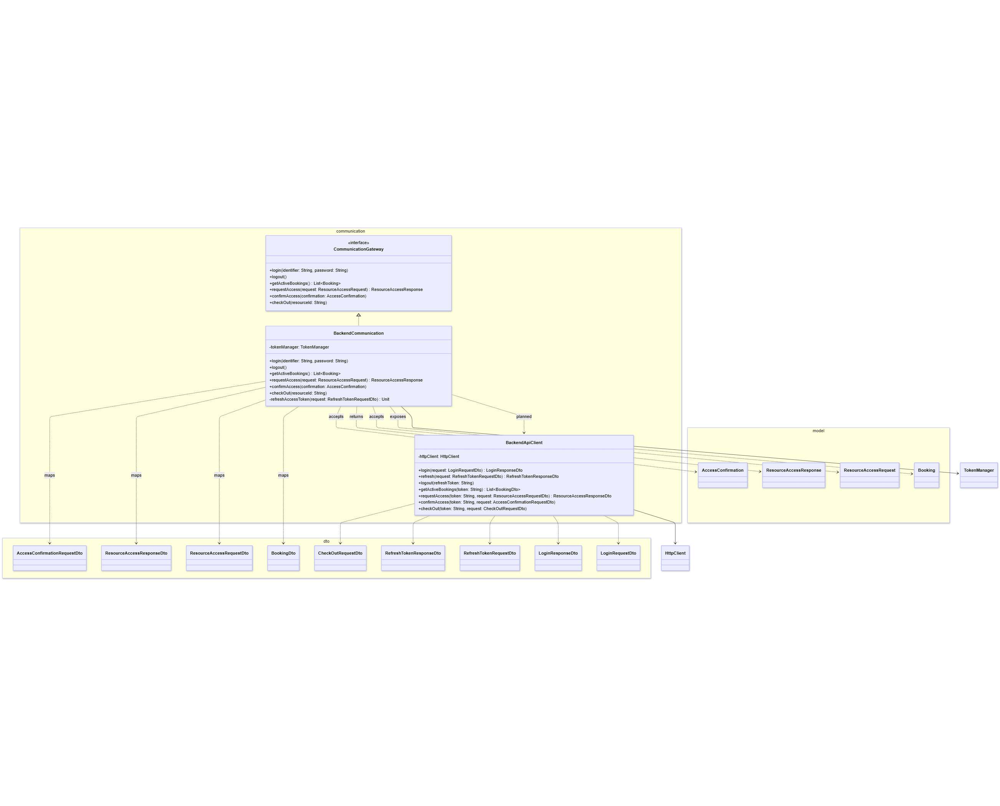{#fig-mobile-communication-classes width=100%}

The enlarged view below shows the operations of the three communication classes; the complete relationship overview remains above.

{#fig-mobile-communication-operations width=100% detail=operations}

##### CommunicationGateway {.unnumbered}

<a id="tbl-08-34"></a>

| Element | Description |
|:----------------------------------------|:------------------------------------------------------------|
| **CommunicationGateway** | **Purpose:** Define the application-facing contract for backend communication, independently from HTTP, endpoint formats, DTOs, and token-management details. `\par\smallskip`{=latex} **Responsibilities:** Expose backend capabilities using application-level types; isolate application services from transport details; hide authentication credential handling; define the boundary between application logic and backend communication. `\par\smallskip`{=latex} **Dependencies:** Application models, with no concrete HTTP dependency. The interface is implemented by `BackendCommunication`. |

: CommunicationGateway — element, description {#tbl-08-34}


###### Interface Operations {.unnumbered}

- `login(identifier: String, password: String)` authenticates the user. Returned credentials are handled internally by the communication and token components.

- `logout()` requests backend session revocation and local credential cleanup.

- `getActiveBookings()` returns active bookings as application `Booking` models.

- `requestAccess(request: ResourceAccessRequest)` sends an access request and returns a `ResourceAccessResponse`.

- `confirmAccess(confirmation: AccessConfirmation)` sends an access confirmation to the backend.

- `checkOut(resourceId: String)` requests completion of resource usage.

The operations are asynchronous. DTO creation, authentication headers, token refresh, and credential persistence remain internal concerns and are not exposed through the operation signatures.

##### Classes {.unnumbered}

\leavevmode\par


<a id="tbl-08-35"></a>

| Element | Description |
|:----------------------------------------|:------------------------------------------------------------|
| **BackendCommunication** | **Purpose:** Implement `CommunicationGateway` and adapt application operations to backend communication. `\par\smallskip`{=latex} **Responsibilities:** Convert models and DTOs; coordinate login, refresh, and logout; manage credentials through `TokenManager`; retry a protected operation once after successful refresh. `\par\smallskip`{=latex} **Dependencies:** `CommunicationGateway`, `BackendApiClient`, `TokenManager`, application models, and transport DTOs. |
| **BackendApiClient** | **Purpose:** Provide the low-level REST communication operations. `\par\smallskip`{=latex} **Responsibilities:** Send HTTP requests, exchange DTOs, attach supplied access credentials, and perform transport operations for authentication, bookings, resource access, and check-out. `\par\smallskip`{=latex} **Dependencies:** An HTTP communication system and transport DTOs. |

: Classes — element, description {#tbl-08-35}


##### Data Transfer Objects {.unnumbered}

\leavevmode\par

The communication module defines DTOs for the backend contract. They remain separate from application models so that transport formats can evolve independently. Their final attributes will be defined with the backend API.


<a id="tbl-08-36"></a>

| Element | Description |
|:----------------------------------------|:------------------------------------------------------------|
| **LoginRequestDto** | Contains the user identifier and password sent to the authentication endpoint. |
| **LoginResponseDto** | Contains the access and refresh tokens returned after successful authentication. |
| **RefreshTokenRequestDto** | Contains the current refresh token sent to renew authentication credentials. |
| **RefreshTokenResponseDto** | Contains the new access token and any replacement refresh token returned after successful renewal. |
| **BookingDto** | Contains booking information received from the backend and converted into an application `Booking` model. |
| **ResourceAccessRequestDto** | Contains the information sent to the backend to request access to a resource. |
| **ResourceAccessResponseDto** | Contains the backend's response to an access request, converted into an application `ResourceAccessResponse` model. |
| **AccessConfirmationRequestDto** | Contains the information sent to confirm the outcome of a resource-access operation. |
| **CheckOutRequestDto** | Contains the information sent to complete resource usage through check-out. |

: Data Transfer Objects — element, description {#tbl-08-36}

##### HTTP Communication {.unnumbered}

\leavevmode\par

The communication module will use an HTTP communication system to exchange requests and responses with the backend. This system will support request execution, authentication headers, transport-data conversion, timeouts, and communication-error handling.

The concrete HTTP library, platform configuration, and client initialization are implementation choices and will be documented in Chapter 5. They do not define additional architectural modules in this design.

#### TokenManager {.unnumbered}
The token-management module owns local authentication credentials. It uses the public `SecureStorage` contract supplied by the native application and remains independent from backend communication.

The interface is defined in the `api` package. The existing diagram retains the relationship between the token manager and this external storage contract.

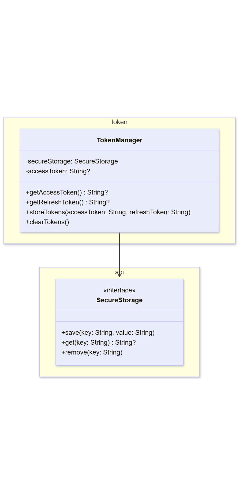{#fig-mobile-token-classes width=80%}


<a id="tbl-08-37"></a>

| Element | Description |
|:----------------------------------------|:------------------------------------------------------------|
| **TokenManager** | **Purpose:** Manage local authentication credentials. `\par\smallskip`{=latex} **Responsibilities:** Keep the access token in memory; persist and retrieve the refresh token through protected storage; replace credentials after login or refresh; clear credentials when the session ends. `\par\smallskip`{=latex} **Dependencies:** `SecureStorage`. |

: TokenManager — element, description {#tbl-08-37}


The component provides operations to obtain the access token, obtain the refresh token, store replacement credentials, and clear local credentials. Token renewal itself is coordinated by `BackendCommunication`.

### Database Schema and Constraints {#database-schema-and-constraints}

This is the documented data-model catalogue. The [implementation discrepancies](05-implementation.md#implementation-discrepancies) distinguish its claims from the supplied V1 migration.


<!-- Author: Reconcile the preserved ERD with V1 and the cardinality conflict before including it. -->

#### Core Entities {.unnumbered}

##### User {.unnumbered}
`id`, `email`, `password_hash` (VARCHAR, **nullable** – supports external or token-based authentication providers), `role` (VARCHAR), `status` (VARCHAR), `created_at` (TIMESTAMPTZ), `first_name`, `last_name`, `start_semester`, `field_of_study`, `failed_attempts`, `locked_until` (TIMESTAMPTZ)

##### Device {.unnumbered}
`id`, `user_id` (FK), `name`, `public_key`, `created_at` (TIMESTAMPTZ), `revoked_at` (TIMESTAMPTZ)

##### RefreshToken {.unnumbered}
`id`, `user_id` (FK), `token_hash`, `expires_at` (TIMESTAMPTZ), `revoked_at` (TIMESTAMPTZ)

##### OneTimeToken {.unnumbered}
`id`, `user_id` (FK), `token_hash`, `purpose` (VARCHAR), `expires_at` (TIMESTAMPTZ), `used_at` (TIMESTAMPTZ), `created_by_user_id` (FK)

##### Resource {.unnumbered}
`id`, `name`, `description`, `price_per_hour` (DECIMAL), `status` (VARCHAR), `type` (VARCHAR), `position` (VARCHAR)

##### Terminal {.unnumbered}
`id`, `public_key`, `status` (VARCHAR), `resource_id` (FK, UNIQUE)

##### Booking {.unnumbered}
`id`, `user_id` (FK), `resource_id` (FK), `start_time` (TIMESTAMPTZ), `end_time` (TIMESTAMPTZ), `status` (VARCHAR), `locked_price` (DECIMAL)
* **Constraints:** Enforces `CHECK (end_time > start_time)` and a PostgreSQL `EXCLUDE USING gist` constraint to prevent overlapping active bookings for the same resource.

##### Receipt {.unnumbered}
`id` (UUID), `booking_id` (FK), `terminal_id` (FK), `ticket_id`, `type` (VARCHAR), `receipt_time` (TIMESTAMPTZ), `signature`, `received_at` (TIMESTAMPTZ)

##### Invoice {.unnumbered}
`id`, `invoice_number`, `booking_id` (FK, UNIQUE), `user_id` (FK), `final_price` (DECIMAL), `pdf_file_path`, `status` (VARCHAR), `created_at` (TIMESTAMPTZ), `type` (VARCHAR), `qr_reference`, `due_date`, `paid_at` (TIMESTAMPTZ), `currency` (VARCHAR)

##### Availability {.unnumbered}
`id`, `resource_id` (FK), `day_of_week` (SMALLINT), `start_time`, `end_time`, `permitted_role` (VARCHAR)

##### AuditLog {.unnumbered}
`id`, `actor_user_id` (FK), `action` (VARCHAR), `target_entity` (VARCHAR), `timestamp` (TIMESTAMPTZ), `details` (JSONB), `target_id`, `outcome` (VARCHAR), `ip_address` (VARCHAR)

#### Relationships & Cardinalities {.unnumbered}
- **User -> Booking ($1 : n$):** A user can place multiple bookings over time.
- **User -> Device ($1 : n$):** A user can register multiple authentication devices.
- **User -> RefreshToken ($1 : n$):** A user can maintain multiple active authentication sessions.
- **User -> OneTimeToken ($1 : n$):** A user can have multiple tokens issued for or by them (`created_by_user_id`).
- **User -> Invoice ($1 : n$):** A user is assigned to all invoices generated for their bookings.
- **User -> AuditLog ($1 : n$):** A user triggers multiple logged system actions (`actor_user_id`).
- **Resource -> Booking ($1 : n$):** A bookable resource can have multiple scheduled bookings.
- **Resource -> Availability ($1 : n$):** A resource defines multiple time-window access rules across days of the week.
- **Terminal -> Resource ($1 : 1$):** Each hardware terminal is assigned to exactly one physical resource (`resource_id` in `terminal`).
- **Terminal -> Receipt ($1 : n$):** A physical terminal generates and signs multiple access receipts.
- **Booking -> Receipt ($1 : n$):** A single booking session tracks check-in and check-out receipts.
- **Booking -> Invoice ($1 : 1$):** Every completed/billable booking correlates to exactly one invoice (`UNIQUE` constraint on `booking_id`).

### Terminal Modules and Interfaces {#terminal-modules-and-interfaces}

T-016 names proposed interfaces and classes; the language and detailed method implementations remain open. The architecture and normal action flow are explained in [Door Terminal Design](03-ideas-and-concepts.md#door-terminal-design).


<a id="tbl-08-38"></a>

| Module | Responsibility | Classes and dependencies |
|---|---|---|
| BLE and protocol | Advertise the service, manage connections, run the protected handshake and translate BLE messages into controller requests. Split and reassemble long messages; check order and maximum total size. | `BleProtocol`, `BleTransport`.`\newline`{=latex} Uses `TerminalController`, `SecurityService` and the platform BLE stack. |
| Access control | Create and manage challenges, coordinate ticket and device-proof checks, and decide whether an action is allowed. Handle repeated requests, receipt recovery and synchronization acknowledgments. | `TerminalController`.`\newline`{=latex} Uses `RecordStore`, `SecurityService`, `Clock`, `DoorControl` and `Feedback`. |
| Storage | Save the local loan state, operation records, signed receipts and configuration. Keep records across restarts and report storage problems. | `RecordStore`, implemented by `FlashRecordStore`.`\newline`{=latex} Uses non-volatile flash storage. |
| Security | Supply secure random values, verify signatures, sign receipts and support session protection. Manage access to the terminal key. | `SecurityService`, implemented by `PlatformSecurity`.`\newline`{=latex} Uses platform cryptography and key storage. |
| Time | Read the RTC and report whether its time is reliable enough for ticket checks. | `Clock`, implemented by `Ds3231Clock`.`\newline`{=latex} Uses the DS3231 over I2C. |
| Door control | Read the door contact and command the servo. Request the locking position only when the contact reports closed. | `DoorControl`, implemented by `ServoDoorControl`.`\newline`{=latex} Uses servo PWM and the door-contact input. |
| Feedback | Show the action result through the RGB LED and buzzer, using the signals proposed in T-015. | `Feedback`, implemented by `RgbBuzzerFeedback`.`\newline`{=latex} Uses the RGB LED and buzzer outputs. |
| Startup and setup | Load configuration, check the services and restore the intended latch position. Provide a local USB setup path for identifiers, keys and time. | `TerminalSupervisor`.`\newline`{=latex} Creates the controller and services; starts BLE after the startup checks. |

: Terminal Modules and Interfaces — module, responsibility {#tbl-08-38}


#### Main classes and interfaces {.unnumbered}
The diagram shows the classes and interfaces in the terminal module catalogue, including startup, BLE transport and the five service implementations.

{#fig-terminal-core-classes width=100%}

*Only selected operations are shown. Dashed arrows with ordinary arrowheads show dependencies; labels identify creation and startup. Hollow triangles point from each implementation to its interface.*

`saveTogether(record)` saves the loan state, event and receipt as one operation. The diagram leaves parameter types and detailed signatures for implementation. The same boundaries can be expressed through classes or modules in the language selected later.

`FlashRecordStore` must keep the loan state, event and receipt consistent across power loss; separate [NVS key writes](https://docs.espressif.com/projects/esp-idf/en/stable/esp32s3/api-reference/storage/nvs_flash.html#security-tampering-and-robustness) do not provide a shared transaction, so the storage layout still needs to be chosen and validated.

`Ds3231Clock` reports unreliable time when the [oscillator-stop flag](https://www.analog.com/media/en/technical-documentation/data-sheets/ds3231.pdf#page=14) is set; a clear flag alone does not establish correct time.

### Web Interface Reference {#web-interface-reference}

#### Required Web Screens {.unnumbered}
Based on the defined use cases, the web application comprises the following functional screens:

* **Public & Authentication:**
  * `S-01: Sign In Screen` (UC-01) – Authentication for all roles via credentials.
  * `S-02: Account Registration Screen` (UC-02) – Single-use invitation link onboarding.
  * `S-03: Password Reset Screen` (UC-01) – Password recovery flow.
* **Ordinary User Space (Student / Lecturer):**
  * `S-04: Resource Catalog & Availability` (UC-03) – Search, filter, and inspect availability.
  * `S-05: Resource Detail & Booking Modal` (UC-04) – Slot selection and booking submission.
  * `S-06: My Bookings & Linked Devices` (UC-05) – View, modify, or cancel personal active and past bookings, and view active mobile device authorizations.
  * `S-07: My Invoices` (UC-06) – Inspect payment status (`DUE`, `PENDING`, `PAID`) and download PDF invoices.
* **Administrative Space:**
  * `S-08: User Management` (UC-07) – User list, role changes, deactivation, and invitation link generation.
  * `S-09: Resource & Terminal Administration` (UC-08) – Manage resources, pricing rules, and link/decommission terminals.
  * `S-10: Global Bookings Overview` (UC-09) – System-wide booking inspection and administrative overrides.
  * `S-11: Billing & Invoice Management` (UC-10) – Global invoice ledger and manual payment status updates.
  * `S-12: Audit Logs & Sync Conflicts` (UC-11) – Read-only system audit trail and offline conflict review.
* **Responsive Mobile Web Views:**
  * `Mobile S-04, S-05, S-06` – Mobile-optimized viewport layouts (375px) featuring hamburger navigation, stacked filters, and card-based resource/booking views.

---

*Figma Prototype:* [BLE Booking System Figma Prototype](https://www.figma.com/design/QzahEEhEJQ6pndblTa12Vl/UI-prototype?node-id=3-17762&t=Y9g1sM36tJAp3LoM-1)

#### Key Screen Wireframes {.unnumbered}
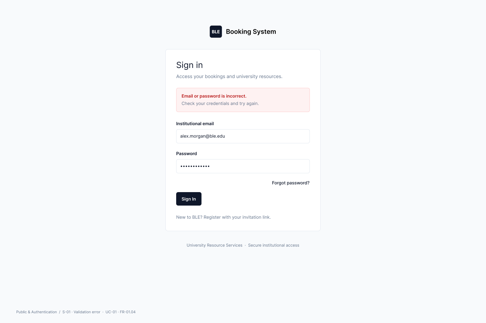{#fig-s01-signin width=100%}

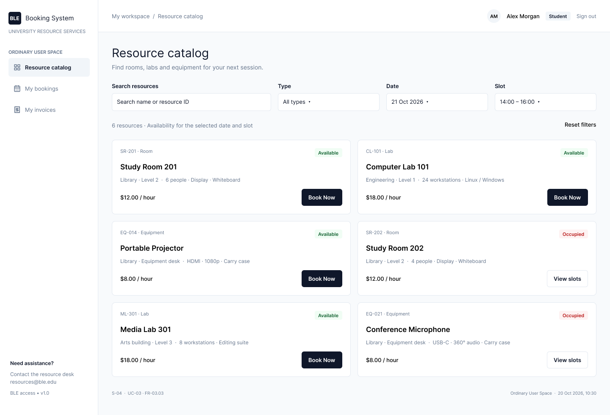{#fig-s04-catalog width=100%}

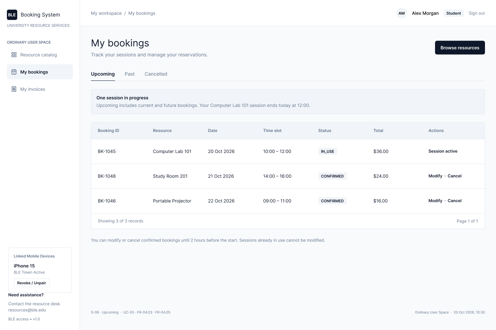{#fig-s06-my-bookings width=100%}

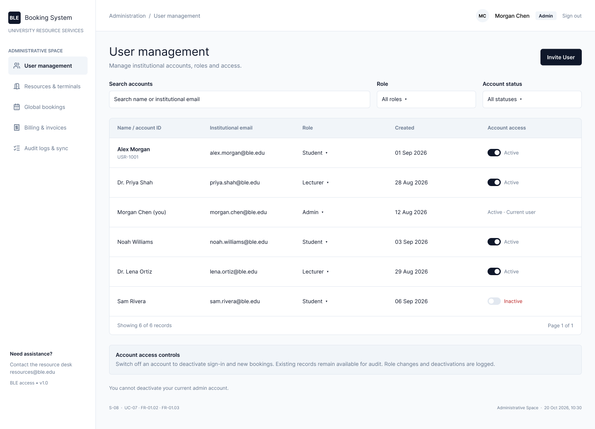{#fig-s08-admin-users width=100%}

## Test Plans and Available Evidence

### Backend Test Plan {#backend-test-plan}

The following is the planned backend test concept. Its workflow, branch-protection and schema statements are not execution evidence; repository differences are recorded in Chapter 5.


Backend tests are written together with the code. For business rules and security checks, the test is written first: it describes the expected behaviour, fails, and passes once the feature is implemented.

**Test levels.**


<a id="tbl-08-39"></a>

| Level | What is tested | Tools |
|---|-----|----|
| Unit tests | Business rules in services and entities, without Spring and without a database, e.g. booking status changes or the 15-minute no-show rule | JUnit 5, Mockito, AssertJ |
| Integration tests | Complete HTTP requests through all layers, including security, validation and error responses, against a real PostgreSQL with the schema from `database/init.sql`, e.g. two overlapping bookings, 401 without token, 403 for a wrong role, 404 for another user's booking | `@SpringBootTest`, MockMvc, Spring Security Test, Testcontainers |
| Architecture tests | The rules of the code structure: controllers do not use repositories, repositories are only used in their own package, no cycles between packages | ArchUnit |

: Backend Test Plan — level, what is tested {#tbl-08-39}


**Test data and dependencies.**

- Each integration test starts with an empty database and creates its own test data. Tests do not depend on each other.
- Time is taken from an injected `Clock`, so time rules can be tested with a fixed time instead of waiting.
- Key pairs for devices and terminals are generated in the test. A test helper signs receipts like a real terminal, so check-in and check-out can be tested without hardware.
- Email is replaced by a fake implementation that only records the sent messages.
- The mobile app and the terminal are not part of the backend tests. The complete flow across all components is tested separately (Chapter 6).

**Naming and execution.** Test classes mirror the packages of the code. Unit tests end with `Test` and run with `./mvnw test` in a few seconds. Integration and architecture tests end with `IT` and run additionally with `./mvnw verify`. JaCoCo creates a coverage report; there is no fixed coverage limit, the focus is on business rules and security.

**Continuous integration.** A GitHub Actions workflow (`.github/workflows/backend.yml`) runs `./mvnw verify` on every pull request and on every push to `main`, but only when files in `backend/` or `database/` change. The standard GitHub runners provide Docker, so Testcontainers also works there. A pull request can only be merged when all tests are green (branch protection on `main`). There is no automatic deployment, because the prototype is not deployed to a server.

**Workflow.** Each feature is developed on its own branch. The developer writes a failing test, implements the feature and refactors while the tests stay green. Before pushing, `./mvnw verify` runs all tests locally. The pull request triggers the CI workflow, which runs the same command in a clean environment. Only a green pipeline allows review and merge; a failing pipeline sends the change back to implementation on the same branch.

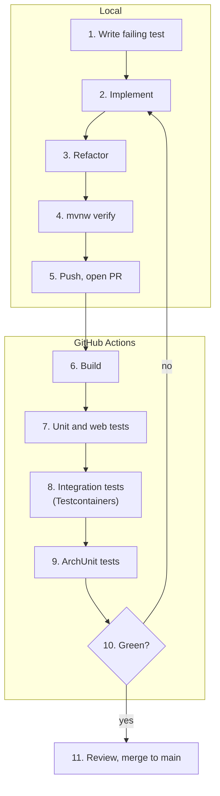{#fig-backend-test-workflow width=40%}

**Responsibilities.** The developer of a feature writes its tests in the same pull request. The reviewer checks that the important cases are tested before approving the pull request.

### Prepared Mobile Tests {#prepared-mobile-tests}


Automated unit tests have been prepared for the shared Kotlin Multiplatform core using `kotlin.test`, Kotlin’s standard multiplatform testing library. Its platform-independent annotations and assertions allow test code to be shared between Android and iOS. `kotlinx-coroutines-test` provides official support for testing suspending operations through `runTest`. Mokkery was selected for dependency mocking because it supports Kotlin Multiplatform and suspending methods.

Mocks replace dependencies with controlled responses, allowing each class to be tested independently. Application services use a mocked `CommunicationGateway`, while `TokenManager` uses a mocked `SecureStorage`. Tests can therefore specify successful results and errors without a running backend or native storage.

The current suite contains **19 test cases**:

- **AuthService:** four cases for login, logout, and error propagation.
- **BookingService:** three cases for empty and populated booking lists and communication errors.
- **AccessService:** six cases for access requests, confirmations, check-out, and related errors.
- **TokenManager:** six cases for credential retrieval, storage, replacement, and clearing.

All cases are currently marked `@Ignore` pending implementation. They specify expected behaviour but do not yet provide functional pass/fail results. `ServiceFacade` has no dedicated unit tests because, as a facade, it only forwards calls to the corresponding service methods.

Backend communication and credential renewal have not yet been tested. These tests are deferred until the REST requests and responses are defined and implemented. HTTP responses will then be simulated to verify client behaviour independently of a running backend.

Native protected storage, application screens, and BLE functionality remain untested on both Android and iOS. Planned platform tests cover discovery, connection, check-in/check-out, permissions, disconnections, and access feedback. The storage mocks do not verify actual credential protection or persistence on either platform.

### Remaining Prototype Hardware Checks


The selection is based on supplier and manufacturer specifications. These checks remain for the build:


<a id="tbl-08-40"></a>

| Area | Check |
|---|---|
| Mechanics | Test hinges, divider cutout and latch on a small test piece. Check screw lengths, panel clearance, latch travel, supports and space for components and USB cable. |
| Electrical setup | Supply stability during servo movement, servo response to 3.3 V control, buzzer current and audibility, and door-contact readings with both magnetic catches fitted. |
| Terminal functions | BLE with the team's phones, RTC backup, saved events and latch control after a restart, and check-out with a closed door. |

: Remaining Prototype Hardware Checks — area, check {#tbl-08-40}


The [terminal reference](08-appendices.md#terminal-modules-and-interfaces) describes the T-016 software modules and interfaces.

## Installation, Operation, and User Guides

### Local Database Setup {#local-database-setup}

The following T-014 record and later initialization account disagree on the PostgreSQL image and volume path. The [implementation discrepancies](05-implementation.md#implementation-discrepancies) identify the exact differences. The current repository configuration is reproduced first; the historical setup description follows for traceability.

```yaml
services:
  postgres:
    image: postgres:18-alpine
    container_name: ble_booking_db_container
    environment:
      POSTGRES_DB: ${POSTGRES_DB}
      POSTGRES_USER: ${POSTGRES_USER}
      POSTGRES_PASSWORD: ${POSTGRES_PASSWORD}
    ports:
      - "5433:5432"
    volumes:
      - postgres_data:/var/lib/postgresql

volumes:
  postgres_data:
```

#### Database Container Setup (Task T-014) {.unnumbered}
To ensure a consistent, isolated, and reproducible local development environment across all developer machines prior to cloud deployment, the local database infrastructure is provisioned using Docker Compose.

##### Technical Configuration {.unnumbered}
The local prototype utilizes PostgreSQL 16 Alpine within a container. To adhere to security best practices and prevent hardcoded credentials, sensitive configuration values are injected securely via an environment file (`.env`), which is excluded from version control via `.gitignore`.

The container setup declared in `docker-compose.yml` at the project root references these environment variables:

```yaml
services:
  postgres:
    image: postgres:16-alpine
    container_name: ble_booking_db_container
    environment:
      POSTGRES_DB: ${POSTGRES_DB}
      POSTGRES_USER: ${POSTGRES_USER}
      POSTGRES_PASSWORD: ${POSTGRES_PASSWORD}
    ports:
      - "5433:5432"
    volumes:
      - postgres_data:/var/lib/postgresql/data

volumes:
  postgres_data:
```

#### Key Architecture & Configuration Decisions {.unnumbered}
* **Container Image:** `postgres:16-alpine` was chosen for local execution to minimize resource consumption and speed up container startup times.
* **Port Mapping:** The container exposes port `5432` internally, mapped to host port `5433` (`5433:5432`) to prevent port collisions with pre-existing local PostgreSQL services on developers' workstations.
* **Security & Environment Separation:** Database credentials and configuration parameters are externalized into a local `.env` file (based on a template `.env.example`). Hardcoded plain-text passwords within the repository are strictly avoided.
* **Persistence:** A named Docker volume (`postgres_data`) preserves data across local container restarts, ensuring development state isn't lost.
* **Scope (Local vs. Cloud):** While production deployment will leverage cloud-managed database services, this containerized setup bridges local developer environments with production parity.

#### Execution & Management {.unnumbered}
Developers can manage the local database lifecycle via Docker CLI:

* **Start Database:** `docker compose up -d`
* **Stop Database:** `docker compose down`

#### Database Setup & Initialization Script {.unnumbered}
To ensure that the local development database can be provisioned automatically, cleanly, and in a reproducible manner from a fresh state, an automated initialization script mechanism has been implemented.

##### Implementation & Structure {.unnumbered}
- **Location:** The initial schema is located at `backend/src/main/resources/db/migration/V1__initial_schema.sql`.
- **Automatic Execution:** The PostgreSQL 18 Alpine container only provides an empty database. Flyway applies the migrations when the backend starts. Each migration runs only once; later schema changes are added as new migrations (`V2__...`).
*   **Schema & Verification:** The `V1__initial_schema.sql` migration sets up the initial baseline schema and tables (e.g., `sample_bookings`) required for the application's starting state.

#### Local Execution & Clean State Verification {.unnumbered}
Developers can initialize, reset, and verify the database lifecycle cleanly using Docker.

1.  **Clean Reset (Wipe existing data and containers):**
    ```bash
    docker compose down -v
    ```
    (The `-v` flag ensures that the persistent `postgres_data` volume is completely removed, establishing a true clean state).

2.  **Start and Initialize:**
    ```bash
    docker compose up -d
    ```
    (PostgreSQL starts up with an empty database. The schema is created by Flyway when the backend starts, from `backend/src/main/resources/db/migration`).

3.  **Verification:**
    After the backend has started once, developers can connect to the container via `psql` to verify the schema:
    ```bash
    docker exec -it ble_booking_db_container psql -U postgres -d ble_booking_db
    ```
    Running `\dt` inside the psql shell confirms that the initial tables have been successfully created.

### Mobile Development Commands

The operational README identifies `iosApp` as the native iOS entry point and `sharedLogic/src/commonMain/kotlin` as shared code. Native iOS work belongs in the Xcode project.

From `mobile/`, the documented Android build command is `./gradlew :androidApp:assembleDebug`; for iOS, open `iosApp` in Xcode and run from there. The shared-core test commands are `./gradlew :sharedLogic:testAndroidHostTest` and `./gradlew :sharedLogic:iosSimulatorArm64Test`. These are procedures, not records of successful execution. The README's additional `sharedUI` command is recorded as a source discrepancy in Chapter 5.

### Terminal Operation {#terminal-operation}

These are T-016 operating proposals for the selected hardware, not evidence of deployed firmware. The [main design](03-ideas-and-concepts.md#door-terminal-design) explains normal actions and the distinction between saved events and physical latch movement.

#### Startup after a power interruption {.unnumbered}
Before accepting new actions, the supervisor checks configuration, keys, storage and the clock. It reads the saved loan state before requesting any latch movement.


<a id="tbl-08-41"></a>

| Saved state and door reading | Planned latch behaviour |
|---|---|
| Active loan | Request the released position and keep the loan active. |
| No active loan; door closed | Request the locked position. |
| No active loan; door open | Wait for a closed-door reading before requesting the locked position. This creates no check-out event. |
| Saved state is missing after prior use, damaged or unreliable | Block new actions and do not guess a latch position. Restore the state through the agreed service procedure. |

: Startup after a power interruption — saved state and door reading, planned latch behaviour {#tbl-08-41}


A new terminal is initialized explicitly during setup; missing records after a reset must not be treated as a new, empty terminal. An unreliable clock or missing keys also prevents new authorized actions. Restoring the latch creates no additional usage event.

#### Failures and receipt recovery {.unnumbered}
Connection failures, authorization errors and unknown results follow [T-003 failure handling](03-ideas-and-concepts.md#failure-and-initial-recovery). The following cases also affect the terminal's hardware or storage:


<a id="tbl-08-42"></a>

| Situation | Result for the app | Terminal behaviour |
|---|---|---|
| Door open during a new check-out | Rejected: door open | Keep the loan active and latch released; rejection feedback. |
| Unreliable clock or full storage before saving | Rejected | Block new execution and retain pending records; technical-error feedback. Never overwrite unsynchronized events. |
| Failed or uncertain save | Rejected if the write clearly saved nothing; otherwise unknown | No latch command without a confirmed save. Retain records for recovery and block new actions if storage is unreliable. |

: Failures and receipt recovery — situation, result for the app {#tbl-08-42}


A rejected request leaves the latch released during an active loan. For read-only recovery, the controller issues a fresh challenge, verifies the original device key's proof and asks Storage for the receipt, without changing the loan or commanding the latch. Authorization and retry rules follow the [T-003 recovery proposal](08-appendices.md#ble-recovery-proposal).

Feedback uses the [LED and sound signals from T-015](08-appendices.md#led-and-sound-feedback).

The smartphone uploads receipts to the backend. Under the T-003 acknowledgment proposal, the controller verifies a backend-signed result before Storage marks an event as synchronized. Conflicts remain available for review. The acknowledgment return path and retention rules still need team agreement.

### Terminal Hardware Assembly {#terminal-hardware-assembly}


#### Enclosure layout {.unnumbered}
We use eight panels of 8 mm poplar plywood, plus a spare door panel. Each front panel has two metal hinges. We print the door handle, cover knob, servo latch and door catch, divider supports and component holders.

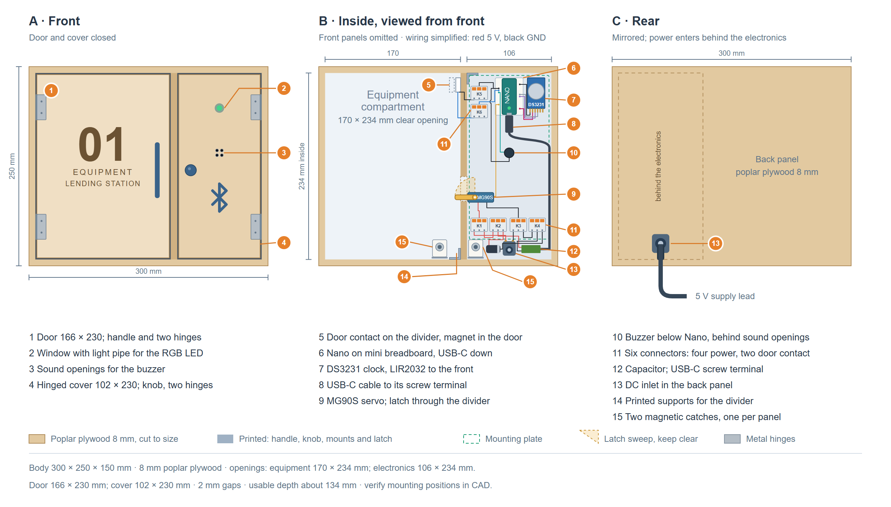{#fig-terminal-servo-locker-layout width=100%}

*A: front. B: front panels omitted. C: rear. Mounting layout based on the reserved panels; final clearances are checked on the prototype.*

The body measures 300 x 250 x 150 mm. A divider separates the 170 mm-wide equipment compartment from the 106 mm-wide electronics compartment. Usable depth is about 134 mm before fittings. The door is hinged on the left, the cover on the right.

We glue the body and divider, using printed corner guides for alignment. Two printed L-shaped rails support the divider at the top and bottom. The rails, hinges and other fittings are secured with M3 screws and nuts through the panel faces, avoiding the narrow edges.

The Nano sits at the top on a mini breadboard, with room below for its USB-C plug. The clock sits beside it so the backup cell stays accessible. The buzzer sits below the Nano, behind the sound openings beneath the LED window.

Power enters at the bottom rear, behind the lever connectors. A holder and strain relief secure the inlet. Cable ties keep the wiring along the outer wall and clear of the latch.

Two magnetic catches near the bottom hold the door and electronics cover closed. The door can therefore stay closed while the servo latch is released. The door contact sits at the top of the divider, with its magnet on the door, away from the servo and catches.

#### Servo and latch {.unnumbered}
The MG90S servo runs at 5 V and turns a printed latch on its horn. In the locked position, the latch engages the printed door catch. To release it, the servo turns the latch upwards by about a quarter-turn. A printed guide supports the latch. We adjust the end positions so the servo does not push continuously against a stop. We cannot verify this movement through the door contact, which only detects whether the door is closed.

{#fig-terminal-servo-latch-states width=100%}

#### Power supply and clock {.unnumbered}
An external 5 V / 4 A adapter powers the terminal through the rear DC inlet. Its output splits into two branches with a common ground:

- The servo receives power directly from the adapter, with a capacitor nearby to reduce voltage dips during movement.
- The Nano receives power through a USB-C cable with screw terminals.

This keeps the servo's supply current off the Nano and breadboard, following the [Arduino servo guide](https://docs.arduino.cc/learn/electronics/servo-motors/). For programming, we unplug the Nano's power cable and replace it with a USB-C data cable to the computer.

The DS3231 RTC keeps time offline. We supply it from the Nano at [3.3 V](https://www.analog.com/media/en/technical-documentation/data-sheets/ds3231.pdf) so its I2C pull-ups match the Nano's logic voltage.

A LIR2032 backup cell keeps the clock running when power is disconnected. We charge it with an external USB-C charger, since the module cannot fully charge it from 3.3 V. We set the time before first use and check it after replacing the backup cell.

#### LED and sound feedback {.unnumbered}
The Nano's built-in RGB LED shines through a light pipe, and an active buzzer gives short sound signals. We propose the following feedback for the prototype:


<a id="tbl-08-43"></a>

| Result | LED | Sound |
|---|---|---|
| Access authorized / action confirmed | Green | One short beep |
| Access rejected | Red | Two short beeps |
| Technical error | Orange | One longer beep |

: LED and sound feedback — result, led {#tbl-08-43}


#### Wiring {.unnumbered}
The diagram shows electrical connections, while the enclosure drawing shows their placement. Pin names follow the Nano's labels and the Arduino IDE's "By Arduino pin" numbering.

{#fig-terminal-wiring width=100%}

*Red: 5 V. Magenta: 3.3 V. Black: GND. Other colours: signals. Crossing wires connect only where a dot is shown.*

We use six lever connectors: two linked for 5 V, two linked for GND and two for the door-contact leads.


<a id="tbl-08-44"></a>

| Part | Connection |
|---|---|
| DC inlet (5.5 / 2.1 mm) | + to the 5 V lever connectors, − to the GND lever connectors |
| MG90S servo | Signal to D9; 5 V and GND from the lever connectors |
| Door contact | One wire to D2 with the internal pull-up, the other to GND; each joined to a jumper wire with a lever connector |
| Active buzzer | + to D3, − to Nano GND through the breadboard |
| DS3231 clock | VCC to 3V3, GND to GND, SDA to A4, SCL to A5; I2C address 0x68 |
| Nano ESP32 | USB-C cable: + to the 5 V lever connectors, − to GND; other cable terminals unused |
| 1000 µF capacitor | + to 5 V, − to GND at the lever connectors |

: Wiring — part, connection {#tbl-08-44}


The selected pins avoid the ESP32-S3's boot (strapping) pins. D0 and D1 remain free for serial communication.

#### Plywood cutting list {.unnumbered}
Finished sizes reserved on 20 October 2026; all panels are 8 mm thick.


<a id="tbl-08-45"></a>

| Qty | Panel | Size (mm) |
|---:|---|---|
| 1 | Back | 300 x 250 |
| 2 | Side | 142 x 250 |
| 2 | Top and bottom | 284 x 142 |
| 1 | Internal divider | 142 x 234 |
| 1 | Inset door | 166 x 230 |
| 1 | Hinged electronics cover | 102 x 230 |
| 1 | Spare door panel | 166 x 230 |

: Plywood cutting list — qty, panel {#tbl-08-45}


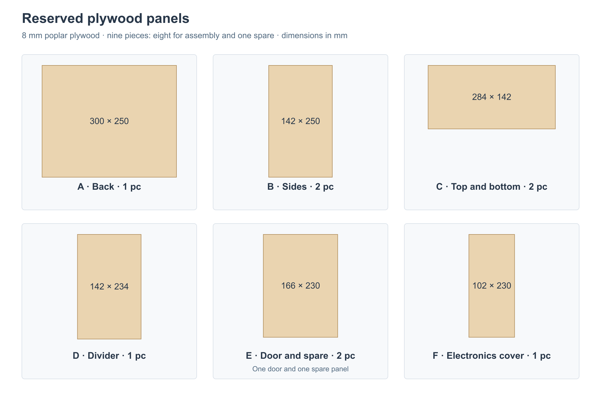{#fig-terminal-plywood-cutting-plan width=100%}

The panels meet the configurator's 100 x 230 mm minimum. Fitting holes, LED and sound openings, rear power entry and the latch cutout are made during assembly.

## Detailed Security Documentation

The following proposals support the BLE Access and Security Concept and Offline Operation and Synchronization sections. They define how saved receipts can be recovered and synchronized. The final cryptographic mechanisms, record retention, and automatic retry policy still require team agreement.

### BLE Recovery Proposal

This proposal details the read-only recovery used for an unknown BLE result and adds limited retries. The retry rules need team agreement before implementation.

#### Read-only recovery {.unnumbered}
Recovery asks the terminal for a saved receipt, using the original device key that was linked to the event. It can work after the ticket has expired. It does not extend permission, create an event, or grant access.

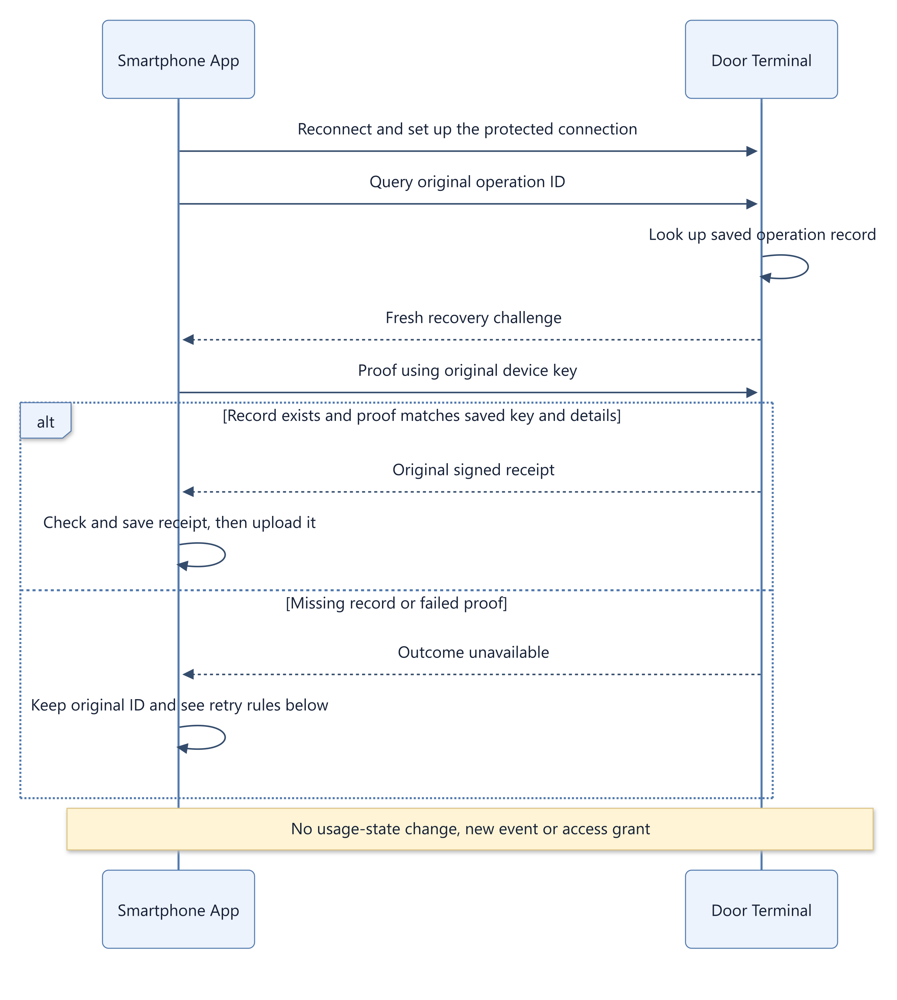{#fig-ble-recovery-flow width=100%}

The recovery proof covers a fresh challenge, the purpose "recovery", the operation ID, the terminal, and the protected session. A proof from a normal check-in or check-out therefore cannot be used for recovery, and a recovery proof cannot be used for an action. The terminal checks the proof before it shows any receipt details. It returns the same generic "unavailable" answer whether the record is missing or the proof fails, and it limits attempts. A different device does not automatically get the receipt; a lost device key needs a separate recovery path.

#### Limited retries {.unnumbered}
If recovery is unavailable, the app may retry the original action a limited number of times. It uses the same operation ID, a valid ticket, and a fresh device proof at the original terminal. The terminal returns the original receipt if the action was already saved, or saves it once if it is still allowed.

- The same operation ID cannot be used with a different booking, resource, action, terminal, or device key.
- A replacement ticket for the same action keeps the operation ID. Only its ticket ID and validity period change. It can be issued only while booking, time, and device are still eligible.
- A rejection is final only if the terminal has checked its complete, reliable saved history and no earlier attempt can still be saved. A rejection before that check, such as an invalid ticket or a failed proof, says nothing about the earlier attempt.

#### When the terminal cannot help {.unnumbered}
- If a reset or storage loss makes the terminal's saved state unreliable, it blocks all new actions until that state is restored.
- If the record of an operation is older than the agreed retention period, only this operation stays unresolved. A missing record does not prove that it never happened. It is resolved through the backend or an Admin before any retry.

### BLE Synchronization Proposal

The backend proposal uses the smartphone to carry signed receipts from the terminal to the backend. This proposal adds an acknowledgment back to the terminal, as a proposal for FR-05.04 and FR-05.05.

1. The terminal and the app keep events and receipts until they are synchronized. When the smartphone is online, the app uploads the original receipt over an authenticated, encrypted connection.
2. The backend checks the terminal, the signature, the event details, and the order of check-in and check-out. It uses the event ID to process each event once, without duplicate usage records or charges.
3. The backend signs its result: accepted, already accepted, or conflict. The result names the event and the terminal it belongs to. The app carries it back, and the terminal checks the backend signature and that the result matches one of its own stored events.
4. Only "accepted" or "already accepted" marks an event as synchronized. Conflicts are kept for Admin review. A rejected upload does not delete the terminal event or undo access already granted.

If no smartphone is available, events stay queued. If the queue is full, the terminal rejects new actions that it cannot save; it never deletes pending events to make room.

## Original Project Assignment {#original-project-assignment}

The supplied eight-page assignment is reproduced below in its original language and layout. Its NFC/BLE alternatives are narrowed by the project's BLE-only requirements; the original remains unchanged.

<!-- The build filter resolves this PDF path relative to the chapter. -->
::: {.original-assignment file="../../project-assignment.pdf" pages="8"}
:::
