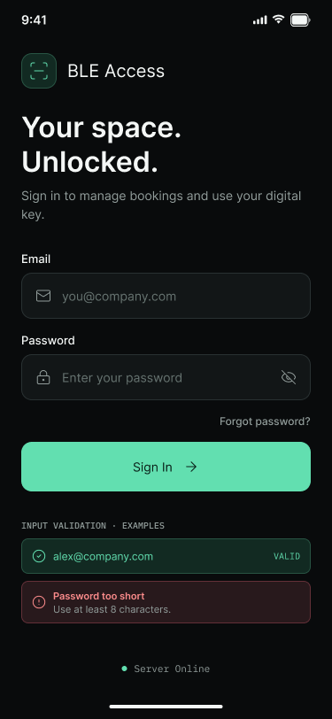
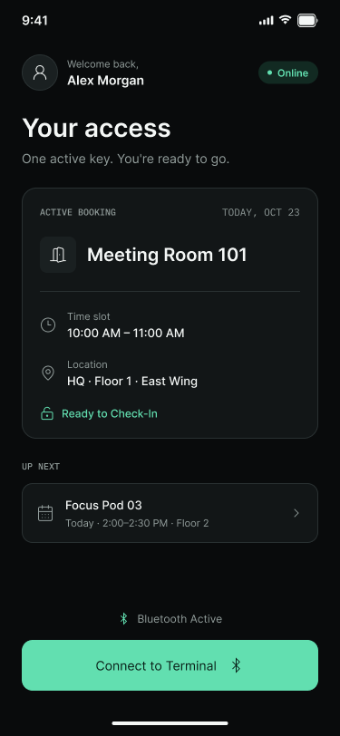
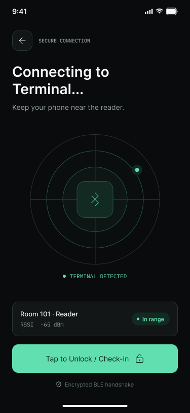
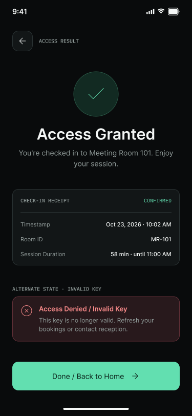

### Mobile Application UI

The native mobile application serves as a dedicated digital key and access verification tool for on-site physical check-in and check-out operations via Bluetooth Low Energy (BLE).

#### Mobile Use Cases Summary
* **M-UC-01 (Authentication):** User logs into the mobile application to retrieve active access entitlements.
* **M-UC-02 (View Active Entitlements):** User views current or upcoming valid bookings and associated BLE access keys.
* **M-UC-03 (BLE Handshake & Check-In):** User approaches the physical terminal, establishes a BLE connection, and executes check-in.
* **M-UC-04 (Check-Out & Access Revocation):** User completes check-out, terminating the active session and releasing the resource.
* **M-UC-05 (Offline & Error Feedback):** System provides explicit visual feedback for missing Bluetooth permissions, unauthorized access attempts, or network offline states.

---

#### Mobile Screen Specifications

##### M-01: Mobile Login & Authentication
* **Purpose:** Authenticates the user and fetches active digital credentials/tokens.
* **UI Components:**
  * Credentials input form (Email/Password or SSO option).
  * System status indicator (Online/Offline status).
* **States:** Standard input, validation error, successful authentication redirect.

##### M-02: Active Entitlements & Access Keys
* **Purpose:** Serves as the primary dashboard displaying active bookings ready for physical check-in.
* **UI Components:**
  * Active booking card (Resource name, time slot, location, lock status).
  * "Connect to Terminal" primary action button.
  * BLE status banner (Bluetooth Enabled / Disabled / Searching).
* **States:**
  * *Active State:* Displays valid booking with active check-in trigger.
  * *Empty State:* "No active bookings or access keys found."

##### M-03: BLE Connection & Terminal Handshake
* **Purpose:** Handles the physical proximity check and Bluetooth communication with the lock terminal.
* **UI Components:**
  * Animated radar/scanning indicator for terminal discovery.
  * Signal strength (RSSI) feedback.
  * Manual "Tap to Unlock / Check-In" action.
* **States:**
  * *Scanning State:* Searching for nearby BLE terminal UUIDs.
  * *Connected State:* Successful handshake with terminal.

##### M-04: Access Feedback & Status Result
* **Purpose:** Provides immediate visual and acoustic/haptic feedback on the access attempt result.
* **UI Components:**
  * High-visibility status badge (Success vs. Denied).
  * Transaction timestamp and session details.
  * Return to home / Retry action button.
* **States:**
  * *Access Granted (Success):* Lock opened / Check-in registered.
  * *Access Denied:* Invalid time window, unlinked device, or unauthorized user.
  * *Connection Error:* Terminal out of range or BLE timeout.

---

#### Figma Prototype Reference & Key Screens

*Figma Mobile Prototype:* [BLE Booking Mobile App Figma Prototype](https://www.figma.com/design/QH1wcmYcl2YjlT166uHUA8/Ohne-Namen?node-id=0-1&t=ZFzgtS7jGWUZrJUu-1)

##### Key Mobile Screen Wireframes

