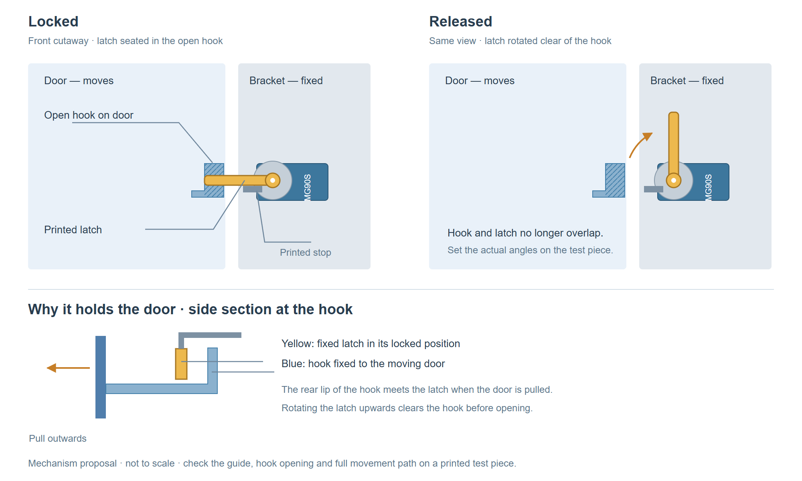
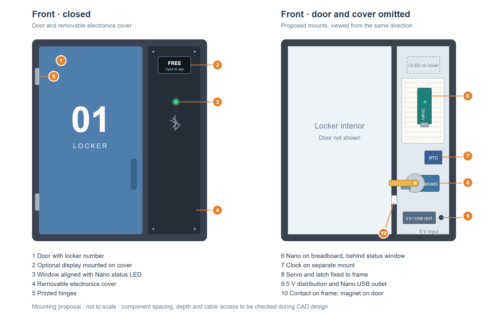

# Terminal prototype hardware selection

**T-015 · 14 October 2026 · Enabler EN-03.02**

The prototype uses an **Arduino Nano ESP32 with headers (ABX00083)** and an **MG90S micro servo** in a small 3D-printed locker. The smartphone communicates with the Nano over BLE. The servo turns a printed latch to hold or release the door.

The model runs from the existing USB-C powerbank at **5 V**. The [shopping list](terminal-hardware-shopping-list.md) totals **CHF 170.70**, including printing material, delivery and a CHF 15 reserve. An optional display brings the total to **CHF 181.60**.

## 1. Selection criteria

The selection follows the [project requirements](https://github.com/thomas-sartini/ble-booking-system/blob/main/planning/requirements.md), especially BLE identification and offline event recording in FR-05.01 to FR-05.04.

| Criterion | Requirement for the prototype |
|---|---|
| BLE | Exchange tickets, device proofs and receipts with the smartphone. |
| Local storage | Retain settings, keys, usage state and pending events after a restart. |
| Network connectivity | Support synchronization. The current backend proposal uses the smartphone to upload receipts; terminal Wi-Fi is an extension. |
| Connections | Connect a servo, door contact and battery-backed clock. |
| Development | Available documentation and examples for BLE, cryptography and storage. |
| Size and cost | Fit in a printed enclosure and keep the complete prototype within CHF 200. |

## 2. Hardware alternatives

All four boards provide BLE and Wi-Fi. They differ in size, connections, memory and software setup.

| Board | Hardware | Assessment |
|---|---|---|
| **Arduino Nano ESP32 with headers** | ESP32-S3; 16 MB flash; 8 MB PSRAM; USB-C; 45 × 18 mm. | Compact board with soldered headers and Arduino documentation. Has the connections needed for the servo, clock and contact. |
| **ESP32-S3-DevKitC-1-N8R8** | ESP32-S3; 8 MB flash; 8 MB PSRAM; more exposed GPIO pins. | More connections for expansion, with a larger board footprint. |
| **M5Stack Atom Lite** | ESP32-PICO-D4; 4 MB flash; no PSRAM; USB-C; 24 × 24 mm enclosure. | Small enclosed board, with fewer connections for additional modules. |
| **Raspberry Pi Zero 2 W** | Quad-core 1 GHz processor; 512 MB RAM; microSD storage; 65 × 30 mm. | Supports Linux and Python. Requires a microSD card, operating-system setup and a BLE GATT service. |

Specifications: [Arduino](https://store.arduino.cc/products/nano-esp32-with-headers), [Espressif](https://docs.espressif.com/projects/esp-dev-kits/en/latest/esp32s3/esp32-s3-devkitc-1/user_guide_v1.1.html), [M5Stack](https://docs.m5stack.com/en/core/Atom-Lite), [Raspberry Pi](https://www.raspberrypi.com/products/raspberry-pi-zero-2-w/).

## 3. Selected board: Arduino Nano ESP32

The Nano combines BLE, flash storage and the required connections in a narrow board. The version with headers simplifies the breadboard setup. Arduino documents board setup and debugging, and the board is listed at **CHF 19.50** at [Galaxus](https://www.galaxus.ch/de/s1/product/arduino-nano-esp32-with-headers-entwicklungsboard-kit-37112615).

The planned modules fit the Nano's connections. The DevKit's additional pins and the Pi's Linux environment are therefore not needed for this build. The Atom Lite is compact, but offers fewer connections for extensions.

Usage state and pending events are saved in flash. PSRAM is temporary working memory and loses its contents when power is removed. The ESP32-S3 supports [secure boot and flash encryption](https://docs.espressif.com/projects/esp-idf/en/stable/esp32s3/security/security.html); their configuration and the BLE security checks belong to the firmware work.

## 4. Locker prototype

### Servo and latch

The selected [MG90S](https://www.bastelgarage.ch/towerpro-micro-servo-mg90s-mit-metallgetriebe) is a positional servo with metal gears, operated at 5 V. It turns a short printed latch attached to its supplied horn.

- **Locked:** the latch enters an open hook on the inside edge of the closed door.
- **Released:** the latch rotates approximately a quarter-turn into the frame compartment and clears the catch.
- **Closing:** the latch remains clear until the door contact reports closed; it can then return to the locked position.

The servo is fixed to the frame. The catch moves with the door. A printed guide supports the latch, and a stop defines its locked end position. The motion must remain free: the servo should not continuously press against the stop. The exact angles are set on the test piece.

*Motion sketch, not to scale. The latch is behind the door catch; the front cutaway makes both visible. The guide and catch geometry are checked on a small printed test piece.*

A servo latch suits a lightweight demonstration model. Its position after a power cut is not guaranteed, and a servo command does not confirm that the door is locked.

### Printed enclosure

The printed parts are the locker body, door, hinges, servo holder, latch, catch and removable electronics cover. The Nano sits on a breadboard in the upper side compartment. The clock and power connections have separate mounts, leaving the servo's movement area clear.

*Both views look from the front. The right view omits the door and electronics cover. Component spacing, the LED window and access to the Nano USB connector are finalized after measuring the parts.*

The Nano's RGB LED provides basic status feedback through a window. Detailed messages appear in the app. The OLED is optional. The removable cover also allows manual access to the latch during testing.

### Power and supporting components

The existing powerbank connects through its **USB-C output** to an [Adafruit 5968 cable](https://www.adafruit.com/product/5968), which supplies **5 V**. The supply target is at least 2 A at 5 V for the combined prototype; the actual setup is checked during movement and idle.

The 5 V supply splits before the Nano: one branch powers the servo, and another powers the Nano through its USB-C connector using a USB-A power socket and an existing USB-A-to-C cable. Both branches share ground. A 1000 µF capacitor sits near the servo power connection. This follows the [Arduino servo guide](https://docs.arduino.cc/learn/electronics/servo-motors/) principle of keeping motor current out of the controller's supply path.

The Nano supplies the Adafruit DS3231 clock and optional display at 3.3 V. The clock uses a CR1220 backup cell. A magnetic contact reports door position; it does not confirm latch engagement.

## 5. Integration and next steps

The BLE flow stays the same: verify the ticket and device proof, save the event, and return a signed receipt. Physical access is released only after successful authorization and event storage. The smartphone uploads the receipt.

Door position and booking status are separate. Closing the door does not automatically check the user out. Reopening during an active booking follows the agreed access policy.

The first setup checks BLE with the team's phones, servo response to the Nano's control signal, power during movement and idle, startup behaviour, timekeeping and stored events after a restart. A small latch test print comes before the full enclosure.

T-016 defines the software modules and interfaces. Firmware implementation, final programming-language selection, CAD design and production hardware selection are outside T-015.
