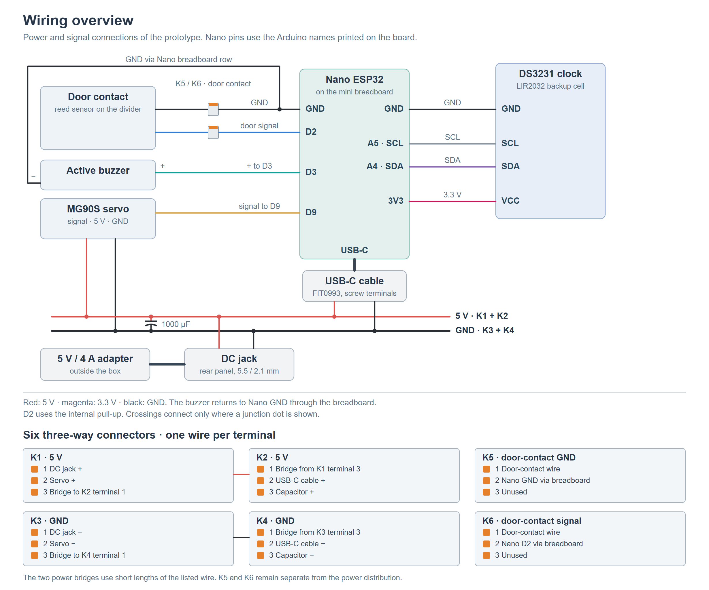
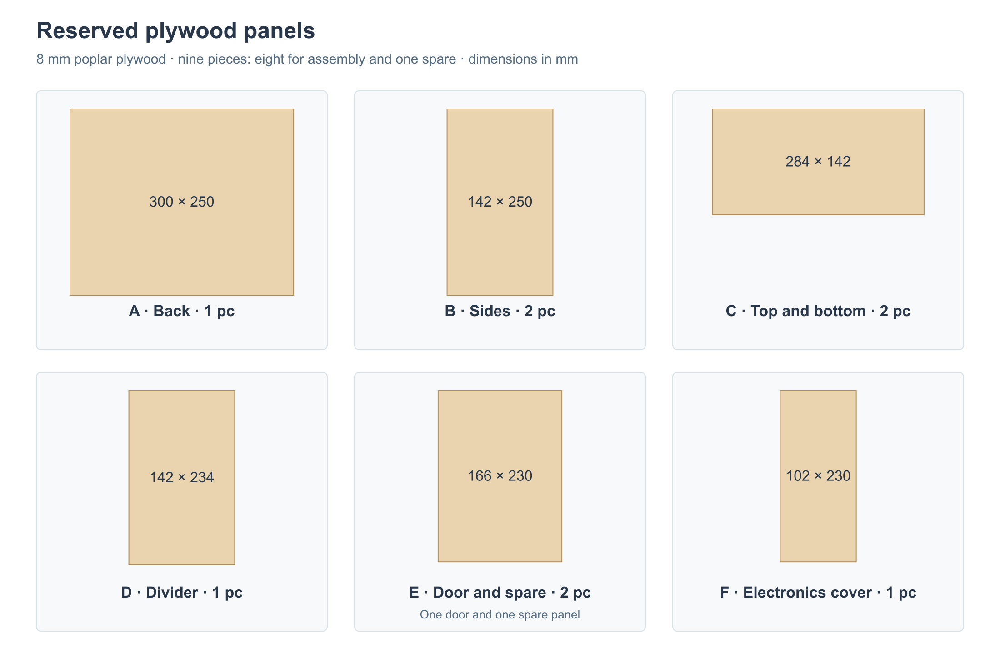

# Terminal prototype hardware selection

**T-015 · 14 October 2026 · Enabler EN-03.02**

*Document updated: 22 October 2026.*

We chose an Arduino Nano ESP32 (ABX00083) for our equipment lending station. A smartphone sends access requests over BLE, an MG90S servo moves the latch, and a magnetic contact detects whether the door is closed. The prototype uses a plywood body with printed holders and fittings.

The purchases total **CHF 131.80** against a CHF 200 budget. The 3D printer, filament, assembly screws and nuts are privately available. The separate [shopping list](terminal-hardware-shopping-list.md) gives the items and prices.

This spike covers the hardware choice and planned setup. Firmware implementation, language selection, detailed CAD and production hardware are outside its scope.

## 1. Selection criteria

The criteria follow the [project requirements](https://github.com/thomas-sartini/ble-booking-system/blob/main/planning/requirements.md), particularly FR-05.01 to FR-05.04 on BLE access and offline event recording.

| Criterion | Requirement for the prototype |
|---|---|
| BLE | Exchange tickets, device proofs and receipts with the smartphone. |
| Local storage | Retain settings, keys, usage state and pending events after a restart. |
| Network connectivity | The smartphone uploads receipts in the proposed BLE flow. Terminal Wi-Fi is available for later extensions. |
| Connections | Support a servo, door contact, I2C clock and buzzer. |
| Development | Documented interfaces, development tools and examples. |
| Size and cost | Fit inside a compact enclosure and keep the complete prototype within CHF 200. |

## 2. Hardware alternatives

All four boards support BLE and Wi-Fi. We compared their size, connections, price and delivery time. The prices and delivery times below refer to the offers we considered when ordering.

| Platform | Main specifications | Fit for the prototype |
|---|---|---|
| **[Arduino Nano ESP32 with headers](https://store.arduino.cc/products/nano-esp32-with-headers)** | ESP32-S3; 16 MB flash; 8 MB PSRAM; USB-C; 45 x 18 mm. | Compact board with fitted headers and enough connections for the planned components. CHF 19.50 at Galaxus, with pickup in Wohlen. |
| **[ESP32-S3-DevKitC-1-N8R8](https://docs.espressif.com/projects/esp-dev-kits/en/latest/esp32s3/esp32-s3-devkitc-1/user_guide_v1.1.html)** | ESP32-S3; 8 MB flash; 8 MB PSRAM; more exposed GPIO pins. | Also covers the planned functions, but needs more mounting space. The offer we compared cost about twice as much as the Nano and would have arrived around a week and a half later. |
| **[M5Stack Atom Lite](https://docs.m5stack.com/en/core/Atom-Lite)** | ESP32-PICO-D4; 4 MB flash; USB-C; 24 x 24 mm enclosure. | Compact board with an enclosure and RGB LED. It exposes fewer GPIO pins than the Nano, leaving less room for additional components. |
| **[Raspberry Pi Zero 2 W](https://www.raspberrypi.com/products/raspberry-pi-zero-2-w/)** | Quad-core 1 GHz processor; 512 MB RAM; microSD storage; 65 x 30 mm. | Provides a Linux environment for Python development. We would also need to set up and maintain the operating system on a microSD card. |

## 3. Selected board: Arduino Nano ESP32

We chose the Nano ESP32 because it covers our requirements in a compact board. Compared with the DevKit offer, its lower price and earlier availability mattered more to us than additional GPIO pins.

We selected the version with fitted headers to avoid soldering them ourselves. For setup and programming, we can use Arduino's [Nano ESP32 guides](https://docs.arduino.cc/hardware/nano-esp32/) and Espressif's [Arduino-ESP32 documentation](https://docs.espressif.com/projects/arduino-esp32/en/latest/getting_started.html).

## 4. Equipment borrowing and return

The compartment holds one assigned item. The user opens and closes the door by hand. The servo only moves the latch.

| Action | Terminal behaviour |
|---|---|
| **CHECK_IN — borrow** | The terminal verifies the BLE authorization and saves CHECK_IN before releasing the latch. The user opens the door and removes the equipment. |
| **CHECK_OUT — return** | The user returns the equipment, closes the door and requests check-out in the app. With valid authorization and a closed-door reading, the terminal saves CHECK_OUT and locks the latch. |

The latch stays released throughout the loan. Closing the door alone does not end it or lock the compartment. This also means equipment left inside after check-in, or returned without check-out, remains unlocked.

After a restart, the saved loan state determines the latch position: released during a loan, otherwise locked once the door is closed. If the saved state cannot be trusted, the terminal blocks new actions until it is restored.

The door contact detects closure, not the equipment itself. The actions follow T-003's ticket and receipt flow.

## 5. Hardware setup

### Enclosure layout

We use eight panels of 8 mm poplar plywood, plus a spare door panel. Each front panel has two metal hinges. We print the door handle, cover knob, servo latch and door catch, divider supports and component holders.

*A: front. B: front panels omitted. C: rear. Mounting layout based on the reserved panels; final clearances are checked on the prototype.*

The body measures 300 x 250 x 150 mm. A divider separates the 170 mm-wide equipment compartment from the 106 mm-wide electronics compartment. Usable depth is about 134 mm before fittings. The door is hinged on the left, the cover on the right.

We glue the body and divider, using printed corner guides for alignment. Two printed L-shaped rails support the divider at the top and bottom. The rails, hinges and other fittings are secured with M3 screws and nuts through the panel faces, avoiding the narrow edges.

The Nano sits at the top on a mini breadboard, with room below for its USB-C plug. The clock sits beside it so the backup cell stays accessible. The buzzer sits below the Nano, behind the sound openings beneath the LED window.

Power enters at the bottom rear, behind the lever connectors. A holder and strain relief secure the inlet. Cable ties keep the wiring along the outer wall and clear of the latch.

Two magnetic catches near the bottom hold the door and electronics cover closed. The door can therefore stay closed while the servo latch is released. The door contact sits at the top of the divider, with its magnet on the door, away from the servo and catches.

### Servo and latch

The MG90S servo runs at 5 V and turns a printed latch on its horn. In the locked position, the latch engages the printed door catch. To release it, the servo turns the latch upwards by about a quarter-turn. A printed guide supports the latch. We adjust the end positions so the servo does not push continuously against a stop. We cannot verify this movement through the door contact, which only detects whether the door is closed.

### Power supply and clock

An external 5 V / 4 A adapter powers the terminal through the rear DC inlet. Its output splits into two branches with a common ground:

- The servo receives power directly from the adapter, with a capacitor nearby to reduce voltage dips during movement.
- The Nano receives power through a USB-C cable with screw terminals.

This keeps the servo's supply current off the Nano and breadboard, following the [Arduino servo guide](https://docs.arduino.cc/learn/electronics/servo-motors/). For programming, we unplug the Nano's power cable and replace it with a USB-C data cable to the computer.

The DS3231 RTC keeps time offline. We supply it from the Nano at [3.3 V](https://www.analog.com/media/en/technical-documentation/data-sheets/ds3231.pdf) so its I2C pull-ups match the Nano's logic voltage.

A LIR2032 backup cell keeps the clock running when power is disconnected. We charge it with an external USB-C charger, since the module cannot fully charge it from 3.3 V. We set the time before first use and check it after replacing the backup cell.

### LED and sound feedback

The Nano's built-in RGB LED shines through a light pipe, and an active buzzer gives short sound signals. We propose the following feedback for the prototype:

| Result | LED | Sound |
|---|---|---|
| Access authorized / action confirmed | Green | One short beep |
| Access rejected | Red | Two short beeps |
| Technical error | Orange | One longer beep |

### Wiring

The diagram shows electrical connections, while the enclosure drawing shows their placement. Pin names follow the Nano's labels and the Arduino IDE's "By Arduino pin" numbering.

*Red: 5 V. Magenta: 3.3 V. Black: GND. Other colours: signals. Crossing wires connect only where a dot is shown.*

We use six lever connectors: two linked for 5 V, two linked for GND and two for the door-contact leads.

| Part | Connection |
|---|---|
| DC inlet (5.5 / 2.1 mm) | + to the 5 V lever connectors, − to the GND lever connectors |
| MG90S servo | Signal to D9; 5 V and GND from the lever connectors |
| Door contact | One wire to D2 with the internal pull-up, the other to GND; each joined to a jumper wire with a lever connector |
| Active buzzer | + to D3, − to Nano GND through the breadboard |
| DS3231 clock | VCC to 3V3, GND to GND, SDA to A4, SCL to A5; I2C address 0x68 |
| Nano ESP32 | USB-C cable: + to the 5 V lever connectors, − to GND; other cable terminals unused |
| 1000 µF capacitor | + to 5 V, − to GND at the lever connectors |

The selected pins avoid the ESP32-S3's boot (strapping) pins. D0 and D1 remain free for serial communication.

### Plywood cutting list

Finished sizes reserved on 20 October 2026; all panels are 8 mm thick.

| Qty | Panel | Size (mm) |
|---:|---|---|
| 1 | Back | 300 x 250 |
| 2 | Side | 142 x 250 |
| 2 | Top and bottom | 284 x 142 |
| 1 | Internal divider | 142 x 234 |
| 1 | Inset door | 166 x 230 |
| 1 | Hinged electronics cover | 102 x 230 |
| 1 | Spare door panel | 166 x 230 |

The panels meet the configurator's 100 x 230 mm minimum. Fitting holes, LED and sound openings, rear power entry and the latch cutout are made during assembly.

## 6. Remaining prototype checks

The selection is based on supplier and manufacturer specifications. These checks remain for the build:

| Area | Check |
|---|---|
| Mechanics | Test hinges, divider cutout and latch on a small test piece. Check screw lengths, panel clearance, latch travel, supports and space for components and USB cable. |
| Electrical setup | Supply stability during servo movement, servo response to 3.3 V control, buzzer current and audibility, and door-contact readings with both magnetic catches fitted. |
| Terminal functions | BLE with the team's phones, RTC backup, saved events and latch control after a restart, and check-out with a closed door. |

T-016 describes the terminal software modules and interfaces.
