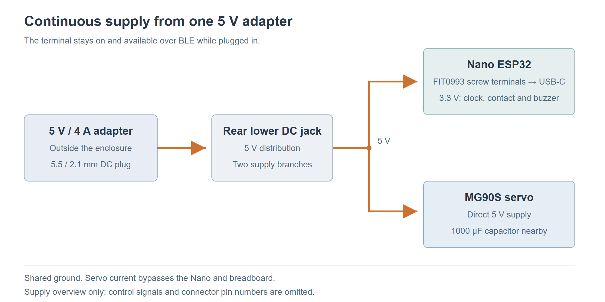

# Terminal prototype hardware selection

**T-015 · 14 October 2026 · Enabler EN-03.02**

*Document updated: 17 October 2026. Prices and supplier availability checked: 16 October 2026.*

We plan to build a small equipment lending station based on an Arduino Nano ESP32 (ABX00083). The smartphone connects to it over BLE. An MG90S servo moves the latch, a magnetic contact detects whether the door is closed, and a clock with a backup cell keeps time when power is disconnected. The Nano's RGB LED and an active buzzer give feedback. For the box, we use plywood and smaller printed parts.

One external 5 V / 4 A power supply runs the prototype. The listed purchases total **CHF 131.65**, including plywood, wood glue and an estimated cutting charge. A 3D printer, filament, assembly screws and nuts are provided privately and are not charged to the project. The [shopping list](terminal-hardware-shopping-list.md) contains the prices and supplier availability.

This spike records our hardware choice and how we plan to put the prototype together. Firmware, the final choice of programming language, detailed CAD models and production hardware are outside its scope.

## 1. Selection criteria

We use the [project requirements](https://github.com/thomas-sartini/ble-booking-system/blob/main/planning/requirements.md) to compare the boards. FR-05.01 to FR-05.04 are especially relevant because they cover BLE access and offline event recording.

| Criterion | Requirement for the prototype |
|---|---|
| BLE | Exchange tickets, device proofs and receipts with the smartphone. |
| Local storage | Retain settings, keys, usage state and pending events after a restart. |
| Network connectivity | The smartphone uploads receipts in the proposed BLE flow. Terminal Wi-Fi is available for later extensions. |
| Connections | Support a servo, door contact, I2C clock and buzzer. |
| Development | Documented BLE, storage and hardware interfaces, with suitable development tools and examples. |
| Size and cost | Fit inside a compact enclosure and keep the complete prototype within CHF 200. |

## 2. Hardware alternatives

All four boards support BLE and Wi-Fi. We compare their connections, size and development tools against what the lending station needs.

| Platform | Main specifications | Fit for the prototype |
|---|---|---|
| **[Arduino Nano ESP32 with headers](https://store.arduino.cc/products/nano-esp32-with-headers)** | ESP32-S3; 16 MB flash; 8 MB PSRAM; USB-C; 45 x 18 mm. | Narrow board with fitted headers, enough connections and board-specific Arduino documentation. |
| **[ESP32-S3-DevKitC-1-N8R8](https://docs.espressif.com/projects/esp-dev-kits/en/latest/esp32s3/esp32-s3-devkitc-1/user_guide_v1.1.html)** | ESP32-S3; 8 MB flash; 8 MB PSRAM; more exposed GPIO pins. | Similar capabilities, with more expansion space and a larger board footprint. |
| **[M5Stack Atom Lite](https://docs.m5stack.com/en/core/Atom-Lite)** | ESP32-PICO-D4; 4 MB flash; USB-C; 24 x 24 mm enclosure. | Compact and supports Arduino development. Fewer exposed connections leave less room for additional modules. |
| **[Raspberry Pi Zero 2 W](https://www.raspberrypi.com/products/raspberry-pi-zero-2-w/)** | Quad-core 1 GHz processor; 512 MB RAM; microSD storage; 65 x 30 mm. | Supports Linux and Python. The proposed setup would also need a microSD card, OS maintenance and a BLE GATT service. |

## 3. Selected board: Arduino Nano ESP32

We chose the Nano because it has the connections we need and fits on a small breadboard. The version with fitted headers saves us soldering the pins. At CHF 19.50 from [Galaxus](https://www.galaxus.ch/de/s1/product/arduino-nano-esp32-with-headers-entwicklungsboard-kit-37112615), it leaves enough of the budget for the lock mechanism, clock and box.

We need five signal connections: one each for the servo, door contact and buzzer, plus SDA and SCL for the clock. The Nano has [14 digital pins (D0-D13) and eight analog pins (A0-A7)](https://docs.arduino.cc/tutorials/nano-esp32/cheat-sheet/#pins), with A4 and A5 used for SDA and SCL.

The DevKit has more GPIO pins than we need. The Atom Lite could also work, but the Nano gives us more access to pins. With the Pi, we would also have to set up and maintain Linux, which adds work without a clear benefit for our planned terminal functions.

Settings and events will be saved in flash so they survive a power interruption. PSRAM is working memory and loses its contents when power is disconnected. The [ESP32-S3 security features](https://docs.espressif.com/projects/esp-idf/en/stable/esp32s3/security/security.html) include secure boot and flash encryption. These still need to be configured during firmware development, together with BLE security.

## 4. Equipment borrowing and return

For this prototype, we use one assigned item in the equipment compartment. Check-in starts the loan and releases the latch. Check-out ends the loan after the user returns the equipment and closes the door.

| Action | Terminal behaviour |
|---|---|
| **CHECK_IN — borrow** | The terminal verifies the BLE authorization and saves CHECK_IN before releasing the latch. The user opens the door and removes the equipment. |
| **CHECK_OUT — return** | The user returns the equipment, closes the door and requests check-out in the app. With valid authorization and a closed-door reading, the terminal saves CHECK_OUT and locks the latch. |

During a loan, the latch stays released. Opening or closing the door does not change the booking status. The user moves the door by hand; the servo only moves the latch.

As a prototype simplification, the compartment stays unlocked if the user leaves the equipment inside after check-in or returns it without checking out.

After a restart, we plan to set the latch from the saved loan state: released during an active loan, otherwise locked once the door is closed. If the saved state cannot be trusted, the terminal blocks new actions until that state is restored.

The user's check-out request confirms that the equipment has been returned. The door contact checks whether the door is closed. Both actions follow the ticket and receipt flow in our BLE concept. The backend proposal requires an accepted check-in receipt before issuing a check-out ticket. We still need to confirm this dependency with the team.

## 5. Hardware setup

### Enclosure layout

For the box, we use one 600 x 600 mm sheet of 6 mm plywood. We print the hinges, handle, latch, catch, divider supports and holders so we can shape these smaller parts to fit our hardware.

*Views A and B show the front; view C shows the rear. The dimensions are based on 6 mm plywood. We will test the hinges, divider cutout and latch on a small test piece first. We also need to check that the mounts, cables and connectors fit inside the 45 mm electronics compartment.*

The box measures 202 x 222 x 146 mm without the hinges and handle. The top and bottom fit between the sides, with the back panel covering their rear edges. A divider separates the 139 mm-wide equipment compartment from the 45 mm-wide electronics compartment. Both openings are 210 mm high. A 2 mm gap on each edge leaves room around the door (135 x 206 mm) and cover (41 x 206 mm). There is about 134 mm of depth behind them, with the latch and holders taking up some of that space. The door uses printed hinges, while the cover screws onto printed tabs.

We glue the body panels and divider with wood glue. Printed corner guides help align the box during assembly. Two printed L-shaped rails sit alongside the divider at the top and bottom, secured to it and the body with M3 screws and nuts. The hinges, catch and other fittings are also bolted through the panel faces to avoid screwing into the narrow 6 mm edges.

At the top of the electronics compartment, we mount the Nano on a [SYB-170 mini breadboard](https://www.bastelgarage.ch/syb-170-mini-breadboard-170-pins-weiss) measuring 47 x 35 x 9 mm. Underneath, there is room for the USB-C plug and cable. The clock goes below it on the mounting plate, where we can still reach the backup cell and header. The buzzer has a printed holder behind four small holes in the cover.

The power connections go at the bottom, with the inlet in the rear wall behind them, so the front stays clear of power cables. A holder and strain relief keep the inlet and cable in place. The cables run along the outer wall, away from the moving latch. Cable ties and four self-adhesive mounts hold them on the mounting plate. The door contact goes near the top of the divider, with its magnet on the door and away from the servo.

### Servo and latch

For the lock mechanism, we use an [MG90S positional servo](https://www.bastelgarage.ch/towerpro-micro-servo-mg90s-mit-metallgetriebe) at 5 V. It turns a printed latch attached to the servo horn. The servo is mounted on the frame, with the matching catch on the inside of the door.

| Position | Mechanism |
|---|---|
| Locked | The latch extends into the door catch. |
| Released at CHECK_IN | The latch turns upwards by approximately a quarter-turn and clears the catch. It remains released during the loan. |
| Locked at CHECK_OUT | Following the user's return confirmation and a closed-door reading, the latch returns to its locking position as part of check-out. |

A printed guide supports the latch. We will adjust the end positions so the servo does not keep pushing against a stop. A small test print will let us check that the latch and catch fit before assembling the full mechanism.

*Concept sketch, not to scale. The section view shows how the latch holds the door catch.*

This mechanism is intended for the lightweight prototype door. The door contact tells us whether the door is closed, but does not measure the latch position. We still need to test what happens to the latch during a power interruption.

### Power supply and clock

We power the station with a [Waveshare 17679 adapter](https://www.bastelgarage.ch/bauteile/netzteile-strom/stecknetzteil/5v-dc-4000ma-stecknetzteil-5-5mm-2-1mm-stecker), which supplies 5 V at up to 4 A through a 5.5 / 2.1 mm DC connector. The selected version has an EU plug. The adapter stays outside the box.

Inside the box, we split the supply into two branches with a shared ground:

- The servo receives 5 V directly through the power wiring, with a 1000 microfarad capacitor nearby.
- The Nano receives power through a 30 cm [DFRobot FIT0993 USB-C cable with screw terminals](https://www.bastelgarage.ch/5-pin-typ-c-stecker-auf-schraubklemme-30cm-5v-2a). Its + and - terminals connect to regulated 5 V and ground. The remaining terminals are unused. For programming, we unplug the USB-C power cable and connect the Nano to a computer with a USB-C data cable.

The [USB-C cable is rated for 5 V / 2 A](https://www.dfrobot.com/product-2831.html) and only powers the Nano. The servo has its own supply wiring, so its current does not pass through this cable, the Nano or the breadboard. We follow the separate servo supply arrangement in the [Arduino servo guide](https://docs.arduino.cc/learn/electronics/servo-motors/), with both branches using the same adapter.

*Only the adapter's 5 V output enters the box. The drawing shows the power connections; signal wires are left out.*

For timekeeping without an internet connection, we use a [DS3231 RTC module with AT24C32 EEPROM](https://www.bastelgarage.ch/rtc-ds3231-zeitmodul-mit-at24c32-eeprom-speicher-32k). It has a fitted header and a replaceable battery holder. The module measures 38.5 x 22 x 13 mm and connects to the Nano's 3V3, GND, SDA and SCL pins. Its clock address is 0x68. Events will be saved in the Nano's flash.

A [LIR2032 rechargeable cell](https://www.bastelgarage.ch/knopfzellen-akku-batterie-lir2032-lithium-3-6v) keeps the clock running when power is disconnected. During normal use, the Nano supplies the clock at [3.3 V](https://www.analog.com/media/en/technical-documentation/data-sheets/ds3231.pdf), which also keeps the I2C pull-ups at the Nano's logic voltage. We will charge the cell before first use with the [LIR2032 USB-C charger](https://www.bastelgarage.ch/lir2032-usb-c-ladegerat-fur-knopfzellen). This charger stays outside the station because the module's [charging circuit does not recharge the cell at 3.3 V](https://www.onetransistor.eu/2019/07/zs042-ds3231-battery-charging-circuit.html). The time needs to be set and checked before first use and after changing the cell.

### LED and sound feedback

The Nano's built-in RGB LED shines through a light pipe, and an [active buzzer](https://www.bastelgarage.ch/piezo-buzzer-summer-aktiv) gives short sound signals. We propose the following feedback for the prototype:

| Result | LED | Sound |
|---|---|---|
| Access authorized / action confirmed | Green | One short beep |
| Access rejected | Red | Two short beeps |
| Technical error | Orange | One longer beep |

We plan to connect the buzzer to a free 3.3 V digital output and GND. The supplier lists a current of 15-20 mA. Arduino specifies up to 40 mA source current per GPIO in the [Nano user manual, section 11.6](https://docs.arduino.cc/resources/datasheets/ABX00083-datasheet.pdf). The sound needs to follow the action result without blocking BLE or servo control. The four sound openings in the wooden cover will each be about 2 mm in diameter.

### Plywood cutting list

The table gives the finished sizes of all eight panels. The cutting plan allows for a 4 mm saw kerf.

| Qty | Panel | Size (mm) |
|---:|---|---|
| 1 | Back | 202 x 222 |
| 2 | Side | 140 x 222 |
| 2 | Top and bottom | 190 x 140 |
| 1 | Internal divider | 140 x 210 |
| 1 | Inset door | 135 x 206 |
| 1 | Removable electronics cover | 41 x 206 |

The three strips are 222, 210 and 140 mm high. Including three 4 mm saw kerfs, they use 584 mm of the sheet. The back and sides come from the first strip, the divider and front panels from the second, and the top and bottom from the third. The door and cover are trimmed from 210 to 206 mm high. The workshop will confirm the cutting order and actual kerf.

## 6. Remaining prototype checks

We chose the components using supplier and manufacturer specifications. Before final assembly, we still need to check the following points on the actual hardware.

| Area | Pending validation before final assembly |
|---|---|
| Mechanics | Latch and catch fit, divider supports, full upward movement, USB plug clearance, component mounting and latch behaviour after a power interruption. |
| Electrical setup | Stable supply during servo movement, response to 3.3 V control, buzzer current and audibility, and reliable door-contact readings. A signal adapter, if required by the servo, is covered by the remaining budget. |
| Terminal functions | BLE with the team's phones, RTC backup, saved events and latch control after a restart, and check-out with a closed door. |

T-016 describes the terminal software modules and interfaces.
