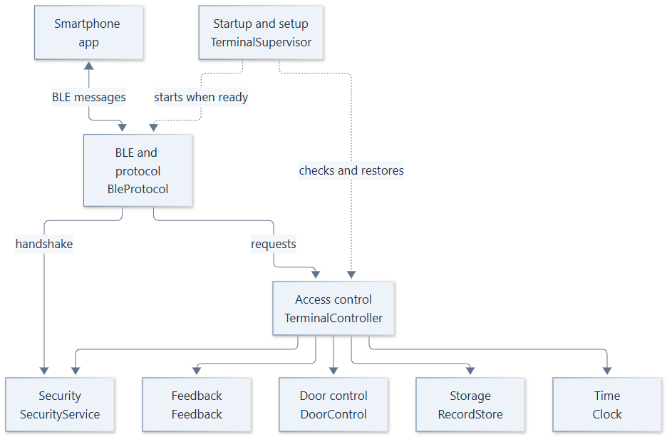
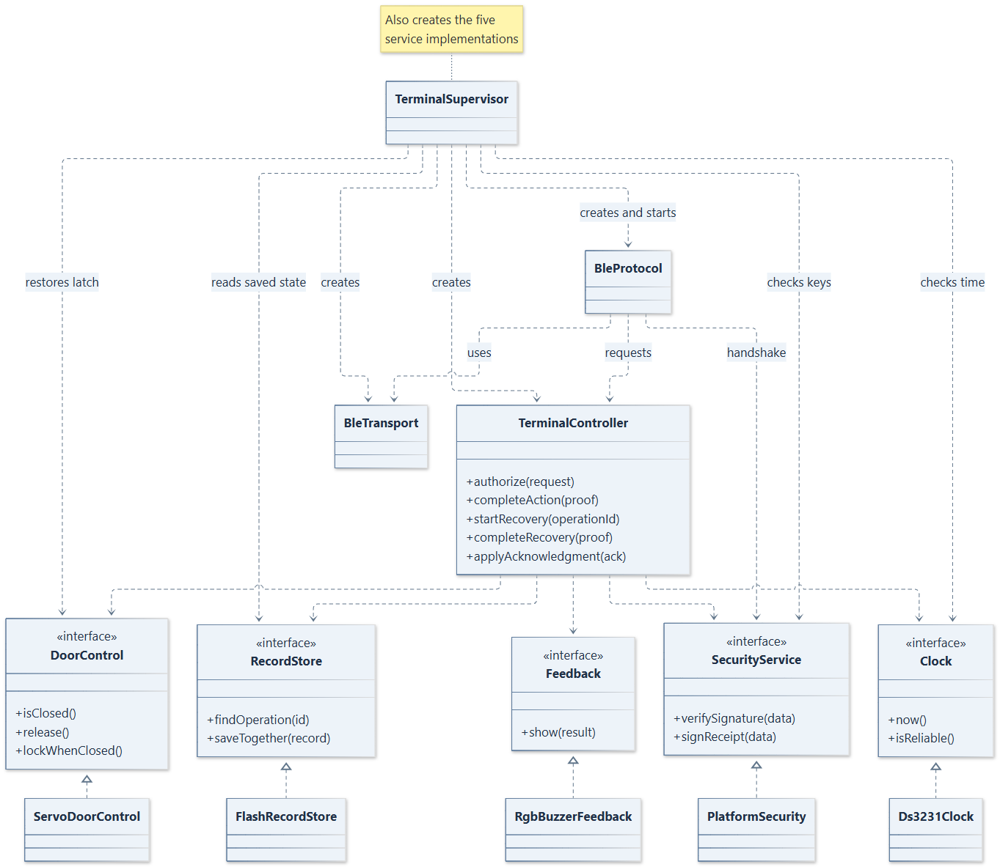

# Terminal software architecture

**T-016 · EN-03.02 · Design proposal · 17 October 2026**

## 1. Purpose and scope

We divide the terminal software into modules with clear responsibilities. One controller coordinates access; separate services handle BLE, security, storage, time and hardware. This lets us test the access rules without a connected servo or smartphone.

The design follows the [BLE communication flow](https://github.com/thomas-sartini/ble-booking-system/blob/2bceae0cc3463140076ecc693fba44b5047f3bc9/docs/report/chapters/03-ideas-and-concepts.md#ble-access-and-security-concept) (T-003) and the [hardware selection](https://github.com/thomas-sartini/ble-booking-system/blob/c07c3545a49d5d0e6c38de107b4af83bbc36719a/docs/terminal-prototype-hardware.md) (T-015): a Nano ESP32, MG90S servo latch, door contact, DS3231 clock, RGB LED and active buzzer. One terminal manages one equipment compartment.

This spike defines responsibilities, dependencies and the main interfaces. The implementation language, firmware and detailed method implementations remain outside its scope. The names below describe the proposed structure; they are not existing terminal code.

## 2. Modules and responsibilities

The smartphone talks to the BLE module. Access control coordinates the checks and calls the other services. Startup and setup connect these components and check that the terminal is ready.

*Solid arrows show communication with the smartphone or dependencies between modules. The dotted arrows show startup coordination.*

| Module | Responsibility | Classes and dependencies |
|---|---|---|
| BLE and protocol | Advertise the service, manage connections, run the protected handshake and translate BLE messages into controller requests. Split and reassemble long messages; check order and maximum total size. | `BleProtocol`, `BleTransport`. Uses `TerminalController`, `SecurityService` and the platform BLE stack. |
| Access control | Create and manage challenges, coordinate ticket and device-proof checks, and decide whether an action is allowed. Handle repeated requests, receipt recovery and synchronization acknowledgments. | `TerminalController`. Uses `RecordStore`, `SecurityService`, `Clock`, `DoorControl` and `Feedback`. |
| Storage | Save the local loan state, operation records, signed receipts and configuration. Keep records across restarts and report storage problems. | `RecordStore`, implemented by `FlashRecordStore`. Uses non-volatile flash storage. |
| Security | Supply secure random values, verify signatures, sign receipts and support session protection. Manage access to the terminal key. | `SecurityService`, implemented by `PlatformSecurity`. Uses platform cryptography and key storage. |
| Time | Read the RTC and report whether its time is reliable enough for ticket checks. | `Clock`, implemented by `Ds3231Clock`. Uses the DS3231 over I2C. |
| Door control | Read the door contact and command the servo. Request the locking position only when the contact reports closed. | `DoorControl`, implemented by `ServoDoorControl`. Uses servo PWM and the door-contact input. |
| Feedback | Show the action result through the RGB LED and buzzer, using the signals proposed in T-015. | `Feedback`, implemented by `RgbBuzzerFeedback`. Uses the RGB LED and buzzer outputs. |
| Startup and setup | Load configuration, check the services and restore the intended latch position. Provide a local USB setup path for identifiers, keys and time. | `TerminalSupervisor`. Creates the controller and services; starts BLE after the startup checks. |

The USB setup path is a proposal for the prototype. It is separate from normal BLE access and needs its own authorization before it can change configuration or keys.

## 3. Dependencies and communication

`BleProtocol` passes requests to `TerminalController` and sends its answers back to the app. The controller uses the service interfaces listed above, so its access rules do not depend on GPIO pins or a particular BLE or storage library.

Messages may exceed the size of one [BLE write or notification](https://www.bluetooth.com/wp-content/uploads/Files/Specification/HTML/Core-54/out/en/host/attribute-protocol--att-.html). `BleTransport` sends suitable chunks, and `BleProtocol` checks their order, total size and completeness before passing the reassembled message to the controller. Final framing and limits belong to T-003.

Only the controller decides whether an access request is allowed. Door control carries out its commands and reports the door contact; a contact change alone cannot start or end a loan. Hardware and library calls stay inside the service implementations.

We propose one event queue for BLE messages, connection changes and door-contact readings. Callbacks add events to the queue; the main loop processes them. Only one action may reach the state-changing part of the flow at a time. A second action receives a busy result instead of running alongside it. Feedback must not block that loop while a beep is playing.

The supervisor creates the services and connects them at startup. Configuration holds the terminal/resource identifiers and agreed limits such as message size, challenge lifetime and storage capacity. Their final values follow the BLE contract.

Security supplies secure random values. The controller uses them to create session-bound challenges and discards each challenge after use, disconnect or expiry. Diagnostic logs must exclude keys, tickets and proofs.

## 4. Check-in, check-out and recovery

### Normal actions

Both actions use the same BLE authorization flow:

1. `BleProtocol` establishes the protected connection with help from `SecurityService`. The app verifies the terminal before sending its ticket.
2. `TerminalController` checks the ticket signature, resource, action and validity using Security and Time. It issues a fresh challenge and verifies the device proof.
3. After a valid proof, the controller checks the operation ID and saved loan state. For a new operation, it checks the action-specific conditions below, signs the receipt and asks Storage to save the new state, event and receipt together.
4. Only after a successful save does it command the latch, signal the result and return the signed receipt through BLE.

| Action | Condition for a new operation | After saving |
|---|---|---|
| `CHECK_IN` | Valid authorization; no conflicting loan; this booking has not already started. | Mark the booking as in use and release the latch. It stays released throughout the loan. |
| `CHECK_OUT` | Valid authorization for the same active booking; door contact reports closed. | End the local loan and command the latch to lock. |

If the operation ID already exists with the same booking, resource, action, terminal and device key, the controller returns the original receipt. It creates no event and issues no new servo command. Reusing that ID with different details is rejected. A retry with an agreed replacement ticket keeps the original operation ID.

The door is moved by hand. Closing it during a loan does not lock it or check the user out. As in T-015, the user confirms the return: the prototype has no sensor that verifies the equipment is inside. Equipment left in the compartment after check-in, or returned without check-out, remains accessible.

Saving the loan event and moving the mechanism are separate steps. The receipt confirms the saved event; the door contact cannot confirm that the latch moved. If a hardware fault is detected after saving, the terminal keeps the record and reports the fault rather than silently undoing the event.

### Startup after a power interruption

Before accepting new actions, the supervisor checks configuration, keys, storage and the clock. It reads the saved loan state before requesting any latch movement.

| Saved state and door reading | Planned latch behaviour |
|---|---|
| Active loan | Request the released position and keep the loan active. |
| No active loan; door closed | Request the locked position. |
| No active loan; door open | Wait for a closed-door reading before requesting the locked position. This creates no check-out event. |
| Saved state is missing after prior use, damaged or unreliable | Block new actions and do not guess a latch position. Restore the state through the agreed service procedure. |

A new terminal is initialized explicitly during setup; missing records after a reset must not be treated as a new, empty terminal. An unreliable clock or missing keys also prevents new authorized actions. Restoring the latch creates no additional usage event.

### Failures and receipt recovery

Connection failures, authorization errors and unknown results follow [T-003 failure handling](https://github.com/thomas-sartini/ble-booking-system/blob/2bceae0cc3463140076ecc693fba44b5047f3bc9/docs/report/chapters/03-ideas-and-concepts.md#failure-and-initial-recovery). The following cases also affect the terminal's hardware or storage:

| Situation | Result for the app | Terminal behaviour |
|---|---|---|
| Door open during a new check-out | Rejected: door open | Keep the loan active and latch released; rejection feedback. |
| Unreliable clock or full storage before saving | Rejected | Block new execution and retain pending records; technical-error feedback. Never overwrite unsynchronized events. |
| Failed or uncertain save | Rejected if the write clearly saved nothing; otherwise unknown | No latch command without a confirmed save. Retain records for recovery and block new actions if storage is unreliable. |

A rejected request leaves the latch released during an active loan. For read-only recovery, the controller issues a fresh challenge, verifies the original device key's proof and asks Storage for the receipt, without changing the loan or commanding the latch. Authorization and retry rules follow the [T-003 recovery proposal](https://github.com/thomas-sartini/ble-booking-system/blob/2bceae0cc3463140076ecc693fba44b5047f3bc9/docs/report/chapters/08-appendices.md#ble-recovery-proposal).

Feedback uses the [LED and sound signals from T-015](https://github.com/thomas-sartini/ble-booking-system/blob/c07c3545a49d5d0e6c38de107b4af83bbc36719a/docs/terminal-prototype-hardware.md#led-and-sound-feedback).

The smartphone uploads receipts to the backend. Under the T-003 acknowledgment proposal, the controller verifies a backend-signed result before Storage marks an event as synchronized. Conflicts remain available for review. The acknowledgment return path and retention rules still need team agreement.

## 5. Main classes and interfaces

The diagram shows the classes and interfaces from section 2, including startup, BLE transport and the five service implementations.

*Only selected operations are shown. Dashed arrows with ordinary arrowheads show dependencies; labels identify creation and startup. Hollow triangles point from each implementation to its interface.*

`saveTogether(record)` saves the loan state, event and receipt as one operation. The diagram leaves parameter types and detailed signatures for implementation. The same boundaries can be expressed through classes or modules in the language selected later.

`FlashRecordStore` must keep the loan state, event and receipt consistent across power loss; separate [NVS key writes](https://docs.espressif.com/projects/esp-idf/en/stable/esp32s3/api-reference/storage/nvs_flash.html#security-tampering-and-robustness) do not provide a shared transaction, so the storage layout still needs to be chosen and validated.

`Ds3231Clock` reports unreliable time when the [oscillator-stop flag](https://www.analog.com/media/en/technical-documentation/data-sheets/ds3231.pdf#page=14) is set; a clear flag alone does not establish correct time.

## 6. Architectural decisions

| Decision | Reason |
|---|---|
| One controller coordinates actions; hardware sits behind interfaces. | The access rules can be tested with simulated storage, clock and door readings. |
| One state-changing action at a time. | Two phones must not both start a loan against the same local state. |
| Save loan state, event and signed receipt together before success or latch commands. | Recovery must find one consistent result after a restart. The flash implementation must provide this guarantee; choosing flash alone does not provide it. |
| Use a stable operation ID and check its associated details. | Retries and replacement tickets must not cause a second event or servo action. |
| Use the saved loan state to control the latch; keep door position separate. | This matches T-015. Closing the door alone does not end the loan. |
| Keep setup separate from the BLE access protocol. | A normal access request must not replace trusted keys, identifiers or time settings. |
| Let the smartphone carry receipts and proposed acknowledgments. | This follows the backend and BLE concepts and keeps terminal Wi-Fi outside the initial prototype. |

## 7. Integration and remaining decisions

The terminal uses the backend's ticket and receipt contracts. The following points need coordination with the other components.

| Area | Integration point or remaining decision |
|---|---|
| Backend | The backend checks account, role and booking eligibility when issuing tickets. The terminal checks the signed permission locally. The proposed requirement to upload an accepted check-in receipt before obtaining a check-out ticket remains a team dependency. |
| Mobile | BLE belongs to the native Android/iOS applications. Agree how `requestAccess`, `confirmAccess` and `checkOut(resourceId)` coordinate tickets and receipts; the current access-service methods are still placeholders. |
| Database | `Device` and `Receipt` already exist in the central design. Agree how the operation ID and terminal retry records map to uploaded receipts; the terminal does not maintain a copy of the backend database. |
| Resource assignment | This prototype uses one terminal per compartment. The backend allows several terminals per resource, while the database currently makes `terminal.resource_id` unique. Multi-terminal coordination needs a separate agreement. |
| T-003 alignment | Align T-003 and mobile with the closed-door condition and the door-open rejection identifier for new check-outs. |
| BLE security and synchronization | Session protection, trust provisioning, recovery limits, acknowledgment delivery and retention follow the open T-003 decisions. This document assigns them to modules without finalizing their formats or algorithms. |

### Platform security

We assume controlled physical access during development, subject to team confirmation. Protection of stored keys and firmware still needs a platform configuration covering [NVS encryption](https://docs.espressif.com/projects/esp-idf/en/stable/esp32s3/api-reference/storage/nvs_encryption.html), [Secure Boot](https://docs.espressif.com/projects/esp-idf/en/stable/esp32s3/security/secure-boot-v2.html) and download/debug restrictions; this protection has not yet been demonstrated.

## 8. Requirement coverage

This table assigns the terminal's part of each requirement. The full requirements also involve the backend and mobile application.

| Requirement | Design responsibility |
|---|---|
| FR-05.01, FR-05.03 | BLE and protocol, Access control, Security and Time verify device-bound permission offline within its validity window. |
| FR-05.02 | Access control and Storage record check-in/check-out. The backend updates its status after synchronization. |
| FR-05.04 | Storage retains pending events; Access control handles duplicates and proposed acknowledgments. Conflicts remain for review. |
| FR-05.05 | BLE and protocol use T-003's enrollment, message and security contract. |
| FR-05.06 | Startup and setup configure the terminal/resource association. Central removal of a compromised terminal belongs to the backend. |
| NFR-01.03, NFR-01.04 | Security, BLE and protocol, and Time enforce proofs, session protection and ticket validity; final policies follow T-003. |
| NFR-01.05 | Security and authorized setup protect keys and configuration; diagnostics exclude secrets. |
| FR-07.03 | Stored events and signed receipts provide the terminal contribution to the backend audit trail. |
