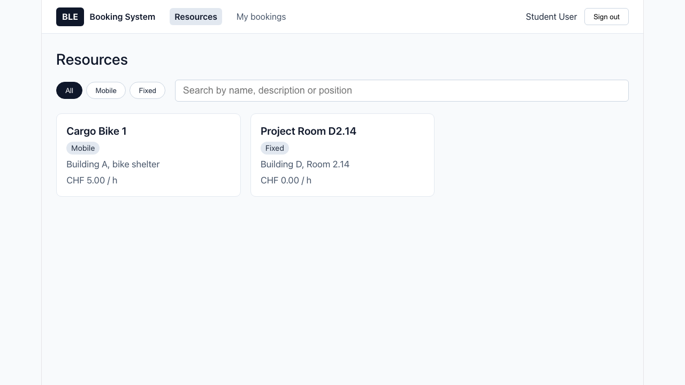
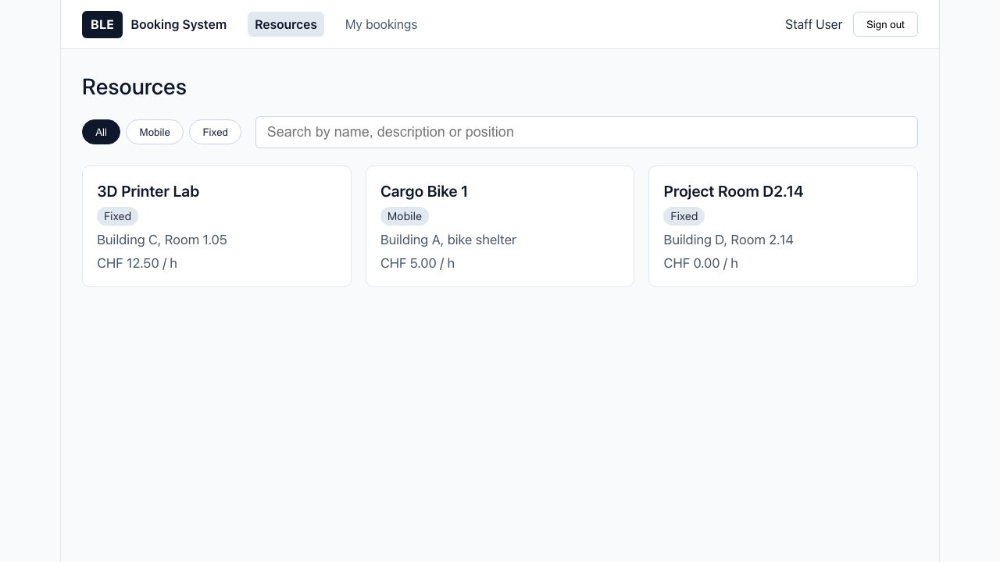
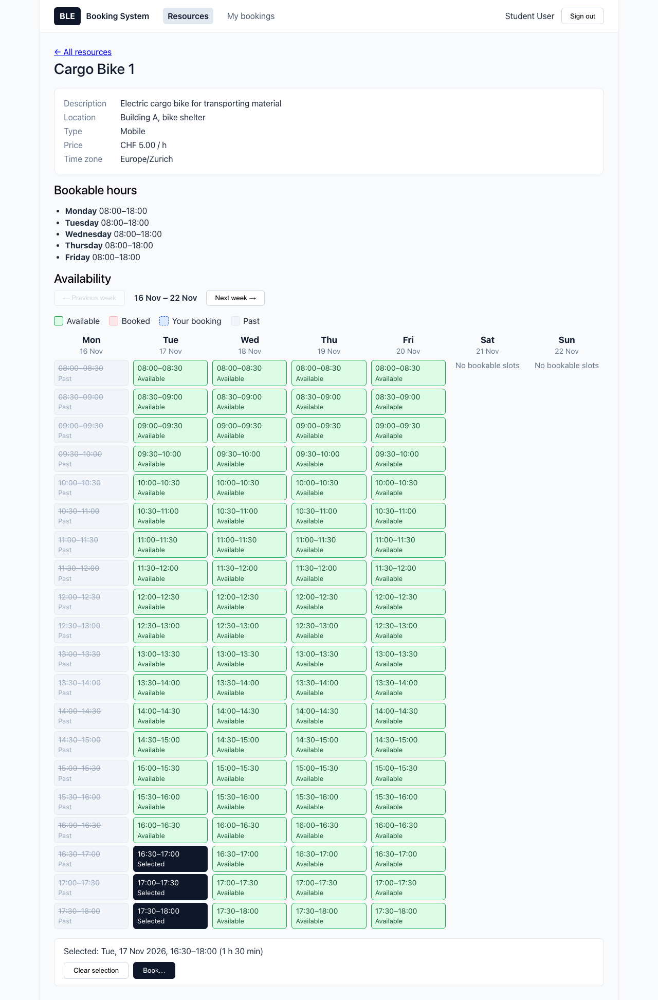
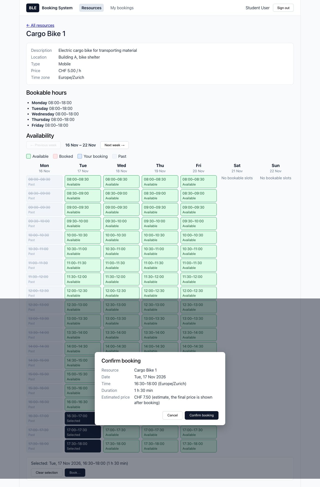
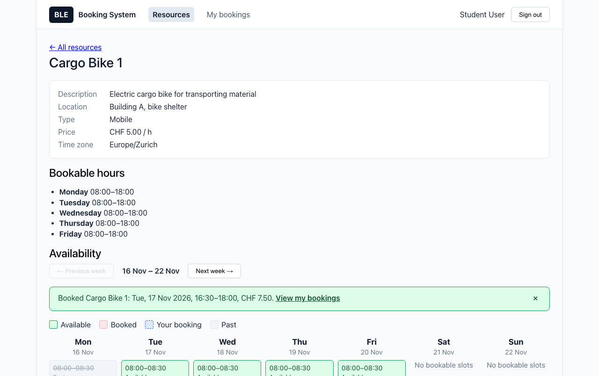
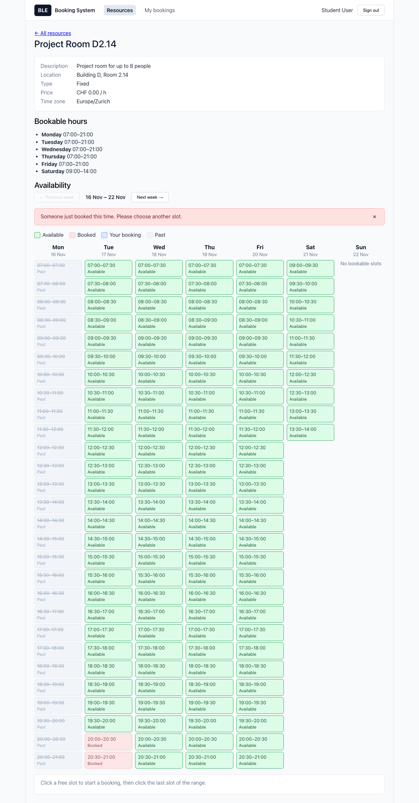
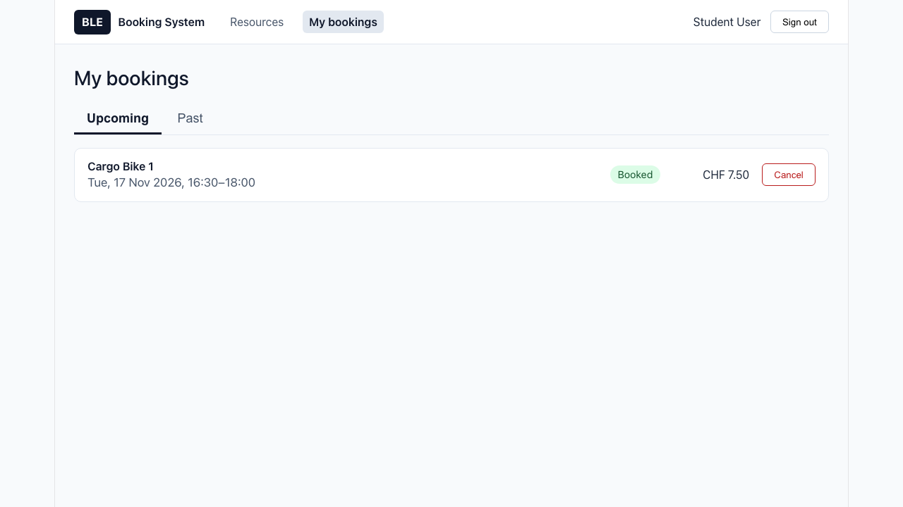
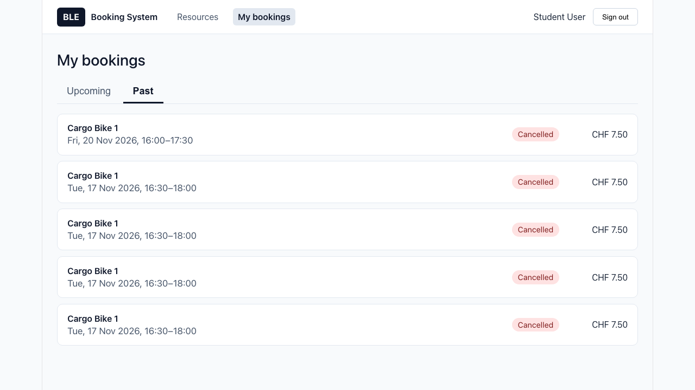

# Verification: Web booking flows against the real backend (US-02.01 to US-02.03)

Issues: T-056 (integrate Web booking creation) and T-061 (integrate Web booking management).
Date of the run: 2026-11-16. Contract: `docs/api/booking-api.md` (Sprint 5).

**Result: all 7 end-to-end tests pass (two consecutive runs). No backend deviation from the contract was found.** Three small Web-side changes came out of the run (see [Findings and fixes](#findings-and-fixes)).

## What was tested

| | |
|---|---|
| Web | branch `feature/nicolaanghileri/T-056-web-booking-integration` (based on T-055 `7cffa02`), Vite dev server on `http://localhost:5173`, `VITE_API_URL=http://localhost:8080`, `VITE_USE_MOCKS=false` |
| Backend | branch `feature/nicolaanghileri/T-052-bookings-api` (`ded6d2f`), dev profile, run from a separate read-only worktree. No backend code was changed. |
| Database | PostgreSQL 18 from `docker compose up -d postgres` (host port 5433), schema by Flyway V1 to V4, dev seed |
| Users | dev seed: `student@example.com` (STUDENT), `staff@example.com` (STAFF) |
| Browser | Chromium (Playwright) |

## Setup

1. Start PostgreSQL from the repository root: `docker compose up -d postgres`.
2. Make sure nothing else listens on port 8080 and 5173.
3. Start the backend with the dev profile (needs the root `.env`, see `.env.example`):
   ```bash
   cd backend
   ./mvnw spring-boot:run -Dspring-boot.run.profiles=dev
   ```
   The dev profile creates the seed users and the seed resources (contract §5). Check `http://localhost:8080/actuator/health`.
4. In `web/`, once: `npm ci` and `npx playwright install chromium`.
5. Run the tests. The password of the seed users is read from `DEV_USER_PASSWORD` in the environment, or from the `.env` file given in `E2E_ENV_FILE` (default: `.env` in the repository root). It is never printed or stored by the tests.
   ```bash
   cd web
   npm run e2e                       # starts the Vite dev server itself
   E2E_SCREENSHOTS=1 npm run e2e     # also refreshes docs/verification/assets/
   ```

The e2e tests are **not** part of `npm test` and not part of CI, because they need a running backend and database.

### How the tests behave

- Free slots are searched through the API in the next 7 days, starting tomorrow (today's slots can already be `PAST`). Tests use different resources or time ranges, so they do not collide with each other or with earlier runs.
- Every booking created through the UI is recorded and cancelled in a fixture teardown, also when a test fails. After two runs the dev users had no upcoming bookings left.
- Only one test logs in through the real login form. The others put a session obtained from `POST /auth/login` into `localStorage`, exactly as the app does after login.
- Traces are only kept for failed tests (`trace: 'retain-on-failure'`). They contain request bodies, including the login password, so `test-results/` and `playwright-report/` are git-ignored and must not be shared. Screenshots are taken only after login and never show the password.

## Results per user story

### US-02.01: Browse resources and availability

| Check | Result |
|---|---|
| Student sees Cargo Bike 1 and Project Room D2.14, but not 3D Printer Lab (STAFF only) and not Old Beamer (INACTIVE) (D4) | pass |
| Staff additionally sees 3D Printer Lab; Old Beamer is still hidden | pass |
| Type filter (Mobile) and search (`room`) use the real query parameters and return the right resources | pass |
| Details page shows description, location, type, price, time zone and the weekly windows (e.g. `08:00–18:00`) | pass |
| Availability grid shows the week Monday to Sunday with correct status labels (Available, Past, Booked, Your booking) | pass |
| Student opens the 3D Printer Lab by URL: the page shows "This resource or booking is not available." (backend answers `404 NOT_FOUND`) | pass |

### US-02.02: Create a booking

| Check | Result |
|---|---|
| Select a range with two clicks, confirm dialog shows resource, date, time in `Europe/Zurich`, duration and the price estimate | pass |
| `POST /bookings` returns `201`; the confirmation shows the **server's** price (Cargo Bike 1.5 h = CHF 7.50, 3D Printer Lab 1 h = CHF 12.50) with a link to My bookings | pass |
| After booking, availability reloads and the selected slots show as "Your booking" | pass |
| Staff books the 3D Printer Lab | pass |
| Conflict: student and staff select the same slots in two browser sessions; staff confirms first. The student's confirm returns `409 BOOKING_OVERLAP`, the page shows "Someone just booked this time. Please choose another slot.", the dialog closes, the user stays on the page and the grid reloads with the slots as "Booked" | pass |

### US-02.03: View and cancel own bookings

| Check | Result |
|---|---|
| The new booking appears under **Upcoming** with resource, date, time, status "Booked", price and a Cancel button | pass |
| Cancel with confirm dialog: `DELETE /bookings/{id}` returns `204`, the booking leaves Upcoming and shows "Booking cancelled." | pass |
| The booking appears under **Past** with status "Cancelled" and no Cancel button; the API lists it as `CANCELLED` | pass |
| The cancelled slots are available again in the grid | pass |
| A booking id that does not belong to the user returns `404 NOT_FOUND` (D13) | pass |

### Session handling (shared by all stories)

| Check | Result |
|---|---|
| An invalid access token plus a valid refresh token: the page loads without a login screen, exactly one `POST /auth/refresh`, both tokens in `localStorage` are replaced, the new token works | pass |
| An invalid access token plus an invalid refresh token: the session is cleared and the user lands on the login page | pass |
| Sign out clears the stored tokens | pass |

### Additional API checks (manual, with `curl`, not part of the e2e suite)

Shapes and codes were compared with the contract: timestamps with `+01:00` offset in Zurich time, windows as `HH:mm`, money as string with 2 decimals, `201` with `Location: /bookings/{id}`, overlap `409 BOOKING_OVERLAP`, repeated cancel `204`, 4.5 h booking `400 VALIDATION_ERROR`, range of 15 days `400`, unknown `type` or `scope` `400`, missing body fields `400`, past dates in availability return `PAST` slots, slots beyond the 30-day horizon are not returned, no token `401`. All matched.

## Findings and fixes

All fixes are in `web/`.

1. **Week navigation reached an empty week.** The Next button was capped at 5 weeks. With the 30-day horizon (D8) the 5th week is empty on most days of the week. The cap is now derived from the horizon (`BOOKING_HORIZON_DAYS = 30` in `web/src/utils/booking.ts`, also used by the mocks): Next is enabled only while the next week starts within the horizon. The horizon is a backend setting (`app.booking.horizon`), so this constant has to follow it.
2. **Message for `FORBIDDEN` (§7).** Added: "Your account is not active. Please contact an administrator." The backend answers `POST /bookings` with `403 FORBIDDEN` for a user who is not active. Covered by a unit test only (see limitations).
3. **Layout.** The details page text was centred, inherited from the Vite template's root styles. The app layout now sets left alignment.

## Backend deviations from the contract

None found in the tested scope.

Observations, not deviations:

- Errors for an invalid or expired access token have an empty body and a `WWW-Authenticate` header (the contract allows an empty body). The Web treats any `401` on a non-auth call as "refresh once".
- Login and refresh errors use the codes `AUTHENTICATION_FAILED` and `INVALID_REFRESH_TOKEN`. They belong to the auth contract, not to `booking-api.md §2`. The Web decides on the HTTP status for them.
- An invalid `type` query value returns `400 VALIDATION_ERROR` with a technical detail ("Failed to convert 'type' with value: ..."). The Web shows `detail` for `VALIDATION_ERROR` (§7), so this text would be visible if a client sent such a value. The Web UI only sends valid values.

## Known limitations

- **Emails are not part of this check.** The T-052 backend branch has no notification module; confirmation and cancellation emails (T-054, T-059) were not verified.
- **An expired access token was simulated** with a token that has an invalid signature. The backend answers both the same way (`401`, `invalid_token`). A real expiry needs a 15-minute wait or the signing key.
- **`FORBIDDEN` was not run end to end.** There is no API to deactivate a user, and the database was not modified. The message is covered by `errorMessages.test.ts`.
- **Limits that are enforced in the UI** (more than 4 hours, non-consecutive or non-available slots) are covered by Vitest component tests, not by e2e tests. The backend side of the 4-hour rule was checked with `curl`.
- Cancelled bookings stay in the database as `CANCELLED` rows (there is no delete endpoint), so the Past tab of the seed users grows with every run.
- The tests use the shared dev database and assume the dev seed. They are not designed to run in parallel with other users of the same database.
- Only Chromium was tested.

## Screenshots

Created by `E2E_SCREENSHOTS=1 npm run e2e` (2026-11-16).

| | |
|---|---|
|  | Catalog as student: no 3D Printer Lab |
|  | Catalog as staff: with 3D Printer Lab |
|  | Selected slot range |
|  | Confirm dialog with price estimate |
|  | Confirmation with server price, slots "Your booking" |
|  | Second user: overlap message, reloaded grid |
|  | My bookings, Upcoming |
|  | My bookings, Past with Cancelled |
